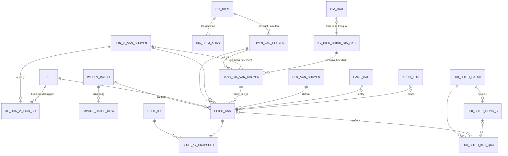
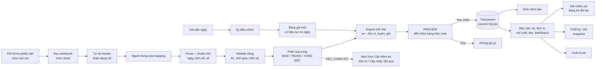

# PHÂN TÍCH & THIẾT KẾ — HỆ THỐNG QUẢN LÝ CHI PHÍ VẬN CHUYỂN OFFLINE

> Tài liệu Phase 1–2 theo MASTER_PROMPT mục XLII (A → H).
> Nguồn phân tích: `Tổng hợp chi phí VC PRINCE OF NATURE V.47 29-09 đến 04-10-2026.xlsx` — đọc cả **công thức** lẫn **giá trị**.
> Toàn bộ số liệu dưới đây được kiểm chứng bằng script (`scripts/validate-sample.js`), không chép tay.

---

## A. PHÂN TÍCH HỆ THỐNG HIỆN TẠI (FILE EXCEL)

### A.1. Danh sách sheet và vai trò

| # | Sheet | Vùng | Vai trò | Loại |
|---|---|---|---|---|
| 1 | Giá dầu + Giá VC | A1:L68 | Giá dầu từng ngày + 3 bảng tính điều chỉnh cước theo giá dầu (NM Hoàng Anh Khôi/Đà Nẵng, NM Đại Hiệp, NM Quế Cường) | Tham số + tính toán |
| 2 | Số xe | A1:C221 | Danh mục 220 xe → tên công ty (HHH 202, QC 8, HAK 5, ĐH 5) | **Dữ liệu gốc (danh mục)** |
| 3 | File tổng | A1:M2074 | 2.035 phiếu cân (dòng 5–2039) + khối tổng hợp theo nơi xuất + tổng HHH/HAK + bảng chuyến xe HAK | **Dữ liệu gốc (phiếu cân)** + báo cáo |
| 4 | CP VC tại ĐH (HHH) | A1:J85 | Tổng hợp chi phí theo xe — xe HHH chạy từ Đại Hiệp (77 xe) | Báo cáo |
| 5 | Xe chạy QS (HHH) | A1:J21 | Tổng hợp theo xe — xe HHH chạy từ Quế Sơn (14 xe) | Báo cáo |
| 6 | Xe chạy QS (HAK) | A1:J25 | Tổng hợp theo xe — đội xe nội bộ (HAK + QC + ĐH) chạy từ Quế Sơn (18 xe) | Báo cáo |

### A.2. Header & cột từng sheet

**File tổng** — header ở **dòng 4** (dòng 1–3 là tiêu đề):

| Cột | Header | Kiểu dữ liệu thực tế | Ghi chú |
|---|---|---|---|
| A | STT | số (9 dòng ở Đại Hiệp là **chuỗi** '01'…'09') | STT riêng theo từng trạm cân |
| B | Số phiếu | số nguyên | Quế Sơn 1387–1908 (có 141 số nhảy), Đại Hiệp 5315–6971 (3 số nhảy) — **đánh số riêng theo trạm** |
| C | Ngày giờ cân 1 | **chuỗi** `dd/mm/yyyy hh:mm:ss` | không phải kiểu ngày Excel |
| D | Ngày giờ cân 2 | chuỗi như trên | |
| E | Biển số 1 | chuỗi `99A-99999` | |
| F, G | Cân lần 1, Cân lần 2 | số (kg) | |
| H | KL Hàng (KG) | số | = \|G − F\| đúng 100% dòng |
| I | Nơi xuất | 'Đại Hiệp' (1.654) / 'Quế Sơn' (381) | |
| J | STT | số | STT toàn file |
| K | Tên cty VC | **công thức** `VLOOKUP(E, 'Số xe'!B:C, 2, FALSE)` | không có #N/A — mọi xe đều có trong danh mục |

**Các sheet tổng hợp** (cùng cấu trúc, header dòng 4): STT · Số xe · Số chuyến · Khối lượng (KG) · Khối lượng (Tấn) · Đơn giá · Thành tiền · VAT · Tổng tiền · Nơi xuất.

### A.3. Công thức & logic nghiệp vụ

**(1) Điều chỉnh cước theo giá dầu** — 3 khối giống hệt nhau:

| Bước | Công thức Excel (khối Đại Hiệp) | Giá trị |
|---|---|---|
| Giá dầu kỳ hiện tại I.6 | `B8 = AVERAGE(B2:B7)` — giá DO 0,05S-II các ngày chạy tàu Condor Express 18–23/09/2026 | 31.640 |
| Lượng dầu/chuyến I.5 | `G35 = G33*0.35` (78 km × 35 L/100 km) | 27,3 L |
| Chênh lệch giá dầu I.7 | `G37 = G36 − G32` (31.640 − 17.240) | 14.400 |
| CP dầu chênh/chuyến II.1 | `G40 = G35*G37` | 393.120 |
| Cước tăng/tấn II.2 | `G41 = ROUND(G40/G34, 0)` (÷ 19 tấn/chuyến) | 20.691 |
| Làm tròn II.3 | `G42 = ROUND(G41, -2)` | 20.700 |
| Đơn giá áp dụng III.1 | `G44 = G31 + G42` (96.000 + 20.700) | **116.700** |
| Giá gồm VAT | `G45 = G44*1.08` | 126.036 |

| Nhà máy (nơi xuất) | Cước cơ sở | Giá dầu cơ sở | Từ ngày | Khoảng cách | Đơn giá áp dụng từ 18/09/2026 |
|---|---:|---:|---|---:|---:|
| NM Hoàng Anh Khôi (Đà Nẵng) | 71.000 | 17.240 | 10/04/2025 | 54 km | 85.300 |
| NM Đại Hiệp | 96.000 | 17.240 | 10/04/2025 | 78 km | 116.700 |
| NM Quế Cường (HAK Quảng Nam) | 130.000 | 19.200 | 07/11/2025 | 110 km | 155.200 |
| Quế Sơn | — | — | — | — | **206.500 (gõ tay)** |

**(2) Tổng hợp theo xe** (sheet 4–6), mỗi dòng xe:
- `Số chuyến = COUNTIFS('File tổng'!I:I, Nơi xuất, 'File tổng'!E:E, Biển số)`
- `KG = SUMIFS('File tổng'!H:H, …cùng điều kiện…)`; `Tấn = KG/1000`
- `Đơn giá` = `'Giá dầu + Giá VC'!$G$44` (Đại Hiệp) hoặc **hằng số 206500** (Quế Sơn)
- `Thành tiền = Đơn giá × Tấn`; `VAT = Thành tiền × 0.08`; `Tổng = VAT + Thành tiền` — **không có ROUND**.

**(3) Khối tổng cuối "File tổng"** (dòng 2042–2074):
- Theo nơi xuất: `COUNTIF`, `SUMIF/1000`; đơn giá có VAT = giá sheet dầu × 1,08 (Quế Sơn = `206500*1.08`); chi phí = đơn giá có VAT × KL **xuống cảng** (gồm cả xe trả về).
- "Xe trả về" Quế Sơn: `E2046 = 10` (gõ tay), `F2046 = SUM(H376:H385)/1000` (vùng cứng = 10 phiếu cuối ngày 04/10, 163,79 tấn). "Xe đổ xuống tàu" = xuống cảng − trả về.
- `E2050` Tổng HHH = ĐH(HHH)!I82 + QS(HHH)!I19 = **4.074.119.880,84**; `E2051` Tổng HAK = QS(HAK)!I23 = **1.438.784.537,40**; tổng 2 bên = `K2048` = **5.512.904.418,24**.
- `H2050` KL giám định = 38.453,23 tấn (gõ tay); chênh với KL xuống tàu 38.399,91 = 53,32 tấn.

### A.4. Bảng dữ liệu gốc vs bảng báo cáo

- **Dữ liệu gốc**: phiếu cân (File tổng A5:K2039), danh mục xe (Số xe), giá dầu ngày (Giá dầu A2:B7), tham số cước (cước cơ sở, giá dầu cơ sở, km, định mức, tấn/chuyến), đơn giá Quế Sơn 206.500, KL giám định.
- **Báo cáo (tính ra)**: 3 sheet tổng hợp theo xe, khối tổng theo nơi xuất, tổng HHH/HAK, bảng chuyến xe HAK.

### A.5. Khóa liên kết

| Liên kết | Khóa | Ghi chú |
|---|---|---|
| Phiếu cân → Công ty | Biển số (E) = 'Số xe'!B | khớp chuỗi tuyệt đối, không chuẩn hóa, không theo thời gian |
| Phiếu cân → Tổng hợp xe | (Biển số, Nơi xuất) | danh sách xe trong sheet tổng hợp **gõ tay** |
| Tổng hợp → Đơn giá | theo sheet (1 giá/sheet) | không theo ngày cân |
| Đơn giá → Giá dầu | ô cố định ($G$44) | |

### A.6. Quy tắc tính chi phí (rút ra từ công thức)

`Chi phí nhóm (xe, nơi xuất) = (Σ KG / 1000) × Đơn giá(nơi xuất) ; VAT = × 8% ; Tổng = Thành tiền + VAT` — làm tròn **chỉ** ở bước điều chỉnh giá dầu (ROUND 0 rồi ROUND −2), **không làm tròn tiền**.

### A.7. Kiểm chứng engine với Excel — ✅ KHỚP 100%

Engine prototype (`src/services/*`) import lại file mẫu và cho kết quả **trùng khớp từng xe** (77/77, 14/14, 18/18 xe: số chuyến, KG, đơn giá, tổng tiền) và mọi tổng: HHH 4.074.119.880,84 · HAK 1.438.784.537,40 · toàn đợt 5.512.904.418,24 · 2.035 chuyến · 38.563.700 kg. Import lại cùng file lần 2: 2.035 dòng `EXACT_DUPLICATE`, 0 dòng mới. Chi tiết: `docs/EXCEL_VS_APP_VALIDATION.md`.

### A.8. Những điểm CHƯA RÕ — cần anh/chị xác nhận

**Đã trả lời ngày 06–07/10/2026:**
- **Q1** ✅ Xe trả về **vẫn tính cước** (trả về vẫn vận chuyển, vẫn tốn dầu) → BR-DOT-05.
- **Q2** ✅ Giá Quế Sơn **suy ngược**: QS cách Quế Cường 18 km (xa cảng hơn) → 146 km khứ hồi; giá dầu cơ sở 19.200 từ 07/11/2025; cước cơ sở **173.000** (≈ 1.185 đ/km, tương đương Quế Cường 1.182) → 173.000 + ROUND(ROUND(51,1 × 12.440 / 19, 0), −2) = 173.000 + 33.500 = **206.500** ✅ → BR-TUYEN-04.
- **Q3** ✅ **Hóa đơn xuất riêng từng bên** (HHH, HAK, QC, ĐH) → BR-XE-06.
- **Q5** ✅ **Làm tròn theo bảng kê** → BR-ROUND-01.
- **Q4** ✅ Nơi đến **không cố định**: mỗi chuyến có nhiều tuyến/nơi đến khác nhau → tuyến luôn xác định theo (nơi xuất → nơi đến) của từng phiếu; "nơi đến mặc định" ở màn hình Import chỉ là giá trị điền khi file không có cột nơi đến.
- **Q6** ✅ Tra giá và xếp đợt theo **ngày cân 1** (đã đúng như engine hiện tại).
- **Q7** ✅ **Đổi km thì đổi đơn giá**: km là tham số của bảng giá/tuyến, đổi km → tạo kỳ điều chỉnh/phiên bản giá mới, không sửa giá cũ. Giữ 54/78/110 km cho tới khi bạn đưa số km mới.
- **Q8** ✅ Kỳ giá dầu do **người dùng tự lập** (Giá dầu → Kỳ điều chỉnh mới: chọn khoảng ngày tham chiếu → xem trước → duyệt) — đã có.
- **Q9** ✅ 3 cặp phiếu cân ngược là **xe chở hàng về** → là chuyến thật, vẫn tính cước (cùng nguyên tắc Q1); cảnh báo thời gian chỉ để tham khảo.
- **Q10** ✅ Cước **luôn tính theo KL cân**; KL giám định chỉ **hiển thị chênh lệch (giám định − cân)** ở Báo cáo theo đợt/tàu, Dashboard khi lọc 1 đợt và danh mục Đợt/Tàu. Sửa KL giám định không làm đổi cước (có test).


| # | Câu hỏi | Vì sao quan trọng | Mặc định đang dùng |
|---|---|---|---|
| Q1 | **10 xe trả về** (Quế Sơn, 04/10, phiếu 1899–1908, 163,79 t) có được tính cước không? Excel hiện **đang tính** (cả sheet QS và K2046 dùng KL xuống cảng). | Ảnh hưởng ≈ 36,5 triệu (gồm VAT) | ✅ **Đã chốt: vẫn tính cước**; cờ "Xe trả về" chỉ để tính KL xuống tàu |
| Q2 | Đơn giá **Quế Sơn 206.500** lấy từ đâu, hiệu lực từ ngày nào, có điều chỉnh theo giá dầu không, khoảng cách bao nhiêu? | Đang gõ tay ở 32 ô + 1 công thức | ✅ **Đã chốt: suy ngược** 146 km, cơ sở 173.000 / dầu 19.200 từ 07/11/2025 → 206.500 |
| Q3 | Sheet "Xe chạy QS **(HAK)**" gồm xe của **HAK (5) + QC (8) + ĐH (5)**. Bên nhận cước/xuất hóa đơn là HAK gộp hay từng đơn vị? QC, ĐH là pháp nhân nào? | Quyết định báo cáo "theo đơn vị" và đối chiếu | ✅ **Đã chốt: hóa đơn riêng từng đơn vị**; `nhom_bao_cao` chỉ để xem gộp |
| Q4 | Nơi đến của mọi chuyến là **Cảng Tiên Sa**? | Tuyến = nơi xuất → nơi đến | Có (cấu hình mặc định theo đợt) |
| Q5 | **Làm tròn**: theo từng phiếu, theo xe, hay theo bảng kê? VAT làm tròn đến đồng? | Lệch vài đồng giữa các cách (HHH +0,16đ; HAK −4,40đ) | ✅ **Đã chốt: làm tròn theo bảng kê** (dòng giá → đồng; VAT 1 lần trên tổng) |
| Q6 | Ngày dùng để tra giá/xếp đợt: **ngày cân 1** hay cân 2? (có phiếu qua đêm 01/10 → 02/10) | Giá đổi đúng nửa đêm | Ngày cân 1 |
| Q7 | Khoảng cách chính thức: 54/78/110 km (đang dùng) hay số ở cột K (25×2=50; 36,5×2=73; 53,3×2=106,6)? | Đổi km → đổi đơn giá | 54/78/110 (đúng công thức hiện tại) |
| Q8 | Quy tắc chọn **kỳ giá dầu tham chiếu**: luôn là các ngày chạy tàu của chuyến trước? Bình quân giản đơn theo ngày? | Module giá dầu tự lập kỳ | Bình quân giản đơn các ngày trong kỳ, người dùng chọn kỳ |
| Q9 | 3 cặp phiếu **cân ngược** (cân 1 có hàng > cân 2 rỗng, phiếu kế tiếp mở sau 10–25 giây cùng bì): 1688→1700, 1828→1849 (Quế Sơn), 6065→6187 (Đại Hiệp). Là 2 chuyến thật hay 1 chuyến bị tách? | Có thể tính trùng 3 chuyến | Vẫn tính, gắn cảnh báo "Cần kiểm tra" |
| Q10 | KL giám định (38.453,23 t) dùng để làm gì — chỉ theo dõi hao hụt hay có ảnh hưởng cước? | | Lưu ở Đợt/Tàu, báo cáo chênh lệch, không ảnh hưởng cước |

### A.9. Lỗi/rủi ro đã phát hiện trong file Excel

1. Đơn giá Quế Sơn **gõ tay** 206.500 ở 32 ô (cột F hai sheet QS) + công thức `I2046 = 206500*1.08`; không có cơ sở tính, không ngày hiệu lực.
2. VAT 8% **hard-code** trong mọi công thức (`*0.08`, `*1.08`).
3. Danh sách xe ở 3 sheet tổng hợp **gõ tay** — xe mới không có trong danh sách sẽ **bị bỏ sót âm thầm** (đợt này đã kiểm: phủ đủ 2.035/2.035 chuyến).
4. `F2046 = SUM(H376:H385)` — **vùng cứng**; chèn/xóa dòng là sai.
5. Bảng "Tổng hợp số chuyến xe HAK" — cột Đại Hiệp (C2056:C2073) **không có công thức** (trống) trong khi cột Tổng có cộng.
6. Nhãn sai: "(II.1)/62" nhưng công thức chia 19; khối Quế Cường ghi "lít/78Km" nhưng tính 110 km; dòng "Công ty HHH áp dụng" lặp cho cả NM Quế Cường.
7. Tiêu đề "Đợt ngày 29-09 đến **03**-10" (File tổng) ≠ "29-09 đến **04**-10" (các sheet khác); dữ liệu thực tế **28/09 13:16 → 04/10 10:42**.
8. Ngày giờ là **chuỗi văn bản**, không phải kiểu ngày → không lọc/sắp xếp theo ngày được trong Excel.
9. Công ty xe lấy bằng VLOOKUP tĩnh → không có lịch sử xe đổi đơn vị.
10. STT có 9 ô kiểu chuỗi '01'…'09'.
11. Không có cơ chế chống nhập trùng phiếu khi dán thêm dữ liệu (đợt này kiểm: 0 trùng).

---

## B. ERD / DATABASE ĐỀ XUẤT

Chi tiết từng cột: `DATABASE_SCHEMA.md`; SQL thực thi: `src/database/migrations/001_init.sql` (đã test).



Điểm thiết kế chính:
- **Tiền lưu INTEGER theo 1/1000 đồng** → `SUM()` trong SQL chính xác tuyệt đối, khớp được số lẻ ,04 / ,24 như Excel.
- `phieu_can.business_key` UNIQUE (chỉ trên phiếu ACTIVE) + `fingerprint` SHA-256 → chống trùng ở **2 lớp** (service + DB).
- Xe ↔ đơn vị là **bảng lịch sử từ–đến ngày**, không lưu tên công ty trong phiếu.
- Bảng giá lưu đủ tham số + JSON từng bước tính (`cong_thuc`) → trả lời "tại sao phiếu này có giá này".
- Trigger DB chặn sửa tài chính trên phiếu đã chốt (lớp bảo vệ thứ 2 sau service).
- `schema_version` + migration tuần tự, rollback khi lỗi, backup trước khi migrate.

## C. DATA FLOW



Mọi bước thay đổi dữ liệu → `audit_log`. Mọi phép tính tiền → **chỉ** qua `TransportCostEngine`.

## D. BUSINESS RULES (tóm tắt — đầy đủ ở `BUSINESS_RULES.md`)

1. KL tấn = KG / 1000. Thành tiền = Tấn × Đơn giá (đồng/tấn) hoặc = Đơn giá (đồng/chuyến). VAT = Thành tiền × VAT% **của bảng giá**. Tổng = Thành tiền + VAT.
2. Đơn vị VC xác định theo **danh mục xe + lịch sử tại ngày cân**; cột công ty trong file nguồn chỉ dùng để đối chiếu, **không** để gán.
3. Xe chưa có trong danh mục → `XE CHƯA XÁC ĐỊNH`, không tính giá, không tự gán; gán xong → tính lại các phiếu liên quan (trừ phiếu đã chốt).
4. Giá tra theo tuyến + ngày cân trong [từ ngày, đến ngày]; giá riêng của đơn vị ưu tiên hơn giá chung; còn >1 → `XUNG ĐỘT BẢNG GIÁ`; không có → `CHƯA CÓ ĐƠN GIÁ`.
5. Giá điều chỉnh theo dầu = Cước cơ sở + ROUND(ROUND(km × định mức/100 × (giá dầu kỳ − giá dầu cơ sở) / tấn bình quân, 0), −2) — mọi tham số cấu hình được; tạo **bảng giá mới** có hiệu lực, không sửa bảng giá cũ.
6. Chống trùng theo Số phiếu + Nơi xuất; giống hệt → bỏ qua; khác dữ liệu → "Cần kiểm tra".
7. Chốt kỳ → snapshot; muốn sửa: Mở khóa → log → sửa → tính lại → chốt lại.
8. Làm tròn: cấu hình được (mặc định giống Excel).

## E. CẤU TRÚC SOURCE CODE

Công nghệ: **Electron** (main + preload + renderer, `contextIsolation`), **better-sqlite3** (đồng bộ, transaction nhanh), **SheetJS** (đọc .xlsx/.xls/.csv), **ExcelJS** (xuất Excel có định dạng), **decimal.js** (tiền), **Tabulator** (bảng ảo hóa: virtual scroll, group, sort, filter — chạy offline), **Chart.js** (biểu đồ), giao diện **vanilla TS + cấu hình khai báo** (theo skill quản lý bảng mẹ/bảng con: 1 bộ render/form dùng chung cho mọi danh mục), đóng gói **electron-builder** → Portable + NSIS Setup. Không React/Vue (không thực sự cần).

```
vc-cost-app/
├─ electron/                  main.js (cửa sổ, IPC), preload.js (API an toàn cho renderer)
├─ src/
│  ├─ database/               connection.js, migrator.js ✅, migrations/001_init.sql ✅
│  ├─ repositories/           TicketRepo, VehicleRepo, CarrierRepo, RouteRepo, PriceRepo, BatchRepo, AuditRepo…
│  ├─ services/               ExcelImportService, TicketService, VehicleService, CarrierService, RouteService,
│  │                          PriceService, FuelPriceService, FuelAdjustmentService ✅, PriceResolver ✅,
│  │                          VehicleResolver ✅, TransportCostEngine ✅, DuplicateDetector ✅, TimeAnomalyService ✅,
│  │                          ReconciliationService, ReportService, ClosingService, AlertService, BackupService, AuditService
│  ├─ excel/                  columnMapping.js ✅, ticketParser.js ✅, exporters/ (ExcelJS)
│  ├─ reports/                truy vấn tổng hợp SQL (xe, đơn vị, nơi xuất, đợt, thời gian)
│  ├─ validation/             schema kiểm tra dữ liệu nhập
│  ├─ models/                 JSDoc typedef cho các entity
│  ├─ utils/                  money.js ✅, plate.js ✅, datetime.js ✅
│  ├─ modules/                mỗi màn hình 1 thư mục: dashboard, tickets, import, vehicles, prices, fuel, reconcile…
│  └─ components/             DataTable (Tabulator), Modal, Form (config-driven), KPI card, Chart, Toast
├─ scripts/validate-sample.js ✅   (EXCEL_VS_APP_VALIDATION)
├─ tests/                     *.test.js ✅ (24 test đang PASS)
├─ data/seed/                 sample-v47.json ✅ (danh mục/giá từ file mẫu — là DỮ LIỆU, không phải code)
└─ docs/                      toàn bộ tài liệu
```
Thư mục dữ liệu khi chạy (tách khỏi code): `%APPDATA%/VCCost/` (bản Setup) hoặc `./VCCost-data/` cạnh file .exe (bản Portable) → `data/app.db`, `backups/`, `exports/`, `imports/`, `logs/`.

## F. KẾ HOẠCH TRIỂN KHAI

> Cập nhật trạng thái mới nhất: xem `TODO_ROADMAP.md`.

| Phase | Nội dung | Trạng thái |
|---|---|---|
| 1 | Phân tích Excel & nghiệp vụ | ✅ Xong (tài liệu này) |
| 2 | Thiết kế database | ✅ Xong — migration v1 chạy được, có test |
| 3 | Danh mục (xe + lịch sử, đơn vị, địa điểm + alias, tuyến, đợt) | ⏳ Chờ xác nhận Q3, Q4 |
| 4 | Excel Import Engine (dò header, mapping, preview, transaction, batch, hoàn tác) | 🟡 Lõi đã có (dò header, parse, chống trùng) |
| 5 | Phiếu cân (danh sách, sửa có log, gán đợt, "Cần kiểm tra") | ⏳ |
| 6 | Bảng giá + Fuel Adjustment Engine | 🟡 Engine xong & khớp Excel; còn màn hình |
| 7 | Transport Cost Engine | 🟡 Engine xong & khớp Excel; còn lưu DB + tính lại hàng loạt |
| 8 | Báo cáo xe (tổng hợp, timeline, drill-down) | 🟡 Timeline/cảnh báo thời gian xong |
| 9 | Reconciliation Engine | ⏳ (đặc tả xong) |
| 10 | Dashboard + biểu đồ | ⏳ |
| 11 | Audit + Backup/Restore + chốt kỳ | ⏳ (schema xong) |
| 12 | Test với Excel mẫu | ✅ Đã chạy sớm — khớp 100% |
| 13–14 | Build Windows Portable + Setup | ⏳ |

## G. RỦI RO DỮ LIỆU

| Rủi ro | Biểu hiện trong file mẫu | Biện pháp trong app |
|---|---|---|
| Nhập trùng khi import lại / dán thêm | Excel không chặn | business_key UNIQUE + fingerprint + preview |
| Bỏ sót xe trong báo cáo | danh sách xe gõ tay | báo cáo GROUP BY từ dữ liệu, không dùng danh sách tay |
| Sai đơn giá do gõ tay | 206.500 gõ tay ở 33 chỗ | bảng giá có hiệu lực, price_rule_id trên từng phiếu |
| Đổi giá làm đổi số đã thanh toán | sửa G44 → cả file đổi | bảng giá mới có hiệu lực; chốt kỳ + snapshot + trigger |
| Ngày dạng chuỗi / định dạng lạ | 'dd/mm/yyyy hh:mm:ss' | parser nhiều định dạng, dòng lỗi không được import |
| Biển số viết khác nhau | (đợt này đồng nhất) | chuẩn hóa `bien_so_chuan`, giữ `bien_so_goc` |
| Xe đổi chủ/đơn vị | VLOOKUP tĩnh | lịch sử xe–đơn vị theo ngày |
| Phiếu cân bất thường | 3 cặp cân ngược, 13 phiếu cân >4 giờ | Trung tâm cảnh báo, không tự kết luận |
| Xe trả về vẫn tính cước | 10 phiếu QS 04/10 | cờ "trả về" + quy tắc tính/không tính cấu hình |
| Lệch làm tròn với hóa đơn | VAT có số lẻ ,04 | quy tắc làm tròn cấu hình + đối chiếu cột VAT |
| Mất DB (offline) | — | backup tự động hằng ngày + retention + backup trước restore/migrate |

## H. CẢI TIẾN SO VỚI EXCEL

1. Một nguồn dữ liệu duy nhất (SQLite) thay cho nhiều sheet copy/paste; báo cáo sinh tự động, không danh sách xe gõ tay.
2. Đơn giá **theo ngày cân** (giá đổi giữa đợt vẫn đúng), có lịch sử, không ghi đè.
3. Module giá dầu: nhập giá dầu ngày → tạo kỳ → engine sinh bảng giá mới cho mọi tuyến cùng lúc, lưu từng bước tính.
4. Không hard-code VAT, km, định mức, tấn/chuyến, đơn giá, đơn vị, nơi xuất.
5. Chống trùng 2 lớp, import có preview + transaction + hoàn tác theo batch.
6. Truy vết: mỗi phiếu biết thuộc batch nào, bảng giá nào, ai sửa gì (audit log).
7. Timeline từng xe + cảnh báo thời gian bất thường (Excel không có).
8. Đối chiếu tự động với bảng kê đối tác — chỉ rõ cột lệch và lệch bao nhiêu.
9. Chốt kỳ có snapshot, mở khóa có lý do và log.
10. Backup/restore, chạy offline, hàng trăm nghìn phiếu (SQL aggregation + index + bảng ảo hóa).
