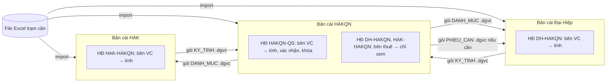

# DATA_STORAGE_DESIGN.md — Thiết kế lưu trữ dữ liệu (Bước 7 — bản DESKTOP)

> **Thay thế** `DATABASE_DESIGN.md` (bản Google Sheets / PostgreSQL). Quyết định ngày 24/09/2026: **phần mềm desktop Electron, chạy offline, không dùng SQL; dữ liệu lưu bằng file JSON có sao lưu; mỗi đơn vị một bản cài riêng; có tài khoản nội bộ.**
> Không đổi: 4 tài liệu nghiệp vụ v5, mọi công thức, cấu trúc bảng. Chỉnh: USERS (mật khẩu băm), KY_TINH (+ nguồn gốc kỳ), IMPORT_BATCH (+ SHA-256 file), CALC_RUN (nối giao dịch ghi); thêm EXCHANGE_LOG; bỏ SYS_LOG (log ra file).
> Kèm theo: `data_seed.zip` — 3 thư mục dữ liệu mẫu (bản cài **HAKQN**, **ĐH**, **HAK**) đọc từ 3 file Excel; đã kiểm chứng ra đúng **178.000 / 88.900 / 125.600**.

---

## 1. Kiến trúc phần mềm

```
┌──────────────────────── Electron app (1 file cài .exe, chạy offline) ─────────────────────────┐
│ RENDERER (giao diện)          PRELOAD                      MAIN PROCESS (Node.js)                 │
│ HTML/CSS/JS thuần             contextBridge:               ipc/router.js  ── 1 cổng 'api'        │
│ views/*.js (mỗi màn hình)  →  window.dgvc.api(a, p)  →     ├ auth/        đăng nhập, phiên, quyền │
│ không truy cập file/Node      ipcRenderer.invoke('api')    ├ services/    nghiệp vụ theo nhóm API │
│                                                            ├ engine/      công thức (hàm thuần)   │
│                                                            ├ import/      đọc Excel/CSV (exceljs) │
│                                                            ├ reports/     BKVC/BKCT → XLSX/PDF    │
│                                                            ├ exchange/    gói .dgvc               │
│                                                            ├ backup/      zip, khôi phục          │
│                                                            └ repo/        JsonStore + Journal     │
│                                                                   │                              │
└───────────────────────────────────────────────────────────────────┼──────────────────────────────┘
                                                                    ▼
                                                  Thư mục dữ liệu (vd D:\DGVC_DATA)
```

| Nguyên tắc | Cách làm |
|---|---|
| Tách tầng | UI chỉ gọi `window.dgvc.api(action, payload)`; nghiệp vụ, công thức, truy cập file đều ở main process. `engine/` là hàm thuần, không đọc file → unit test trực tiếp |
| An toàn Electron | `contextIsolation: true`, `nodeIntegration: false`, `sandbox: true`, CSP chặn mọi nguồn ngoài, không tải trang web nào |
| Offline hoàn toàn | Mọi thư viện đóng gói trong bản cài; không cần mạng để chạy, cài, cập nhật (bản mới = cài đè file .exe mới) |
| Đổi nơi lưu sau này | Chỉ `repo/` biết dữ liệu là file JSON; đổi kho lưu = thay 1 lớp |
| Thư viện | `exceljs` (đọc/ghi Excel), `yazl`/`yauzl` (zip sao lưu), Node `crypto` (scrypt, SHA-256), `zlib` (nén gói), `electron-builder` (đóng gói NSIS), `vitest` (test) |

Cấu trúc mã nguồn dự kiến (Bước 10):
```
app/
  main/  main.js · ipc/router.js · auth/ · services/ · engine/ · repo/JsonStore.js · repo/Journal.js · import/ · reports/ · exchange/ · backup/ · logger.js
  preload/preload.js
  renderer/ index.html · styles/ · views/ · components/
  shared/  api_spec.json · enums.js · errorCodes.js
  tests/   engine.test.js (đáp án = api_examples) · journal.crash.test.js · import.test.js
```

---

## 2. Mô hình triển khai: mỗi đơn vị một bản cài



| Quy tắc | |
|---|---|
| Bản cài gắn **1 đơn vị** (`manifest.unitCode`) | chọn lúc khởi tạo, không đổi được |
| **Ghi** kỳ tính, bảng kê dầu | chỉ với hợp đồng mà `carrier_unit_code` = đơn vị bản cài ("nhà thầu nào làm vận chuyển nhà thầu đó") — áp dụng cả với ADMIN |
| Hợp đồng mà đơn vị bản cài là **bên thuê** | có trong danh mục để xem; nhận kỳ của bên VC qua gói `KY_TINH` → lưu `origin = IMPORTED`, chỉ xem, in lại được |
| Danh mục chung (đơn vị, xe, tuyến, giá) | một bản cài làm "gốc" (đề xuất HAKQN) xuất gói `DANH_MUC` cho các bản khác |
| Phiếu cân | mỗi bản cài import file Excel trạm cân; `ticket_id` suy ra từ `ticket_key` nên giống nhau ở mọi bản cài → gộp gói không trùng |

---

## 3. Thư mục dữ liệu

```
D:\DGVC_DATA\                      (người dùng chọn lúc khởi tạo; mặc định %USERPROFILE%\Documents\DGVC_DATA)
  manifest.json                    định danh bản cài + danh sách file + SHA-256 + dataVersion + bộ đếm ID
  .lock                            khóa thư mục khi APP đang mở {pid, host, user, heartbeatAt}
  tables\
    DON_VI.json  XE.json  TUYEN_VC.json  PRICE_HISTORY.json  HOP_DONG.json  HOP_DONG_XE.json
    IMPORT_BATCH.json  KY_TINH.json  TRANSPORT_CALCULATION.json  BKVC_LINE.json  CALC_RUN.json
    USERS.json  CONFIG.json  EXCHANGE_LOG.json
    PHIEU_CAN\2026.json            ┐
    GIAO_NHAN_DAU\2026.json        │ bảng lớn: 1 file / năm
    TRANSPORT_DETAIL\2026.json     │
    FUEL_DETAIL\2026.json          │
    AUDIT_LOG\2026.json            ┘
  journal\                         giao dịch ghi đang dở (rỗng khi bình thường)
  backups\daily\  backups\monthly\  backups\manual\
  exports\                         file xuất mặc định (BKVC.pdf, gói .dgvc…)
  logs\app-2026-09-24.log          log kỹ thuật (thay SYS_LOG), giữ 90 ngày
```

**File bảng**
```json
{ "table": "PHIEU_CAN", "partition": "2026", "schemaVersion": 1,
  "columns": ["ticket_id", "ticket_key", "..."],
  "rows": [ { "ticket_id": "PC-3f9c1a…", "ticket_key": "573|2026-09-18|43H-01080", "net_kg": 17470, "...": "..." } ] }
```

**manifest.json**
```json
{ "app": "DGVC", "schemaVersion": 1, "installId": "INS-0E901607CE", "installCode": "DH", "unitCode": "DH",
  "createdAt": "…", "dataVersion": 1, "lastBackupAt": null,
  "sequences": { "GD": 16, "KY": 0, "TC": 0, "CR": 0, "IB": 2, "EX": 0, "AL": 0 },
  "files": { "tables/PHIEU_CAN/2026.json": { "sha256": "…", "rows": 77 } } }
```

| Quy ước | |
|---|---|
| Kiểu | ngày `yyyy-MM-dd`, giờ `HH:mm:ss`, ngày giờ ISO `+07:00` (chuỗi); số là JSON number; TRUE/FALSE là boolean; cột JSON lưu chuỗi JSON |
| ID | `PC-` + SHA-1(ticket_key)[:12] cho phiếu cân (giống nhau mọi bản cài); ID khác = `<tiền tố>-<mã bản cài>-<số tăng>` (vd `GD-DH-00016`, `KY-HAKQN-000003`) → không đụng nhau khi trao đổi |
| Khóa duy nhất, khóa ngoại, CHECK | kiểm trong `repo/` bằng chỉ mục dựng trong bộ nhớ (Map) trước mỗi lần ghi |
| Xóa | không xóa dòng: danh mục `is_active = false`, dữ liệu nhập `is_deleted = true` |
| Không sửa tay file | APP kiểm SHA-256 mỗi lần mở; file bị sửa ngoài APP → `INTEGRITY_ERROR`, đề nghị khôi phục sao lưu |

---

## 4. Ghi an toàn (thay cho transaction của SQL)

Mọi thao tác ghi đi qua **một hàng đợi** trong main process (chỉ 1 giao dịch tại 1 thời điểm) và thuật toán **journal 2 pha**:

```
BẮT ĐẦU giao dịch (vd periods.calculate chạm 6 bảng)
 1. Tính nội dung mới của mọi file bị chạm — trong bộ nhớ, kiểm khóa duy nhất / khóa ngoại / CHECK
 2. Ghi journal\txn-<id>.json  {state: PREPARED, files:[{rel, sha256Mới}]}               (fsync)
 3. Ghi từng file mới ra <file>.new                                                       (fsync)
 4. Đổi journal → state: COMMITTING                                                       (fsync)
 5. Với từng file: <file> → <file>.bak ; <file>.new → <file>   (đổi tên — nguyên tử trên NTFS)
 6. Ghi manifest.json.new (sha256 mới, dataVersion + 1) → đổi tên thành manifest.json
 7. Xóa .bak và journal → XONG
KHI MỞ APP: còn journal?
   PREPARED   → xóa các .new  (hoàn tác — dữ liệu như trước giao dịch)
   COMMITTING → đổi nốt các .new còn lại thành file chính, ghi manifest (làm tiếp cho xong)
```

- Mất điện / APP bị tắt ở bất kỳ bước nào → dữ liệu là trạng thái **trước** hoặc **sau** giao dịch, không bao giờ nửa vời.
- `CALC_RUN.journal_id` nối lần tính với giao dịch ghi để truy vết.
- **Khóa thư mục** `.lock`: APP thứ 2 (máy khác trỏ cùng thư mục, hoặc mở 2 lần) nhận `DATA_LOCKED`. Khóa có nhịp tim 60 giây; khóa không cập nhật > 3 phút coi là khóa chết → hỏi người dùng có chiếm quyền không.

---

## 5. Sao lưu và khôi phục

| Loại | Khi nào | Giữ | Nội dung |
|---|---|---|---|
| Hằng ngày | lần ghi đầu tiên mỗi ngày | 30 bản (`BACKUP_DAILY_KEEP`) | `manifest.json` + `tables\` nén `.zip` |
| Hằng tháng | ngày đầu tháng | 24 bản (`BACKUP_MONTHLY_KEEP`) | như trên |
| Thủ công | nút **Sao lưu ngay** | không tự xóa | như trên + ghi chú |
| An toàn | trước khi **khôi phục**, **nhập gói**, **đổi thư mục** | 10 bản gần nhất | như trên |
| Sao lưu ra ngoài (tùy chọn) | sau mỗi bản ngày | theo thư mục đích | copy file zip sang `BACKUP_MIRROR_FOLDER` (USB, ổ mạng, thư mục Google Drive for Desktop) |

Khôi phục: chọn bản → APP kiểm SHA-256 trong zip → tạo bản an toàn của hiện trạng → thay `tables\` + `manifest.json` → mở lại. Có trong AUDIT_LOG (`RESTORE`, lý do). Cảnh báo `W_BACKUP_OLD` nếu quá 7 ngày chưa sao lưu.

---

## 6. Chống tính trùng, trạng thái kỳ

Không đổi so với bản trước — trạng thái sử dụng lưu ở `TRANSPORT_DETAIL.usage_state` / `FUEL_DETAIL.usage_state` theo **(hợp đồng, phiếu)**:

| `usage_state` | Kỳ | Đưa vào kỳ khác **cùng hợp đồng**? |
|---|---|---|
| `DRAFT` | `NHAP` | cảnh báo, cho chuyển (kỳ cũ `needs_recalc`) |
| `CONFIRMED` | `DA_XAC_NHAN` | **chặn** — "Phiếu cân này đã được sử dụng trong kỳ tính [Mã kỳ]. Không thể đưa vào kỳ mới." |
| `LOCKED` | `DA_KHOA` | **chặn** (mở khóa: ADMIN / `can_unlock`, có lý do) |
| `RELEASED` | `HUY` | dùng lại được |

Kỳ `IMPORTED` (nhận qua gói) không tham gia kiểm trùng của bản cài nhận, vì bản cài đó không phải bên vận chuyển của hợp đồng.

---

## 7. Tài khoản và bảo mật

| Nội dung | Cách làm |
|---|---|
| Mật khẩu | băm **scrypt** (N=16384, r=8, p=1, salt 16 byte ngẫu nhiên) bằng Node `crypto`; không lưu, không log mật khẩu gốc |
| Lần đầu | dữ liệu mẫu và user mới tạo **không có mật khẩu** → đăng nhập lần đầu bắt đặt mật khẩu (≥ 8 ký tự, có chữ và số) — không có mật khẩu mặc định chung |
| Sai mật khẩu | 5 lần liên tiếp → khóa 15 phút (`LOGIN_MAX_FAILED`, `LOGIN_LOCK_MINUTES`) |
| Phiên | token ngẫu nhiên chỉ giữ trong bộ nhớ main process; không thao tác 60 phút → đăng xuất |
| Quên mật khẩu | ADMIN `users.resetPassword` → user tự đặt lại. Không ADMIN nào nhớ mật khẩu → chạy công cụ khôi phục đi kèm bản cài (cần quyền Windows trên máy) |
| Dữ liệu trên đĩa | không mã hóa (để sao lưu / khôi phục đơn giản); bảo vệ bằng quyền thư mục Windows và BitLocker của máy nếu cần |
| ADMIN mặc định | `saoluucvhak@gmail.com`, `phuthuy.apple@gmail.com` (tên đăng nhập) — có trong cả 3 bản cài mẫu |

---

## 8. Gói trao đổi `.dgvc`

**Định dạng**: JSON nén gzip.
```json
{ "header": { "format": "DGVC-PKG", "formatVersion": 1, "packageType": "KY_TINH", "schemaVersion": 1,
              "sourceInstallId": "INS-0E901607CE", "sourceUnitCode": "DH", "targetUnitCode": "HAKQN",
              "createdAt": "…", "createdBy": "ketoan.dh", "appVersion": "1.0.0", "periodCodes": ["DH-HAKQN/20260918-20260923"] },
  "contentSha256": "sha256 của tables (JSON chuẩn hóa, khóa sắp xếp)",
  "tables": { "KY_TINH": […], "TRANSPORT_CALCULATION": […], "TRANSPORT_DETAIL": […], "FUEL_DETAIL": […], "BKVC_LINE": […],
              "PHIEU_CAN": […], "GIAO_NHAN_DAU": […], "HOP_DONG": […], "HOP_DONG_XE": […] } }
```

| Loại gói | Nội dung | Ai xuất → ai nhận |
|---|---|---|
| `DANH_MUC` | DON_VI, XE, TUYEN_VC, PRICE_HISTORY, HOP_DONG (+ xe) mà bên nhận là 1 bên | bản cài gốc (HAKQN) → các bản khác |
| `PHIEU_CAN` | phiếu cân theo ngày / xe | bản có file trạm cân → bản khác (khi bên kia không có file Excel) |
| `KY_TINH` | kỳ **đã xác nhận / đã khóa** + kết quả + chi tiết + BKVC + phiếu + dòng dầu đã dùng | bên vận chuyển → bên thuê |

**Quy tắc gộp khi nhập** (luôn qua bước xem trước; tự sao lưu an toàn trước khi ghi):

| Bảng | Quy tắc |
|---|---|
| DON_VI, XE, TUYEN_VC | theo khóa chính; bản đến mới hơn (`updated_at`) và bản cục bộ không đổi kể từ lần nhập trước → cập nhật; cả hai cùng đổi → **xung đột**, người dùng chọn |
| PRICE_HISTORY | phiên bản giá không sửa: `price_id` mới → thêm; trùng id khác nội dung → xung đột |
| HOP_DONG, HOP_DONG_XE | chỉ nhận hợp đồng mà đơn vị bản cài là 1 bên |
| PHIEU_CAN | theo `ticket_id`: chưa có → thêm; giống → bỏ qua; khác số liệu (KG, ngày, xe) → **xung đột** (nghi dữ liệu trạm cân khác nhau) |
| KY_TINH + kết quả | bản cài nhận phải là **bên thuê** của HĐ; lưu `origin = IMPORTED`, `package_sha256`; gói mới hơn của cùng kỳ (`calc_version` lớn hơn, sau khi bên VC mở lại & tính lại) → thay bản cũ, giữ lịch sử trong AUDIT_LOG |
| GIAO_NHAN_DAU | ID mang mã bản cài nguồn → thêm, không đụng dữ liệu cục bộ |
| CONFIG, USERS, AUDIT_LOG | **không** trao đổi |

**Ví dụ thật** (`api_examples/DH-HAKQN_20260918-20260923.dgvc`, 12,6 KB): ĐH xuất kỳ DH-HAKQN đã xác nhận → HAKQN xem trước: 77 phiếu cân **đã có** (cùng `ticket_id`) → bỏ qua; mới: 16 dòng dầu, 1 kỳ, 1 kết quả, 77 chi tiết phiếu, 16 chi tiết dầu, 5 dòng BKVC; 0 xung đột; tóm tắt 88.900 đ/tấn, 139.421.905 đ.

---

## 9. Hiệu năng và dung lượng

| | Giá trị |
|---|---|
| Kích thước phiếu cân | ~1,4 KB / dòng JSON (gồm `raw_row_json`) |
| Bản cài HAKQN (~20.000 phiếu / năm) | `PHIEU_CAN\2026.json` ≈ 27 MB; toàn bộ dữ liệu 1 năm ≈ 45–60 MB |
| Mở APP | đọc toàn bộ file năm hiện tại vào bộ nhớ + dựng chỉ mục: ~1 s |
| Ghi | ghi lại cả file bị chạm (file năm lớn nhất ~27 MB): 0,2–0,5 s / giao dịch |
| Năm cũ | chỉ đọc khi tra cứu / báo cáo năm đó |
| Ngưỡng đổi cách chia | file năm > 50 MB → chia theo tháng (tham số, không đổi code nghiệp vụ) |

---

## 10. Chi tiết từng bảng
