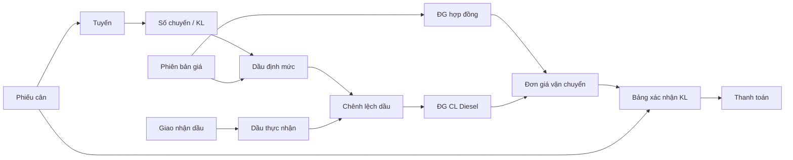
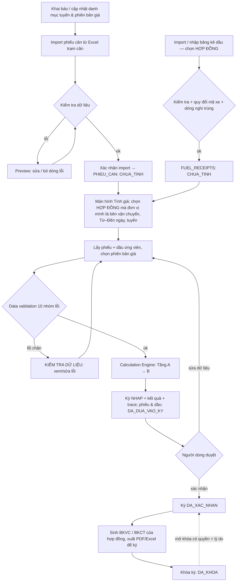
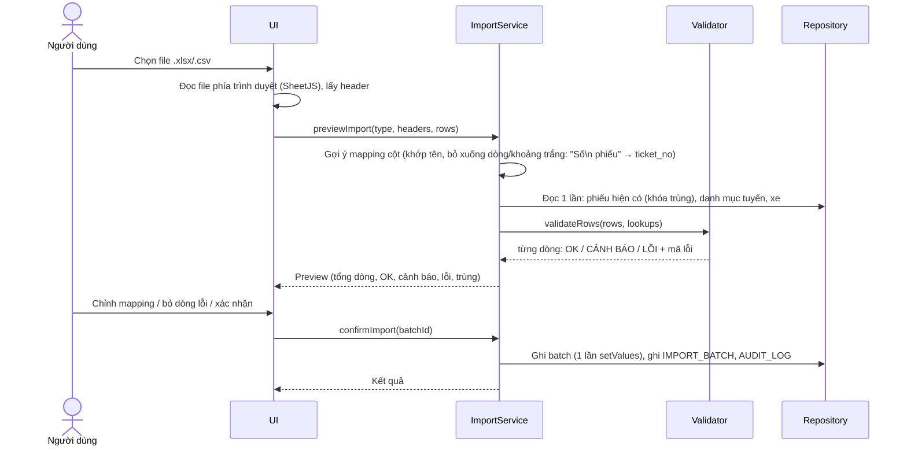
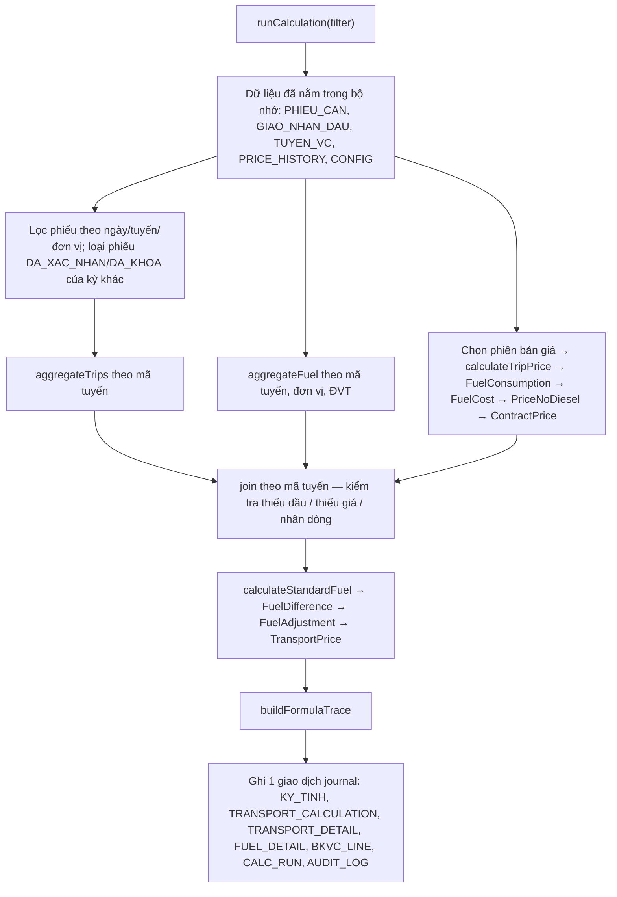
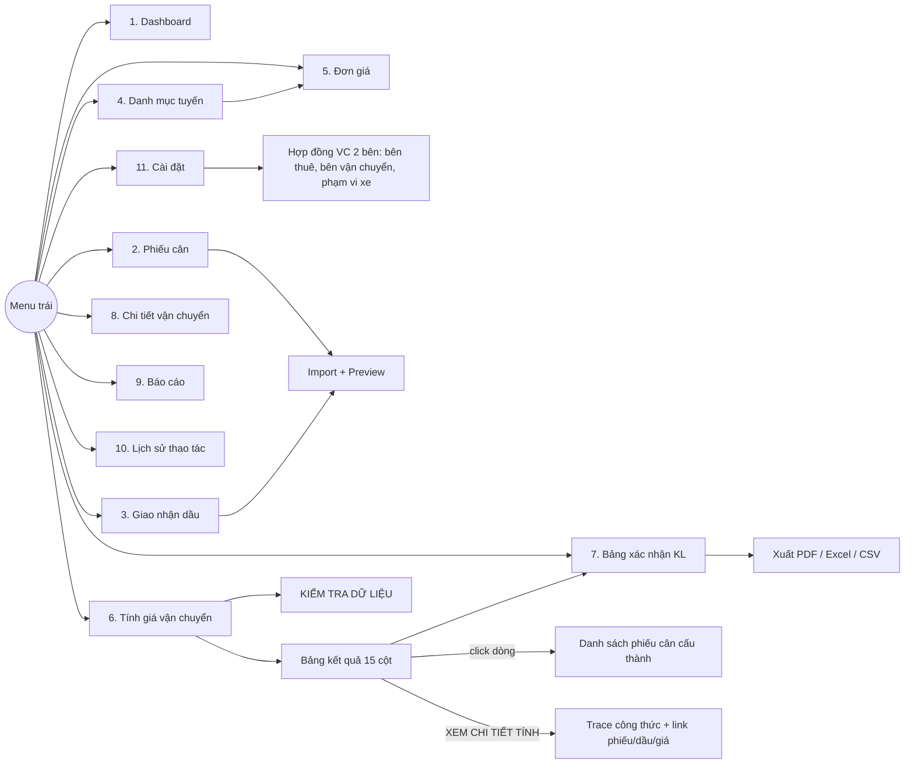

# APP_FLOW.md — Luồng ứng dụng

> Luồng dữ liệu, luồng nghiệp vụ, luồng màn hình và kiến trúc tầng cho APP thay thế quy trình Excel + Power Query.
> Thiết kế API/DB/UI chi tiết sẽ làm ở Bước 7–9 sau khi 4 tài liệu này được xác nhận.

> **v6 (24/09/2026): chuyển sang phần mềm desktop Electron, offline, lưu JSON** — xem §7.
> **Cập nhật 24/09/2026 (v4):** đã áp dụng 5 câu trả lời — định mức 0,4 lít/km; tính hết dầu trong bảng kê; đơn giá dầu trung bình cộng; làm tròn tiền đến đồng; giá dầu chưa VAT; **mỗi hợp đồng vận chuyển 2 bên tính độc lập, bên vận chuyển tự lập**. Các mục đã chốt đánh dấu ✅.
> **v5 (24/09/2026):** bổ sung 2 file hợp đồng `Dongiavanchuyen_24.09_DH.xlsx` (ĐH – HAKQN) và `Dongiavanchuyen_24.09_ĐN.xlsx` (HAK – HAKQN); **sửa** cách lấy dầu: dầu lấy theo **bảng kê giao nhận dầu của chính hợp đồng**, không lọc bảng kê của hợp đồng khác theo xe.

---

## 1. Chuỗi truy vết bắt buộc



Mỗi mũi tên = một liên kết được **lưu** trong DB (TRANSPORT_DETAIL, CALC_FUEL_DETAIL, price_id snapshot), nên từ con số 178.000 đi ngược được tới từng phiếu cân và từng dòng dầu.

---

## 2. Input / Processing / Output

| | Nội dung | Nguồn Excel tương ứng |
|---|---|---|
| **Input – danh mục** | Tuyến, phiên bản giá (đơn giá mới, KL_TB, thể tích TB, giá dầu cơ sở, định mức lít/km), xe, đơn vị VC, hợp đồng VC 2 bên (bên thuê / bên vận chuyển / phạm vi xe), cấu hình (làm tròn, VAT, người ký) | `TBL_DATA` (nhúng PQ), text/hằng số trong BKVC |
| **Input – phát sinh** | Phiếu cân (file trạm cân, dùng chung cho nhiều hợp đồng), bảng kê giao nhận dầu **theo từng hợp đồng** | `TBL_VC`, `TBL_GIAONHANDAU` |
| **Input – người dùng** | Từ ngày, Đến ngày, mã tuyến, đơn vị VC; chọn/bỏ phiếu, dòng dầu; xác nhận/khóa | (Excel: dán dữ liệu đúng kỳ) |
| **Processing** | Tầng A: ĐG_HĐ từ phiên bản giá · Tầng B: gom phiếu, gom dầu, định mức, chênh lệch, ĐG CL, ĐG VC · Tầng C: dòng BKVC theo xe | `QR_DATA (2)`, `TBL_GIAONHANDAU (2)`, `QR_DGVC (2)`, Pivot, BKVC |
| **Output** | Bảng tính đơn giá VC (17 cột), chi tiết tính, BKVC, BKCT, dashboard, danh sách lỗi, audit log; xuất Excel/CSV/PDF | `QR_DGVC (2)`, `BKVC`, `BKCT` |

---

## 3. Luồng nghiệp vụ tổng thể (to-be)



---

## 4. Luồng Import Excel



Kiểm tra khi import phiếu cân: trùng trong file, trùng DB, KG ≤ 0, KG ≠ cân 2 − cân 1, biển số sai định dạng, thiếu / sai mã tuyến, ngày cân 2 < ngày cân 1.
Kiểm tra khi import dầu: số lượng ≤ 0, đơn giá ≤ 0, mã xe không quy đổi được, mã tuyến không tồn tại.
Dòng gốc lưu nguyên vào `raw_row_json` — không mất dữ liệu.

---

## 5. Luồng Tính giá (chi tiết Engine)



Toàn bộ khối giữa "Đọc" và "Ghi" là **hàm thuần** trên mảng JS → unit test trực tiếp.
Ghi an toàn: toàn bộ kết quả của 1 lần tính ghi trong **1 giao dịch journal** (DATA_STORAGE_DESIGN §4) — lỗi / mất điện giữa chừng thì dữ liệu trở về đúng trạng thái trước khi tính.

---

## 6. Luồng màn hình



| Màn hình | Chức năng chính |
|---|---|
| Dashboard | Bộ lọc Từ–Đến ngày, tuyến, đơn vị; thẻ: tổng chuyến, tổng KL, dầu thực nhận, dầu định mức, chênh lệch, ĐG VC bình quân, số tuyến, phiếu chưa tính, phiếu lỗi |
| Phiếu cân | Lưới có lọc/tìm, trạng thái màu, import, sửa (theo trạng thái), xem kỳ đang dùng |
| Giao nhận dầu | Lưới + import + nhập nhiều dòng; hiển thị mã xe gốc và biển số quy đổi |
| Danh mục tuyến | Thêm/sửa/ngừng, lọc theo mã, đơn vị VC |
| Đơn giá | Phiên bản giá theo tuyến, hiệu lực từ–đến, tạo phiên bản mới, xem ĐG_HĐ tính sẵn (bảng Tầng A), lịch sử |
| Tính giá vận chuyển | Bộ lọc → TÍNH GIÁ → bảng 15 cột (theo hợp đồng đã chọn) → xác nhận / khóa / mở khóa / tính lại |
| Bảng xác nhận KL | BKVC theo hợp đồng + kỳ, mẫu in giống sheet BKVC, số tiền bằng chữ tự động |
| Chi tiết vận chuyển | BKCT 16 cột theo kỳ, lọc/tìm |
| Báo cáo | Danh sách kỳ, so sánh kỳ, xuất file |
| Lịch sử thao tác | AUDIT_LOG, xem before/after |
| Cài đặt | Làm tròn, VAT, tiêu chí ngày, người dùng & quyền (user gắn đơn vị); **danh mục đơn vị, xe, hợp đồng VC 2 bên** (bên thuê – bên vận chuyển – phạm vi xe – người ký) |

---

## 7. Kiến trúc (bản DESKTOP — quyết định 24/09/2026)

Phần mềm **Electron** chạy offline trên Windows, **không dùng SQL**, dữ liệu là **file JSON** trong một thư mục (có journal ghi an toàn + sao lưu zip), **mỗi đơn vị vận chuyển một bản cài**, **tài khoản nội bộ**. Chi tiết: `DATA_STORAGE_DESIGN.md` (lưu trữ), `API_DESIGN.md` (API nội bộ qua IPC).

```
Renderer (HTML/CSS/JS) ── window.dgvc.api(action, payload) ── IPC ──► Main process (Node.js)
                                                                        router → auth → services → engine (hàm thuần)
                                                                                                  → repo (JsonStore + Journal) → thư mục dữ liệu
                                                                        import (exceljs) · reports (XLSX/PDF) · exchange (.dgvc) · backup (zip)
```

Trao đổi giữa các bản cài: gói `.dgvc` — `DANH_MUC` (bản gốc → bản khác), `PHIEU_CAN`, `KY_TINH` (bên vận chuyển → bên thuê, nhận về chỉ xem).

## 8. Kế hoạch kiểm thử đối chiếu Excel (Bước 13–14)

Dữ liệu: 3 file Excel (QS, ĐH, ĐN) — 326 phiếu cân (dùng chung), 3 bảng kê dầu (18 / 16 / 13 dòng), 12 dòng danh mục; tuyến VC.007, kỳ 18/09/2026 – 23/09/2026. Import cả 3 file → tạo 3 hợp đồng → chạy 3 kỳ → so với 3 bảng QR_DGVC (2).

| Chỉ tiêu | Kỳ vọng (QR_DGVC (2)) | Dung sai |
|---|---|---|
| Số chuyến | 326 | 0 |
| Tổng KL (Tấn) | 6.143,68 | 0 |
| Dầu thực nhận | 5.853 | 0 |
| Dầu định mức | 18.777,6 | 1e-9 |
| Chênh lệch dầu | 12.924,6 | 1e-9 |
| Đơn giá dầu | 29.940 | 0 |
| ĐG HĐ | 115.000 | 0 |
| ĐG CL Diesel | 62.985,46213344446 | 1e-6 |
| Đơn giá vận chuyển | 178.000 | 0 |
| BKVC: 17 dòng xe, tổng trước VAT / VAT / sau VAT (làm tròn đến đồng — đã xác nhận) | 1.093.575.040 / **87.486.003** / **1.181.061.043** (file Excel: …,2 — lệch 0,2 đ là do quy tắc làm tròn, có chủ đích) | 0 |
| Tầng A: ĐG_HĐ 12 tuyến | bảng §2.8 CALCULATION_RULES | 0 |
| Hợp đồng ĐH – HAKQN (file `_DH.xlsx`): số chuyến / tấn / dầu thực nhận / giá dầu / CL / ĐG CL / **ĐG VC** | 77 / 1.452,13 / 5.734,69 / 29.210 / −1.299,49 / −26.139,60 / **88.900** | 0 (ĐG CL 1e-6) |
| Hợp đồng HAK – HAKQN (file `_ĐN.xlsx`) | 100 / 1.870,38 / 5.088,35 / 29.490,77 / 671,65 / 10.590,08 / **125.600** | 0 (ĐG CL, giá dầu 1e-6) |

Test bổ sung (edge case): cùng 1 phiếu dùng ở 2 hợp đồng khác nhau (được phép) và ở 2 kỳ của cùng hợp đồng (bị chặn); xe đổi hợp đồng giữa kỳ; xe không thuộc hợp đồng nào; user lập kỳ cho hợp đồng mà đơn vị mình không phải bên vận chuyển (bị chặn); tuyến không có dầu; dầu 2 đơn vị cùng tuyến; tổng KL = 0; kết quả âm → 0; điểm giữa làm tròn (x.500) với ToEven vs half-up; tuyến M3; phiếu qua đêm ở ranh giới kỳ; phiếu đã khóa bị chọn lại.

Nếu APP khác Excel: **không sửa cho khớp** — báo cáo theo 5 mục (công thức / dữ liệu / làm tròn / kiểu dữ liệu / nguyên nhân) rồi đề xuất.

> Kết quả kiểm chứng trước khi code: một script Python độc lập tái lập đúng các bước Power Query đã cho kết quả **trùng khớp 100%** với 9 chỉ tiêu trên.
