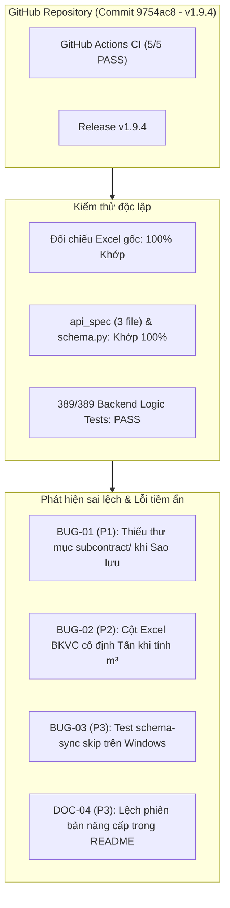

# BÁO CÁO TOÀN DIỆN: RÀ SOÁT LỖI MÃ NGUỒN, HƯỚNG XỬ LÝ & PROMPT THI CÔNG
**Phiên bản kiểm tra:** DGVC 1.9.4 (Commit: `9754ac8` - GitHub `main`)  
**Ngày lập:** 24/11/2026  
**Mục đích:** Báo cáo chi tiết các lỗi tiềm ẩn, phân tích nguyên nhân gốc rễ, kế hoạch sửa chữa từng bước và cung cấp sẵn các **Agent Prompt** tiêu chuẩn để giao việc trực tiếp cho kỹ sư phần mềm hoặc AI Agent thực thi.

---

## 1. TỔNG HỢP HIỆN TRẠNG KIỂM TRA MÃ NGUỒN



> [!NOTE]
> Toàn bộ logic tính toán tài chính (`app/main/engine/*`) được bảo vệ nghiêm ngặt: 100% khớp dữ liệu Excel thực tế của 3 nhà máy HAK, HAKQN, ĐH; không có sai lệch số tiền nào. Các lỗi phát hiện nằm ở tầng **Sao lưu/Khôi phục phụ**, **Báo cáo xuất Excel**, và **Môi trường chạy test**.

---

## 2. CHI TIẾT CÁC LỖI & PHƯƠNG ÁN XỬ LÝ

---

### 🔴 BUG-01: Thư mục `subcontract/` bị bỏ sót khi Sao lưu & Khôi phục (Mức độ: P1 - Nghiêm trọng)

#### 1. Hiện trạng & Vị trí code
* **Tệp liên quan:** `app/main/services/SubcontractService.js` (dòng 55-60) và `app/main/services/BackupService.js` (dòng 42-58).
* Dữ liệu phân hệ *"Thuê vận chuyển & Đối chiếu 3 tiêu chuẩn"* được lưu trữ dạng JSON tại:
  - `<store.root>/subcontract/batches.json` (metadata danh sách các đợt nạp).
  - `<store.root>/subcontract/files/<batchId>.json` (chi tiết phiếu cân và dầu của từng đợt).

#### 2. Nguyên nhân gốc rễ
* Hàm `backup()` trong `BackupService.js`:
  - Khi kho là **SQLite**: chỉ nén file `dgvc.db` và `backup-info.json`.
  - Khi kho là **JSON**: chỉ nén `manifest.json` và các file bảng được liệt kê trong `manifest.files`.
* Cả hai nhánh đều **hoàn toàn không quét thư mục `subcontract/`**.
* Tương tự, hàm `restore()` / `restoreFile()` chỉ phục hồi `dgvc.db` hoặc các file của `manifest.json`, không giải nén thư mục `subcontract/`.

#### 3. Rủi ro vận hành
* Khi người dùng thực hiện tính năng **Sao lưu dữ liệu** (ra USB, Google Drive, hoặc file zip) rồi chuyển sang máy trạm mới hoặc khôi phục sau sự cố máy tính, **toàn bộ lịch sử các đợt nạp của đối tác và Báo cáo thuê vận chuyển sẽ bị biến mất**.

#### 4. Giải pháp khắc phục kỹ thuật
1. **Trong `BackupService.js` (Hàm `backup`)**:
   - Sau khi đóng gói DB/manifest, kiểm tra sự tồn tại của thư mục `path.join(root, 'subcontract')`.
   - Nếu tồn tại, đệ quy duyệt qua tất cả các file trong `subcontract/` và thêm vào file zip với đường dẫn tương đối `subcontract/...`.
2. **Trong `BackupService.js` (Hàm `restore` & `restoreFile`)**:
   - Khi giải nén file zip sao lưu, kiểm tra các entry có tiền tố `subcontract/`.
   - Ghi đè/khôi phục an toàn vào thư mục `<store.root>/subcontract/`.
3. **Viết kiểm thử tự động**:
   - Tạo file test `app/tests/backup.subcontract.test.js`: nạp 1 đợt subcontract mẫu → chạy sao lưu → xóa thư mục dữ liệu → khôi phục từ bản sao lưu → kiểm tra `SubcontractService.listBatches()` và `getBatch()` đọc lại đầy đủ 100%.

---

### 🟡 BUG-02: Cột Excel BKVC cố định chữ "Tấn" khi hợp đồng tính theo m³ (Mức độ: P2 - Báo cáo)

#### 1. Hiện trạng & Vị trí code
* **Tệp liên quan:** `app/main/reports/xlsxExport.js` (dòng 25 và dòng 72).
* Dòng 25 hiện tại:
  ```javascript
  const heads = ['STT', 'Biển số xe', 'Số chuyến', 'Khối lượng (KG)', 'Khối lượng (Tấn)', 'Đơn giá', 'Thành tiền', `VAT (${H.vatPct}%)`, 'Thành tiền', 'Ghi chú'];
  ```
* Dòng 72 (sheet `HOA_DON`):
  ```javascript
  const t = inv.addRow(['', 'TỔNG CỘNG', '', d.totals.ton, '', d.totals.amount, '', d.totals.vat, d.totals.total]);
  ```

#### 2. Nguyên nhân gốc rễ
* Tiêu đề cột 5 trong file xuất Excel bị gán cứng là `'Khối lượng (Tấn)'`.
* Trong khi đó, tại màn hình hiển thị HTML và xuất PDF (`htmlTemplates.js:148`), hệ thống đã dùng biến động `d.uomLabel || 'Tấn'`.
* Khi hợp đồng tính giá theo thể tích m³ (ví dụ tuyến chở củi bìa, dăm tính theo khối thùng), số liệu ở cột 5 là số mét khối (m³) nhưng tiêu đề cột trong file Excel gửi cho khách hàng vẫn ghi là "Tấn".

#### 3. Giải pháp khắc phục kỹ thuật
1. Trong `xlsxExport.js`, lấy nhãn đơn vị tính từ `d.uomLabel || 'Tấn'`:
   ```javascript
   const uomColTitle = (d.uomLabel && d.uomLabel.toLowerCase().includes('m')) ? 'Thể tích (m³)' : 'Khối lượng (Tấn)';
   const heads = ['STT', 'Biển số xe', 'Số chuyến', 'Khối lượng (KG)', uomColTitle, 'Đơn giá', 'Thành tiền', `VAT (${H.vatPct}%)`, 'Thành tiền', 'Ghi chú'];
   ```
2. Trong sheet `HOA_DON`, cập nhật tương tự nhãn đơn vị tính ở cột tổng cộng để phản ánh đúng số m³ hoặc tấn.
3. Bổ sung test kiểm tra xuất Excel cho hợp đồng tính m³ để đảm bảo tiêu đề cột khớp nhãn m³.

---

### 🟢 BUG-03: Test `spec.schema-sync.test.js` bị skip trên Windows (Mức độ: P3 - Kiểm thử)

#### 1. Hiện trạng & Vị trí code
* **Tệp liên quan:** `app/tests/spec.schema-sync.test.js` (dòng 9-11).
* Dòng 9:
  ```javascript
  test('schema.py có đủ cột của schema.json', { skip: (() => { try { execFileSync('python3', ['--version']); return false; } catch { return 'không có python3'; } })() }, () => {
    ...
    const cols = JSON.parse(execFileSync('python3', ...));
  ```

#### 2. Nguyên nhân gốc rễ
* Test gọi cứng tên lệnh thực thi là `python3`. Lệnh này phổ biến trên Ubuntu/macOS nhưng trên Windows lệnh mặc định thường là `python.exe` hoặc `py.exe`. Dù máy trạm Windows đã cài đặt Python 3.12 đầy đủ, test này vẫn bị bỏ qua (`skip: không có python3`).

#### 3. Giải pháp khắc phục kỹ thuật
* Thêm hàm xác định lệnh Python khả dụng đa nền tảng:
  ```javascript
  function resolvePythonCmd() {
    for (const cmd of ['python3', 'python', 'py']) {
      try {
        const out = execFileSync(cmd, ['--version'], { encoding: 'utf8', stdio: ['pipe', 'pipe', 'ignore'] });
        if (/Python\s+3\./i.test(out)) return cmd;
      } catch {}
    }
    return null;
  }
  ```
* Nếu `resolvePythonCmd()` trả về `null`, lúc đó mới skip với lý do `'không có python 3'`.

---

### 🟢 DOC-04: Lệch thông tin phiên bản trong `README.md` (Mức độ: P3 - Tài liệu)

#### 1. Hiện trạng
* Trong `README.md`: Dòng 3 ghi `Bản hiện tại: 1.9.4`.
* Nhưng dòng 39 tiêu đề lại ghi: `## Nâng cấp từ bản cũ (1.8.3 → 1.9.2)`.
* Chưa có tóm tắt phát hành riêng cho 1.9.3 và 1.9.4 trong thư mục `docs/`.

#### 2. Giải pháp khắc phục
* Cập nhật tiêu đề thành: `## Nâng cấp từ bản cũ (1.8.3 → 1.9.4)`.
* Bổ sung tài liệu tóm tắt phát hành `docs/PHAT_HANH_1.9.3.md` và `docs/PHAT_HANH_1.9.4.md`.

---

## 3. PROMPT THI CÔNG DÀNH CHO AI AGENT / LẬP TRÌNH VIÊN

Dưới đây là các prompt chuẩn hóa, độc lập và đầy đủ ngữ cảnh để có thể copy & paste giao việc ngay cho AI Agent thực hiện:

### 🎯 Prompt 1: Sửa triệt để BUG-01 (Sao lưu toàn vẹn phân hệ Thuê vận chuyển)

````markdown
Bạn là chuyên gia Node.js backend của dự án DGVC (VCNB_OFFLINE). Hãy thực hiện sửa lỗi sao lưu phân hệ Thuê vận chuyển như sau:

1. MỤC TIÊU:
Đảm bảo khi chạy tính năng Sao lưu (BackupService.backup), toàn bộ dữ liệu của phân hệ Thuê vận chuyển nằm trong thư mục `<store.root>/subcontract/` (gồm batches.json và các file files/*.json) được đóng gói đầy đủ vào file zip sao lưu (.zip). Đồng thời khi Khôi phục (BackupService.restore / restoreFile), thư mục subcontract/ được giải nén và phục hồi nguyên vẹn.

2. CÁC TỆP CẦN CHỈNH SỬA:
- `app/main/services/BackupService.js`:
  + Trong hàm `backup()`: sau khi đóng gói dgvc.db (kho SQLite) hoặc manifest.json (kho JSON), kiểm tra xem `path.join(root, 'subcontract')` có tồn tại không. Nếu có, đệ quy nén toàn bộ tệp vào zip với tiền tố `subcontract/...`.
  + Trong hàm `restoreFile()` / `restore()`: khi giải nén các entry từ file zip sao lưu, nếu gặp entry bắt đầu bằng `subcontract/`, tự động tạo thư mục con tương ứng và ghi tệp vào `<store.root>/subcontract/...`.
- `app/tests/backup.subcontract.test.js`:
  + Viết test độc lập kiểm tra:
    a) Khởi tạo SubcontractService, nạp 1 batch mẫu (có phiếu cân và dòng dầu).
    b) Gọi BackupService.backup({ kind: 'manual' }).
    c) Kiểm tra bên trong file .zip sinh ra có chứa entry `subcontract/batches.json` và `subcontract/files/<batchId>.json`.
    d) Xóa thư mục subcontract trong data.
    e) Gọi BackupService.restoreFile() từ file zip.
    f) Kiểm tra SubcontractService.listBatches() đọc lại nguyên vẹn batch vừa nạp.

3. NGUYÊN TẮC BẤT BIẾN:
- Không thay đổi cấu trúc bảng hay logic của cơ sở dữ liệu chính.
- Chạy `npm test -- app/tests/backup.subcontract.test.js` và `node app/tools/verify-seed.js` phải pass 100%.
````

---

### 🎯 Prompt 2: Sửa BUG-02 (Cột Excel BKVC tự động nhận diện đơn vị m³)

````markdown
Bạn là lập trình viên của dự án DGVC (VCNB_OFFLINE). Hãy sửa lỗi hiển thị đơn vị tính trong file xuất Excel BKVC:

1. MỤC TIÊU:
Khi một kỳ vận chuyển hoặc hợp đồng tính cước theo đơn vị m³ (`uomLabel === 'm³'`), file Excel BKVC xuất ra từ `app/main/reports/xlsxExport.js` phải hiển thị tiêu đề cột là `Khối lượng (m³)` (hoặc `Thể tích (m³)`), không được gán cứng là `Khối lượng (Tấn)`.

2. CÁC TỆP CẦN CHỈNH SỬA:
- `app/main/reports/xlsxExport.js`:
  + Tại hàm `writeBkvc(d, file)` (khoảng dòng 25): sửa mảng `heads`:
    ```javascript
    const uomColTitle = (d.uomLabel && d.uomLabel.toLowerCase().includes('m')) ? 'Thể tích (m³)' : 'Khối lượng (Tấn)';
    const heads = ['STT', 'Biển số xe', 'Số chuyến', 'Khối lượng (KG)', uomColTitle, 'Đơn giá', 'Thành tiền', `VAT (${H.vatPct}%)`, 'Thành tiền', 'Ghi chú'];
    ```
  + Tại sheet HOA_DON (khoảng dòng 72): nếu `d.uomLabel === 'm³'`, cập nhật nhãn diễn giải ở cột số lượng tương ứng.
- `app/tests/reports.test.js`:
  + Bổ sung 1 test case kiểm tra xuất Excel cho kỳ có uomLabel là 'm³': đọc lại workbook bằng exceljs và assert ô E6 có giá trị chứa 'm³'.

3. NGUYÊN TẮC:
- Không làm thay đổi định dạng in ấn hiện có của các kỳ tính theo Tấn.
- Chạy `node app/tools/verify-seed.js` phải báo "TẤT CẢ KHỚP EXCEL".
````

---

### 🎯 Prompt 3: Sửa BUG-03 (Tương thích lệnh Python trên Windows)

````markdown
Bạn là lập trình viên của dự án DGVC. Hãy tối ưu test `app/tests/spec.schema-sync.test.js` để có thể chạy được trên cả Windows, Linux và macOS:

1. MỤC TIÊU:
Hiện tại test gọi cứng `execFileSync('python3', ...)` khiến test luôn bị bỏ qua trên Windows (nơi lệnh mặc định là `python`). Cần nhận diện lệnh Python khả dụng để chạy test đầy đủ trên mọi hệ điều hành.

2. CÁC TỆP CẦN CHỈNH SỬA:
- `app/tests/spec.schema-sync.test.js`:
  + Thêm hàm kiểm tra:
    ```javascript
    function findPythonExecutable() {
      for (const bin of ['python3', 'python', 'py']) {
        try {
          const res = execFileSync(bin, ['-c', 'import sys; print(sys.version_info[0])'], { encoding: 'utf8', stdio: ['pipe', 'pipe', 'ignore'] });
          if (res.trim() === '3') return bin;
        } catch {}
      }
      return null;
    }
    const pyBin = findPythonExecutable();
    ```
  + Dùng `pyBin` trong khai báo test `{ skip: !pyBin && 'không tìm thấy python 3' }` và trong lệnh thực thi `execFileSync(pyBin, ...)`.

3. NGUYÊN TẮC:
- Chạy thử lệnh: `node app/tests/spec.schema-sync.test.js` trên máy Windows hiện tại phải pass và in ra kết quả kiểm tra thành công, không bị skip.
````

---

## 4. KẾ HOẠCH NÂNG CẤP TÍNH NĂNG TIẾP THEO (BACKLOG ROADMAP)

| Hạng mục nâng cấp | Mô tả chi tiết | Độ ưu tiên | Lợi ích vận hành |
| :--- | :--- | :---: | :--- |
| **1. ADMIN đặt mật khẩu trực tiếp** | Bổ sung checkbox `[x] Đặt mật khẩu trực tiếp (Bỏ qua mã kích hoạt)` khi ADMIN tạo tài khoản mới. | Trung bình | Tránh rườm rà trong mạng LAN nội bộ không có mail server. |
| **2. Quản lý hạn đăng kiểm xe** | Thêm cột `Ngày hết hạn đăng kiểm` trong Danh mục xe (kèm import Excel) và cảnh báo màu vàng khi xe sắp/đã hết hạn. | Cao | Tránh rủi ro pháp lý xe hết kiểm định vẫn vận chuyển hàng. |
| **3. Lưu trữ năm cho Thuê vận chuyển** | Tích hợp tính năng đóng gói phân hệ `subcontract` khi người dùng bấm Lưu trữ theo năm (`archive.year`). | Trung bình | Giúp dữ liệu hàng năm gọn gàng, tăng tốc độ khởi động app. |
| **4. Ký số gói trao đổi nhà máy** | Thêm mã HMAC SHA-256 kèm secret key giữa các nhà máy trong gói `.dgvc`/`.json`. | Khá cao | Chống việc sửa tay số liệu trung gian trước khi nạp vào máy khác. |
| **5. Đăng ký Code Signing Windows** | Ký số file `DGVC-Setup.exe` bằng chứng chỉ số doanh nghiệp. | Khá cao | Loại bỏ hoàn toàn màn hình cảnh báo "Windows protected your PC". |

---
*Tài liệu này được tạo tự động bởi Antigravity và lưu trữ an toàn trong kho tài liệu dự án.*
