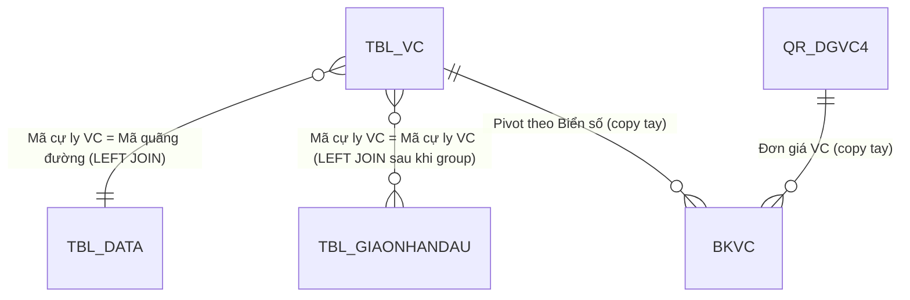
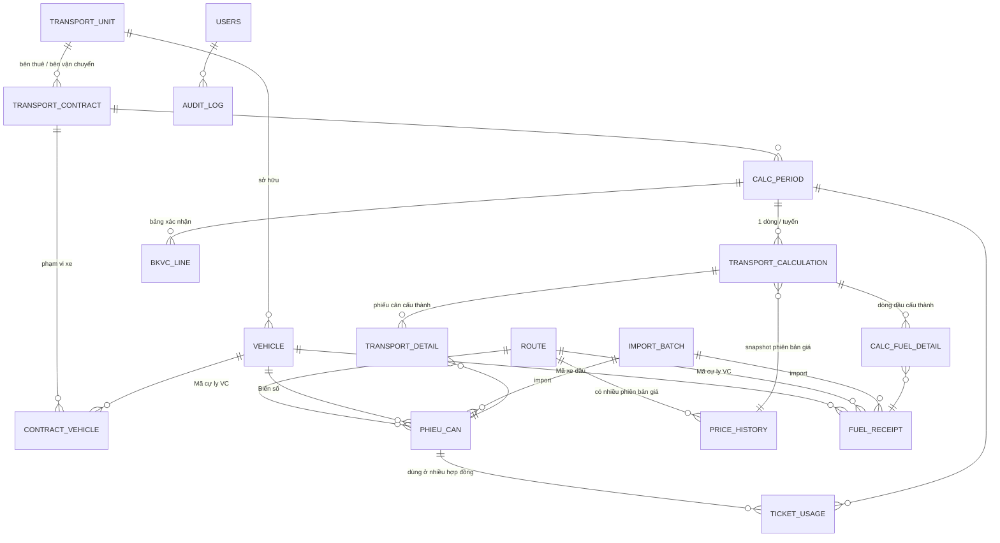

# DATA_MODEL.md — Mô hình dữ liệu

> Nguồn phân tích: `Dongiavanchuyen_24.09 QS-TS( XUẤT QS).xlsx` (đường dẫn gốc trong file: `H:\My Drive\HẸN\VC DĂM\T9.2026\`).
> Quy ước: **[ĐỌC TỪ EXCEL]** = mô tả đúng những gì có trong file. **[ĐỀ XUẤT]** = thiết kế cho APP, chưa có trong Excel. **[CẦN XÁC NHẬN]** = chưa rõ, cần anh/chị trả lời trước khi code.

> **Cập nhật 24/09/2026 (v4):** đã áp dụng 5 câu trả lời — định mức 0,4 lít/km; tính hết dầu trong bảng kê; đơn giá dầu trung bình cộng; làm tròn tiền đến đồng; giá dầu chưa VAT; **mỗi hợp đồng vận chuyển 2 bên tính độc lập, bên vận chuyển tự lập**. Các mục đã chốt đánh dấu ✅.
> **v5 (24/09/2026):** bổ sung 2 file hợp đồng `Dongiavanchuyen_24.09_DH.xlsx` (ĐH – HAKQN) và `Dongiavanchuyen_24.09_ĐN.xlsx` (HAK – HAKQN); **sửa** cách lấy dầu: dầu lấy theo **bảng kê giao nhận dầu của chính hợp đồng**, không lọc bảng kê của hợp đồng khác theo xe.

---

## 1. Cấu trúc file Excel [ĐỌC TỪ EXCEL]

### 1.1. Các sheet

| # | Sheet | Trạng thái | Vai trò thực tế |
|---|---|---|---|
| 1 | `NL_VC` | Hiện | **Nguồn chính**: bảng `TBL_VC` (A1:P327 = 326 phiếu cân) + PivotTable `PivotTable1` (J328:L346) tổng hợp theo biển số |
| 2 | `NL_GIAONHANDAU` | Hiện | **Nguồn chính**: bảng `TBL_GIAONHANDAU` (A2:H21 = 18 dòng giao nhận dầu) |
| 3 | `QR_DGVC (2)` | Hiện | **Kết quả**: bảng `QR_DGVC4` (A5:Q6) — load từ query Power Query `QR_DGVC (2)`; có tiêu đề + ô ký tên |
| 4 | `BKVC` | Hiện | **Báo cáo**: Bảng xác nhận khối lượng vận chuyển dăm (in ấn, vùng in A1:J33) |
| 5 | `BK` | Ẩn | Mẫu BKVC cũ (kỳ 08–09/11/2025), có công thức `ROUND` tổng và `vnd()` đọc số thành chữ |
| 6 | `BKCT`, `BKCT (2)`, `BKCT (3)`, `Sheet1` | Ẩn | Bảng kê chi tiết phiếu cân các kỳ cũ (07/2026, 06/2026, 08/2026, 04/2026) — tương đương báo cáo BKCT |
| 7 | `NL_GIAONHANDAU (2)`, `NL_GIAONHANDAU (3)`, `Sheet2`, `Sheet6` | Ẩn | Bảng kê / biên bản giao nhận dầu các kỳ cũ. `(3)` là **biên bản giao nhận dầu** có bên giao/bên nhận, tổng lít và chữ ký |
| 8 | `CAN` | Ẩn | Báo cáo danh sách lượt xe đã cân (kỳ 11/2025) có thêm cột **Cty VC** và **Số HĐVC** |
| 9 | `Sheet3` | Ẩn | Trích *Sổ chi tiết vật tư hàng hóa* — xuất kho Dầu Diezel (TK 152, mã `152QS.001`) cho từng xe, cột *Mã thống kê* = mã xe (vd `QC_92H00865`) |

### 1.2. Excel Tables

| Table | Sheet | Vùng | Ghi chú |
|---|---|---|---|
| `TBL_VC` | NL_VC | A1:P327 | Nguồn của query `TBL_VC`, `TBL_VC (2)` và PivotTable |
| `TBL_GIAONHANDAU` | NL_GIAONHANDAU | A2:H21 | Nguồn của query `TBL_GIAONHANDAU`, `TBL_GIAONHANDAU (2)` |
| `QR_DGVC4` | QR_DGVC (2) | A5:Q6 | Kết quả load của query `QR_DGVC (2)` |
| `TBL_GIAONHANDAU4`, `TBL_GIAONHANDAU7`, `TBL_GIAONHANDAU78`, `Table1` | các sheet ẩn | — | Dữ liệu kỳ cũ, **không** được query nào dùng |

### 1.3. Power Query (10 query)

| Query | Nguồn | Load ra sheet? |
|---|---|---|
| `TBL_VC` / `TBL_VC (2)` | `Excel.CurrentWorkbook` → `TBL_VC` | Không (connection only). Hai query **giống hệt nhau** |
| `TBL_GIAONHANDAU` / `TBL_GIAONHANDAU (2)` | `Excel.CurrentWorkbook` → `TBL_GIAONHANDAU` | Không. Giống hệt nhau |
| `TBL_DATA` / `TBL_DATA (2)` | **Dữ liệu nhúng cứng** trong query (Enter Data, JSON nén base64) | Không. Giống hệt nhau |
| `QR_DATA` / `QR_DATA (2)` | `TBL_DATA` / `TBL_DATA (2)` | Không. Giống hệt nhau |
| `QR_DGVC` | `TBL_VC` + `TBL_GIAONHANDAU` + `QR_DATA` | Có connection nhưng hiện **không** có bảng load ra |
| `QR_DGVC (2)` | `TBL_VC (2)` + `TBL_GIAONHANDAU (2)` + `QR_DATA (2)` | **Có** → bảng `QR_DGVC4`. Khác `QR_DGVC` duy nhất ở bước làm tròn cuối `ROUND(…,-2)` |

Khác: 1 external link tới add-in `C:\Program Files (x86)\vnTools\Ufunctions.xlam` (hàm `vnd` đọc số thành chữ) — đang **lỗi refresh** (`refreshError="1"`).

> ⚠️ **Phát hiện quan trọng:** Danh mục tuyến/đơn giá (`TBL_DATA`) **không nằm trên sheet nào** mà được gõ trực tiếp trong Power Query. Muốn đổi đơn giá phải mở Power Query Editor. Đây là dữ liệu bắt buộc phải tách ra thành danh mục trong APP.

---

### 1.4. Các file cùng mẫu (bổ sung v5)

| File | Hợp đồng | Tiêu đề QR_DGVC (2) | TBL_VC | TBL_GIAONHANDAU | Khác biệt so với file QS |
|---|---|---|---|---|---|
| `Dongiavanchuyen_24.09 QS-TS( XUẤT QS).xlsx` | HAKQN – QS | CÔNG TY TNHH HOÀNG ANH KHÔI QUẢNG NAM | 326 dòng | 18 dòng, `Đơn vị` = CNHAK | — |
| `Dongiavanchuyen_24.09_DH.xlsx` | ĐH – HAKQN | CÔNG TY TNHH SX TM DV ĐẠI HIỆP | 77 dòng (đúng 77 phiếu xe ĐH trong file QS) | 16 dòng, `Đơn vị` = HAKQN | Không có sheet BKVC và NL_GIAONHANDAU (3) |
| `Dongiavanchuyen_24.09_ĐN.xlsx` | HAK – HAKQN | CÔNG TY TNHH HOÀNG ANH KHÔI | 100 dòng (đúng 100 phiếu xe HAK trong file QS) | 13 dòng, `Đơn vị` = HAKQN | Không có sheet BKVC |

- 3 file có **Power Query giống hệt nhau** và **cùng bảng giá nhúng** (12 tuyến, ngày 10/07/2025) → xác nhận 1 Engine + 1 danh mục giá dùng chung là đúng.
- File ĐH/ĐN: `Số phiếu` lưu dạng text; file ĐN `KL hàng (KG)` lưu dạng số thực; tên `Đơn vị VC` file ĐN có khoảng trắng cuối (`"Công ty TNHH Hoàng Anh Khôi "`) → import phải trim.
- Mã xe trong bảng kê dầu có **3 kiểu viết**: `DH_92H00192`, `92H-00192`, `92H00195` → quy đổi qua danh mục VEHICLE (chuẩn hóa: bỏ tiền tố `XX_`, bỏ gạch, so với `plate_key`).
- Ô ký tên của file ĐH/ĐN còn giữ nguyên tên người ký và bên "CN CÔNG TY TNHH HOÀNG ANH KHÔI" của file QS (trong khi bên thuê là HAKQN) → chứng cứ cho việc lấy tên người ký từ hợp đồng thay vì copy mẫu (BL-44, BL-66).

## 2. Chi tiết các bảng nguồn [ĐỌC TỪ EXCEL]

### 2.1. `TBL_VC` — Phiếu cân (dữ liệu từng chuyến)

| Cột Excel | Kiểu trong ô Excel | Kiểu ép trong PQ | Ví dụ | Hồ sơ dữ liệu kỳ 18–23/09/2026 |
|---|---|---|---|---|
| `Stt` | text (`'01'`) | text | `01` | 01…326 |
| `Số\n phiếu` (tiêu đề có xuống dòng) | số | **text** | 573 | 573…902, không trùng; thiếu số 782, 783, 784, 900 |
| `Ngày cân 1` | date | date | 18/09/2026 | 18/09 → 23/09 |
| `Giờ cân 1` | **text** `'08:11:18'` | time | 08:11:18 | |
| `Ngày cân 2` | date | date | 18/09/2026 | 6 phiếu qua đêm (ngày cân 2 = ngày cân 1 + 1): 612, 613, 740, 809, 875, 876 |
| `Giờ cân 2` | text | time | 08:19:42 | |
| `Biển số 1` | text | text | `43H-01080` | 17 xe, đều đúng dạng `NNX-NNNNN` |
| `Cân lần 1` | số (kg) | number | 13810 | 13.700–14.280 (xe rỗng) |
| `Cân lần 2` | số (kg) | number | 31280 | 30.100–35.950 (xe có hàng) |
| `KL hàng (KG)` | số (kg) | number | 17470 | 16.200–21.920; **326/326 dòng đúng = Cân lần 2 − Cân lần 1** |
| `Nguồn gốc` | text | text | `ĐN` | 1 giá trị |
| `Khách hàng` | trống | text | — | trống toàn bộ |
| `LDĐ` | text | text | `UTXK/ĐN-QS/0726` | 1 giá trị |
| `Kiểu cân` | text | text | `XBUT` | 1 giá trị (kỳ cũ có `Trung Chuyển`) |
| `Mã cự ly VC` | text | text | `VC.007` | 1 giá trị (`VC.007`) |
| `Đơn vị VC` | text | text | `Công ty TNHH Hoàng Anh Khôi Quảng Nam` | HAKQN 149 · HAK 100 · Đại Hiệp 77 |

Tổng kỳ: **326 chuyến – 6.143.680 kg**.

Quan hệ xe ↔ Đơn vị VC trong kỳ (mỗi xe chỉ thuộc 1 đơn vị):
- HAK (`Công ty TNHH Hoàng Anh Khôi`): 43H-01021, 43H-01055, 43H-01068, 43H-01080, 43H-01098
- Đại Hiệp: 92H-00057, 92H-00133, 92H-00141, 92H-00192, 92H-00195
- HAKQN: 92H-00834, 92H-00844, 92H-00865, 92H-00893, 92H-00903, 92H-00979, 92H-00994

### 2.2. `TBL_GIAONHANDAU` — Giao nhận dầu

| Cột | Kiểu PQ | Ví dụ | Hồ sơ kỳ này |
|---|---|---|---|
| `Ngày nhận dầu` | date | 20/09/2026 | 20/09 → 23/09 |
| `Mã cự ly VC` | text | `VC.007` | 1 giá trị |
| `Biển số xe` | text | `DH_92H00192` | **Khác định dạng TBL_VC**: `<tiền tố>_<biển không gạch>`. Tiền tố: `DN` = xe HAK, `DH` = xe Đại Hiệp, `QC` = xe HAKQN |
| `ĐVT` | text | `LÍT` | 1 giá trị |
| `Số lượng (lít)` | number | 385 | Tổng **5.853 lít**, 18 dòng, 12 xe |
| `Đơn giá dầu` | **Int64** | 29940 | 1 giá trị 29.940 |
| `Ngày mua dầu` | date | 17/09/2026 | 17/09 và 22/09 |
| `Đơn vị` | text | `CNHAK` | 1 giá trị |

5 xe có chạy trong kỳ nhưng **không có dòng nhận dầu**: 43H-01098, 92H-00057, 92H-00133, 92H-00141, 92H-00844 (không ảnh hưởng công thức hiện tại vì Excel chỉ cộng dầu theo tuyến, nhưng cần biết khi truy vết).

### 2.3. `TBL_DATA` — Danh mục tuyến / đơn giá (nhúng trong Power Query)

Tất cả giá trị được lưu dạng text rồi ép kiểu. Cột `Cự ly/chuyến` được đổi tên thành `Cự ly chuyến`.

| Ngày cập nhật | Mã quãng đường | Tuyến | Cự ly | Cự ly/chuyến | ĐVT | Đơn Giá (chưa VAT) | Giá/km | Đơn giá mới | Đơn vị VC | ĐG dầu chưa VAT | ĐM dầu_100km | KL_TB | Thể tích TB |
|---|---|---|---|---|---|---|---|---|---|---|---|---|---|
| 10/07/2025 | VC.002 | Xã Bà Nà - Tiên Sa | 27 | 54 | Tấn | 71000 | 2629.63 | 71000 | HHH | 15500 | 0.4 | 18 | 57.82 |
| 10/07/2025 | VC.003 | Xã Đại Lộc - Tiên Sa | 38 | 76 | Tấn | 96000 | 2526.32 | 96000 | HHH | 15500 | 0.4 | 18 | 57.82 |
| 10/07/2025 | VC.008 | Xã Quế Sơn Trung - Tiên Sa | 54 | 108 | Tấn | 130000 | 2407.41 | 123750 | HAK | 15500 | 0.4 | 18 | 57.82 |
| 10/07/2025 | **VC.007** | **Xã Quế Sơn - Tiên Sa** | 72 | **144** | Tấn | 150000 | 2083.33 | **165000** | HAK | **15500** | **0.4** | **18** | 57.82 |
| 10/07/2025 | VC.009 | Xã Quế Sơn Trung - Hòa Nhơn | 40 | 80 | Tấn | 110000 | 2750 | 91666.66667 | HAK | 15500 | 0.4 | 18 | 57.82 |
| 10/07/2025 | VC.010 | Xã Quế Sơn - Hòa Nhơn | 57 | 114 | Tấn | 130000 | 2280.70 | 130625 | HAK | 15500 | 0.4 | 18 | 57.82 |
| 10/07/2025 | VC.004 | Xã Quế Sơn Trung - Dung Quất | 85 | 170 | Tấn | 150000 | 1764.71 | 194791.6667 | HAK | 15500 | 0.4 | 18 | 57.82 |
| 10/07/2025 | VC.005 | Xã Quế Sơn - Dung Quất | 102 | 204 | Tấn | 170000 | 1666.67 | 233750 | HAK | 15500 | 0.4 | 18 | 57.82 |
| 10/07/2025 | VC.012 | Dung Quất lên tàu | 1 | 2 | Tấn | 8900 | 8900 | 8900 | HAK | 15500 | 0.4 | 18 | 57.82 |
| 10/07/2025 | VC.014 | Nam Vạn Lý - Tiên Sa | 24 | 48 | Tấn | 55000 | 2291.67 | 55000 | HHH | 15500 | 0.4 | 18 | 57.82 |
| 10/07/2025 | VC.013 | Nhất Hưng - Tiên Sa | 42 | 84 | Tấn | 75000 | 1785.71 | 75000 | HHH | 15500 | 0.4 | 18 | 57.82 |
| 10/07/2025 | VC.015 | Nhất Hưng - Tiên Sa | 42 | 84 | **M3** | 25000 | 595.24 | 25000 | HHH | 15500 | 0.4 | 18 | 57.82 |

Kiểu ép trong PQ: `Cự ly`, `Cự ly/chuyến`, `Đơn Giá (chưa VAT)`, `Giá/km`, `Đơn giá mới`, `ĐG dầu chưa VAT`, `KL_TB` → **Int64** (bị làm tròn, xem CALCULATION_RULES §1.2); `ĐM dầu_100km`, `Thể tích TB` → number; `Ngày cập nhật` → date.

Quan sát (chưa có trong file dưới dạng công thức):
- `Giá/km = Đơn Giá (chưa VAT) / Cự ly` (vd 150000/72 = 2083.33) — đúng với cả 12 dòng.
- Với các tuyến `HAK` (trừ VC.012): `Đơn giá mới = Cự ly × 2291.6667` (= Giá/km của VC.014 = 55000/24). Tuyến `HHH` giữ nguyên `Đơn giá mới = Đơn Giá (chưa VAT)`. **[CẦN XÁC NHẬN]** — đây là suy luận từ số liệu, Excel chỉ lưu giá trị gõ tay. APP sẽ lưu `Đơn giá mới` là giá trị nhập, không tự tính, trừ khi anh/chị xác nhận quy tắc.
- Chỉ có **1 phiên bản** đơn giá (ngày 10/07/2025). `Ngày cập nhật` không được dùng trong bất kỳ bước tính nào.
- `Mã quãng đường` là duy nhất; VC.013 và VC.015 cùng tên tuyến nhưng khác ĐVT (Tấn/M3).

### 2.4. Kết quả `QR_DGVC4` (sheet `QR_DGVC (2)`) — giá trị đang lưu

| STT | Mã tuyến | Tuyến | Cự ly tuyến | Ngày bắt đầu | Ngày kết thúc | ĐG theo HĐ (chưa NL) | Số chuyến | Tổng KL (Tấn) | Dầu thực nhận | ĐM dầu | Dầu theo ĐM (lít) | CL tiêu hao | Đơn giá dầu | Ngày nhập dầu | ĐG CL Diezel | Đơn giá VC |
|---|---|---|---|---|---|---|---|---|---|---|---|---|---|---|---|---|
| 1 | VC.007 | Xã Quế Sơn - Tiên Sa | 144 | 18/09/2026 | 23/09/2026 | 115.000 | 326 | 6.143,68 | 5.853 | 0,4 | 18.777,6 | 12.924,6 | 29.940 | 22/09/2026 | 62.985,4621… | **178.000** |

Lưu ý: cột "Cự ly tuyến" thực chất là **`Cự ly chuyến`** (144 = 72 × 2 chiều), đã bị đổi tên ở bước cuối query.

### 2.5. `BKVC` — Bảng xác nhận khối lượng

- Dòng 7–23 (17 xe): `Biển số`, `Số chuyến`, `KL (KG)` là **giá trị dán tay** (khớp 100% với PivotTable trên sheet NL_VC); `Đơn giá` = **178000 gõ tay** (lấy từ QR_DGVC (2)).
- Công thức: `E = D/1000`, `G = E*F`, `H = G*0.08`, `I = G+H`; dòng 24 = `SUM`. Không có `ROUND` ở bất kỳ ô tiền nào (vd H23 = 6.481.905,600000001).
- Dòng tiêu đề kỳ `( Vận chuyển từ ngày 18/09/2026 đến ngày 23/09/2026 )` và ngày ký `Quế Sơn Trung, ngày 24 tháng 09 năm 2026` là text gõ tay.
- Ký: bên **Công ty TNHH Hoàng Anh Khôi Quảng Nam** (Giám đốc, Kế toán) và bên **CN Công ty TNHH Hoàng Anh Khôi** (P. Giám đốc, Kế toán).

---

## 3. Quan hệ dữ liệu hiện tại trong Excel [ĐỌC TỪ EXCEL]

- Khóa nối **chỉ là `Mã cự ly VC`**. Không nối theo biển số xe, không nối theo đơn vị VC, không nối theo ngày.
- Mã xe trong dầu (`DN_43H01080`) và trong phiếu cân (`43H-01080`) **không được nối với nhau** ở bất kỳ đâu.
- `Đơn vị VC` có **2 bộ mã khác nhau**: trong TBL_DATA là `HAK`/`HHH`; trong TBL_VC là tên đầy đủ 3 công ty. Không có bảng quy đổi. **[CẦN XÁC NHẬN]**

---

## 4. Mô hình dữ liệu cho APP [ĐỀ XUẤT]

Nguyên tắc: tách **Danh mục** / **Dữ liệu đầu vào** / **Kết quả tính** / **Hệ thống**. Bản desktop: mỗi bảng là 1 file JSON (bảng lớn 1 file / năm) — chi tiết `DATA_STORAGE_DESIGN.md`; tên cột `snake_case`. Mọi bảng đều có `created_at, created_by, updated_at, updated_by`, và `is_active` với danh mục (xóa mềm).

### 4.1. Danh mục

**ROUTES / TUYEN_VC** (thay phần định danh của TBL_DATA)

| Cột | Kiểu | Nguồn Excel | Ghi chú |
|---|---|---|---|
| `route_code` (PK) | text | Mã quãng đường | `VC.007` |
| `route_name` | text | Tuyến | |
| `distance_km` | number | Cự ly | một chiều |
| `trip_distance_km` | number | Cự ly/chuyến | khứ hồi, dùng trong mọi công thức |
| `unit_of_measure` | enum `TAN`/`M3` | Đơn vị tính | |
| `catalog_unit_code` | text | Đơn vị VC (HAK/HHH) | ✅ HAK = Công ty TNHH Hoàng Anh Khôi, HHH = Công ty Hùng Hoàng Hoa; tham khảo |
| `is_active` | bool | — | ngừng sử dụng thay cho xóa |

**PRICE_HISTORY** (phần giá của TBL_DATA — có hiệu lực theo thời gian, không ghi đè)

| Cột | Kiểu | Nguồn Excel |
|---|---|---|
| `price_id` (PK) | text | — |
| `route_code` (FK) | text | Mã quãng đường |
| `effective_from` | date | Ngày cập nhật |
| `effective_to` | date/null | — (tự đóng khi có phiên bản mới) |
| `base_price_excl_vat` | number | **Đơn giá tham khảo** (chưa VAT) — TBL_DATA[Đơn Giá (chưa VAT)], không dùng tính |
| `base_price_source` | text | Nguồn của đơn giá tham khảo (file · bảng · cột · ngày); bắt buộc khi có đơn giá tham khảo |
| `price_per_km` | number | Giá/km (lưu để đối chiếu, không dùng tính) |
| `price_method` | text | (bản 1.2.3) `THEO_DAU` (trống = mặc định) · `CO_DINH` = đơn giá cố định |
| `fixed_price` | number | (bản 1.2.3) đơn giá cố định đ/tấn chưa VAT, > 0 khi `CO_DINH` |
| `new_price` | number | Đơn giá mới — **dùng để tính** |
| `fuel_price_excl_vat` | number | ĐG dầu chưa VAT (15.500) |
| `fuel_norm_l_per_km` | number | ĐM dầu_100km (0,4) — ✅ đơn vị **lít/km** (= 40 lít/100km), đã xác nhận |
| `avg_load_ton` | number | KL_TB (18) |
| `avg_volume_m3` | number | Thể tích TB (57,82) |
| `status` | enum `DRAFT/ACTIVE/CLOSED` | — |
| `is_used` | bool | — true khi đã có kỳ tính dùng → khóa sửa, chỉ được tạo phiên bản mới |

**TRANSPORT_UNIT** — đơn vị (công ty); cùng một đơn vị có thể là bên vận chuyển ở hợp đồng này và bên thuê ở hợp đồng khác: `unit_code`, `unit_name` (tên đầy đủ như TBL_VC), `short_code` (HAK/HHH?), `fuel_prefix` (DN/DH/QC), `tax_code`… **[CẦN XÁC NHẬN]** bảng quy đổi.

**VEHICLE** — xe: `plate_no` (chuẩn `43H-01080`), `plate_key` (bỏ gạch `43H01080`), `fuel_code` (`DN_43H01080`), `unit_code`, `is_active`. Dùng để quy đổi mã xe giữa phiếu cân và dầu.

**TRANSPORT_CONTRACT** — hợp đồng vận chuyển **2 bên** (✅ Q8: mỗi quan hệ tính độc lập, bên vận chuyển tự lập). Số HĐ thấy ở sheet ẩn `CAN`: `02.2025/HĐKT` – HAKQN, `01.06.2025/HĐKT/ĐH-CNHAK` – Đại Hiệp, `28.03.25/QĐ-HAK` – HAK.

| Cột | Kiểu | Ghi chú |
|---|---|---|
| `contract_id` (PK) | text | |
| `contract_no` | text | Số HĐVC |
| `customer_unit_code` | text | **Bên thuê** (vd CN HAK; hoặc HAKQN khi HAKQN thuê lại) |
| `carrier_unit_code` | text | **Bên vận chuyển** — đơn vị lập kỳ tính & BKVC |
| `price_id_override` | text/null | null = dùng phiên bản giá tuyến chung |
| `effective_from`, `effective_to` | date | |
| `signers_json` | text | chức danh + người ký hai bên trên BKVC |
| `is_active` | bool | bật/tắt |

**CONTRACT_VEHICLE** — phạm vi xe của hợp đồng: `contract_id`, `plate_no`, `effective_from`, `effective_to`. (Gợi ý mặc định: xe của bên vận chuyển + xe thuộc các hợp đồng mà bên vận chuyển là bên thuê.)

### 4.2. Dữ liệu đầu vào

**PHIEU_CAN** (thay TBL_VC) — giữ nguyên 16 cột gốc + cột hệ thống:

| Cột | Kiểu | Nguồn |
|---|---|---|
| `ticket_id` (PK) | text | sinh tự động |
| `ticket_no` | text | Số phiếu (lưu text như PQ) |
| `row_no` | text | Stt |
| `weigh1_date`, `weigh1_time` | date, time | Ngày/Giờ cân 1 |
| `weigh2_date`, `weigh2_time` | date, time | Ngày/Giờ cân 2 |
| `plate_no` | text | Biển số 1 |
| `weight1_kg`, `weight2_kg`, `net_kg` | number | Cân lần 1, 2, KL hàng |
| `origin`, `customer`, `ldd`, `weigh_type` | text | Nguồn gốc, Khách hàng, LDĐ, Kiểu cân |
| `route_code` | text | Mã cự ly VC |
| `transport_unit_name` | text | Đơn vị VC (đơn vị sở hữu xe, giữ nguyên gốc) |
| *(trạng thái tính)* | — | không lưu trên phiếu; lưu ở `TICKET_USAGE` vì 1 phiếu dùng ở nhiều hợp đồng |
| `validation_flags` | text | mã lỗi dữ liệu |
| `import_batch_id` | text | lô import |
| `raw_row_json` | text | nguyên dòng gốc khi import (không mất dữ liệu) |

Khóa chống trùng **[CẦN XÁC NHẬN]**: đề xuất `ticket_no + weigh1_date + plate_no` (số phiếu có thể lặp lại giữa các trạm cân / năm — kỳ cũ có số 196, 3, 4149, 2378… nên số phiếu **không** duy nhất vĩnh viễn).

**TICKET_USAGE** — trạng thái phiếu **theo hợp đồng**: `ticket_id`, `contract_id`, `period_id`, `status` (`DA_DUA_VAO_KY`/`DA_XAC_NHAN`/`DA_KHOA`). Duy nhất `(ticket_id, contract_id)` với status còn hiệu lực → chống tính trùng trong cùng hợp đồng. Không có dòng = `CHUA_TINH` với hợp đồng đó. **FUEL_USAGE** tương tự cho dòng dầu.

**FUEL_RECEIPTS / GIAO_NHAN_DAU** (thay TBL_GIAONHANDAU): `receipt_id`, `contract_id` (✅ v5: mỗi dòng thuộc bảng kê dầu của **một** hợp đồng), `giver_unit_code` (cột `Đơn vị`: CNHAK / HAKQN…), `receive_date`, `route_code`, `fuel_vehicle_code` (nguyên gốc `DN_43H01080`), `plate_no` (quy đổi), `owner_unit_code` (qua VEHICLE — để truy vết, cảnh báo xe ngoài phạm vi hợp đồng), `uom`, `qty_liter`, `fuel_price` (✅ chưa VAT), `purchase_date`, `supplier_unit` (CNHAK), `import_batch_id`, `raw_row_json`.

**IMPORT_BATCH**: `batch_id`, `type` (PHIEU_CAN/DAU/GIA), `file_name`, `row_count`, `ok_count`, `error_count`, `mapping_json`, `status` (PREVIEW/CONFIRMED/CANCELLED), `created_by/at`.

### 4.3. Kết quả tính

**CALC_PERIOD**: `period_id` (vd `KY-2026-09-18_23-VC007`), `contract_id`, `date_from`, `date_to`, `route_filter`, `unit_filter`, `status` (`NHAP` → `DA_XAC_NHAN` → `DA_KHOA`), `rounding_final` (mặc định −2), `rounding_money` (0 = đến đồng, đã xác nhận), `vat_rate` (mặc định 8%), `calc_version` (số lần tính lại), `calculated_at/by`, `locked_at/by`.

**TRANSPORT_CALCULATION** (1 dòng/tuyến/phạm vi/kỳ — thay QR_DGVC4, lưu **cả số trung gian** để truy vết):
`calc_id`, `period_id`, `contract_id`, `route_code`, `route_name`, `price_id` (snapshot), `trip_distance_km`, `start_date`, `end_date`, `trip_count`, `total_kg`, `total_ton`, `fuel_unit`, `fuel_uom`, `actual_fuel_liter`, (dầu lọc theo phạm vi) `fuel_start_date`, `fuel_end_date`, `fuel_price`, `fuel_import_date`, `fuel_norm`, `trip_price` (ĐG 1 chuyến), `fuel_per_trip`, `fuel_cost_per_trip`, `fuel_cost_ratio`, `price_no_diesel`, `contract_price` (ĐG_HĐ), `standard_fuel_liter`, `fuel_diff_liter`, `fuel_adjust_price` (ĐG CL Diesel), `transport_price_raw`, `transport_price` (sau làm tròn), `warnings_json`, `formula_trace_json`.

**TRANSPORT_DETAIL**: `calc_id`, `ticket_id`, `net_kg` (snapshot). **CALC_FUEL_DETAIL**: `calc_id`, `receipt_id`, `qty_liter`, `fuel_price` (snapshot).

**BKVC_LINE**: `period_id`, `calc_id`, `owner_unit_code`, `seq`, `plate_no`, `trip_count`, `kg`, `ton`, `unit_price`, `amount`, `vat`, `amount_incl_vat`, `note`.

### 4.4. Hệ thống

**USERS**: `email` (PK), `full_name`, `unit_code` (chỉ lập kỳ cho hợp đồng mà đơn vị này là bên vận chuyển), `role` (`ADMIN`/`KE_TOAN`/`XEM`), `can_unlock`, `is_active`.
**AUDIT_LOG**: `log_id`, `timestamp`, `user`, `action`, `entity`, `entity_id`, `before_json`, `after_json`, `device_info`.
**CONFIG**: `key`, `value`, `effective_from` — vd `ROUND_FINAL=-2`, `ROUND_CONTRACT=-3`, `ROUND_MODE=HALF_EVEN|HALF_UP` (đơn giá), `ROUND_MONEY=0` + `ROUND_MONEY_MODE=HALF_UP` (tiền), `FUEL_PRICE_METHOD=AVERAGE`, `VAT_RATE=0.08`, tên công ty/người ký trên báo cáo.

---

## 5. Bảng ánh xạ Excel → APP

| Excel | APP |
|---|---|
| Table `TBL_VC` (sheet NL_VC) | `PHIEU_CAN` |
| Table `TBL_GIAONHANDAU` (sheet NL_GIAONHANDAU) | `FUEL_RECEIPTS` |
| Query `TBL_DATA` (dữ liệu nhúng) | `ROUTES` + `PRICE_HISTORY` |
| Query `QR_DATA` | Hàm `computeContractPrice()` trên phiên bản giá (không lưu bảng riêng, kết quả snapshot vào `TRANSPORT_CALCULATION`) |
| Query `TBL_GIAONHANDAU` (group) | Hàm `aggregateFuel()` |
| Query `QR_DGVC (2)` / Table `QR_DGVC4` | `CALC_PERIOD` + `TRANSPORT_CALCULATION` + `TRANSPORT_DETAIL` + `CALC_FUEL_DETAIL` |
| PivotTable1 + sheet `BKVC` | `BKVC_LINE` + Report Engine |
| Sheet `BKCT*` | Báo cáo chi tiết từ `TRANSPORT_DETAIL` ⨝ `PHIEU_CAN` |
| Sheet `NL_GIAONHANDAU (3)` (biên bản giao nhận dầu) | Có thể thêm báo cáo sau — **[CẦN XÁC NHẬN]** có cần không |

---

## 6. Vấn đề chất lượng dữ liệu phát hiện trong file

| # | Vấn đề | Vị trí | Mức độ |
|---|---|---|---|
| D1 | **Số tiền bằng chữ sai**: "Một tỷ, hai trăm năm mươi lăm triệu, bảy trăm chín mươi chín ngàn, năm trăm tám mươi mốt đồng" (= 1.255.799.581) trong khi tổng thanh toán = **1.181.061.043,2** | BKVC!A25 | **Cao** – chứng từ in ra có thể sai |
| D2 | Dòng ghi chú còn sót nội dung tuyến khác: "Cước vận chuyển … đến NM dăm gỗ … Xã Bà Nà … BKS: 43H-01055" | BKVC!C37 (ngoài vùng in) | Thấp |
| D3 | Đơn giá, số chuyến, KL trên BKVC là giá trị dán tay, không liên kết công thức | BKVC!C:D, F | Trung bình |
| D4 | Mã xe trong dầu khác định dạng phiếu cân | TBL_GIAONHANDAU[Biển số xe] | Trung bình |
| D5 | Hai bộ mã "Đơn vị VC" khác nhau (HAK/HHH vs tên đầy đủ) | TBL_DATA vs TBL_VC | Trung bình |
| D6 | Danh mục giá nhúng trong Power Query, không có lịch sử | TBL_DATA | Cao |
| D7 | Tiêu đề cột `Số\n phiếu` có ký tự xuống dòng; `CL Tiêu hao Diezel ` có khoảng trắng cuối | TBL_VC, QR_DGVC | Thấp (cần chú ý khi mapping import) |
| D8 | Add-in `vnd()` đọc số bằng chữ bị lỗi liên kết | externalLink1 | Trung bình (giải thích D1) |
| D9 | 5/17 xe không có dòng nhận dầu trong kỳ | TBL_GIAONHANDAU (file QS) | Thông tin |
| D10 | 2 dòng dầu nghi trùng: 18/09/2026, xe 92H-00192, 400 lít × 2 | file ĐH, NL_GIAONHANDAU dòng 8–9 | Trung bình — cần anh/chị kiểm tra |
| D11 | 2 dòng dầu nhận trước kỳ phiếu cân (16/09, 17/09 — 768 lít) vẫn được cộng | file ĐH | Thông tin (đúng quy tắc "tính hết bảng kê") |
| D12 | Mã xe trong bảng kê dầu viết 3 kiểu khác nhau | file ĐH, ĐN | Trung bình |
| D13 | Ô ký tên file ĐH/ĐN copy từ file QS | file ĐH, ĐN, QR_DGVC (2) dòng 10–14 | Trung bình |

## Bổ sung bản 1.2.1
- **GIAO_NHAN_DAU.fuel_depot** (TEXT, không bắt buộc): kho / cây xăng nhận dầu.
- **XE_KM** — chốt đồng hồ km (bản 1.2.2): `km_id` (PK `KM-<mã bản cài>-<số>`), `plate_no` (FK XE), `km_date`, `odometer`, `read_at` (DAU_NGAY | CUOI_NGAY), `note`; (`odo_start`, `odo_end`, `km` của 1.2.1 không dùng nữa); duy nhất (plate_no, km_date); có cột audit.

### Bổ sung bản 1.2.3
- `PRICE_HISTORY.price_method`, `PRICE_HISTORY.fixed_price` (không bắt buộc — dữ liệu cũ hiểu là theo giá dầu).
- `TRANSPORT_CALCULATION.price_method` — snapshot phương thức giá đã dùng của lần tính.
