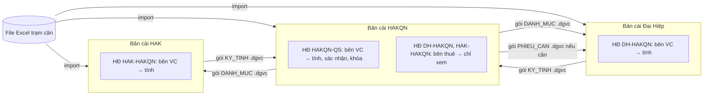

# DATA_STORAGE_DESIGN.md — Thiết kế lưu trữ dữ liệu (Bước 7 — bản DESKTOP)

> **Thay thế** `DATABASE_DESIGN.md` (bản Google Sheets / PostgreSQL). Quyết định ngày 24/09/2026: **phần mềm desktop Electron, chạy offline, không dùng SQL; dữ liệu lưu bằng file JSON có sao lưu; mỗi đơn vị một bản cài riêng; có tài khoản nội bộ.**
> Không đổi: 4 tài liệu nghiệp vụ v5, mọi công thức, cấu trúc bảng. Chỉnh: USERS (mật khẩu băm), KY_TINH (+ nguồn gốc kỳ), IMPORT_BATCH (+ SHA-256 file), CALC_RUN (nối giao dịch ghi); thêm EXCHANGE_LOG; bỏ SYS_LOG (log ra file).
> Kèm theo: `data_seed.zip` — 3 thư mục dữ liệu mẫu (bản cài **HAKQN**, **ĐH**, **HAK**) đọc từ 3 file Excel; đã kiểm chứng ra đúng **178.000 / 88.900 / 125.600**.

---

## 1. Kiến trúc phần mềm

```
┌──────────────────────── Electron app (1 file cài .exe, chạy offline) ─────────────────────────┐
│ RENDERER (giao diện)          PRELOAD                      MAIN PROCESS (Node.js)                 │
│ HTML/CSS/JS thuần             contextBridge:               ipc/router.js  ── 1 cổng 'api'        │
│ views/*.js (mỗi màn hình)  →  window.dgvc.api(a, p)  →     ├ auth/        đăng nhập, phiên, quyền │
│ không truy cập file/Node      ipcRenderer.invoke('api')    ├ services/    nghiệp vụ theo nhóm API │
│                                                            ├ engine/      công thức (hàm thuần)   │
│                                                            ├ import/      đọc Excel/CSV (exceljs) │
│                                                            ├ reports/     BKVC/BKCT → XLSX/PDF    │
│                                                            ├ exchange/    gói .dgvc               │
│                                                            ├ backup/      zip, khôi phục          │
│                                                            └ repo/        JsonStore + Journal     │
│                                                                   │                              │
└───────────────────────────────────────────────────────────────────┼──────────────────────────────┘
                                                                    ▼
                                                  Thư mục dữ liệu (vd D:\DGVC_DATA)
```

| Nguyên tắc | Cách làm |
|---|---|
| Tách tầng | UI chỉ gọi `window.dgvc.api(action, payload)`; nghiệp vụ, công thức, truy cập file đều ở main process. `engine/` là hàm thuần, không đọc file → unit test trực tiếp |
| An toàn Electron | `contextIsolation: true`, `nodeIntegration: false`, `sandbox: true`, CSP chặn mọi nguồn ngoài, không tải trang web nào |
| Offline hoàn toàn | Mọi thư viện đóng gói trong bản cài; không cần mạng để chạy, cài, cập nhật (bản mới = cài đè file .exe mới) |
| Đổi nơi lưu sau này | Chỉ `repo/` biết dữ liệu là file JSON; đổi kho lưu = thay 1 lớp |
| Thư viện | `exceljs` (đọc/ghi Excel), `yazl`/`yauzl` (zip sao lưu), Node `crypto` (scrypt, SHA-256), `zlib` (nén gói), `electron-builder` (đóng gói NSIS), `vitest` (test) |

Cấu trúc mã nguồn dự kiến (Bước 10):
```
app/
  main/  main.js · ipc/router.js · auth/ · services/ · engine/ · repo/JsonStore.js · repo/Journal.js · import/ · reports/ · exchange/ · backup/ · logger.js
  preload/preload.js
  renderer/ index.html · styles/ · views/ · components/
  shared/  api_spec.json · enums.js · errorCodes.js
  tests/   engine.test.js (đáp án = api_examples) · journal.crash.test.js · import.test.js
```

---

## 2. Mô hình triển khai: mỗi đơn vị một bản cài



| Quy tắc | |
|---|---|
| Bản cài gắn **1 đơn vị** (`manifest.unitCode`) | chọn lúc khởi tạo, không đổi được |
| **Ghi** kỳ tính, bảng kê dầu | chỉ với hợp đồng mà `carrier_unit_code` = đơn vị bản cài ("nhà thầu nào làm vận chuyển nhà thầu đó") — áp dụng cả với ADMIN |
| Hợp đồng mà đơn vị bản cài là **bên thuê** | có trong danh mục để xem; nhận kỳ của bên VC qua gói `KY_TINH` → lưu `origin = IMPORTED`, chỉ xem, in lại được |
| Danh mục chung (đơn vị, xe, tuyến, giá) | **chốt 25/09/2026: không có bản gốc** — bản cài của nhà máy nào cũng sửa được và xuất gói `DANH_MUC`; APP nhắc sửa giống ở các nhà máy còn lại (bảng `SYNC_REMINDER`, `CONFIG.SYNC_TARGET_UNITS`) |
| Phiếu cân | mỗi bản cài import file Excel trạm cân; `ticket_id` suy ra từ `ticket_key` nên giống nhau ở mọi bản cài → gộp gói không trùng |

---

## 3. Thư mục dữ liệu

```
D:\DGVC_DATA\                      (người dùng chọn lúc khởi tạo; mặc định %USERPROFILE%\Documents\DGVC_DATA)
  manifest.json                    định danh bản cài + danh sách file + SHA-256 + dataVersion + bộ đếm ID
  .lock                            khóa thư mục khi APP đang mở {pid, host, user, heartbeatAt}
  tables\
    DON_VI.json  XE.json  TUYEN_VC.json  PRICE_HISTORY.json  HOP_DONG.json  HOP_DONG_XE.json
    IMPORT_BATCH.json  KY_TINH.json  TRANSPORT_CALCULATION.json  BKVC_LINE.json  CALC_RUN.json
    USERS.json  CONFIG.json  EXCHANGE_LOG.json
    PHIEU_CAN\2026.json            ┐
    GIAO_NHAN_DAU\2026.json        │ bảng lớn: 1 file / năm
    TRANSPORT_DETAIL\2026.json     │
    FUEL_DETAIL\2026.json          │
    AUDIT_LOG\2026.json            ┘
  journal\                         giao dịch ghi đang dở (rỗng khi bình thường)
  backups\daily\  backups\monthly\  backups\manual\
  exports\                         file xuất mặc định (BKVC.pdf, gói .dgvc…)
  logs\app-2026-09-24.log          log kỹ thuật (thay SYS_LOG), giữ 90 ngày
```

**File bảng**
```json
{ "table": "PHIEU_CAN", "partition": "2026", "schemaVersion": 1,
  "columns": ["ticket_id", "ticket_key", "..."],
  "rows": [ { "ticket_id": "PC-3f9c1a…", "ticket_key": "573|2026-09-18|43H-01080", "net_kg": 17470, "...": "..." } ] }
```

**manifest.json**
```json
{ "app": "DGVC", "schemaVersion": 1, "installId": "INS-0E901607CE", "installCode": "DH", "unitCode": "DH",
  "createdAt": "…", "dataVersion": 1, "lastBackupAt": null,
  "sequences": { "GD": 16, "KY": 0, "TC": 0, "CR": 0, "IB": 2, "EX": 0, "AL": 0 },
  "files": { "tables/PHIEU_CAN/2026.json": { "sha256": "…", "rows": 77 } } }
```

| Quy ước | |
|---|---|
| Kiểu | ngày `yyyy-MM-dd`, giờ `HH:mm:ss`, ngày giờ ISO `+07:00` (chuỗi); số là JSON number; TRUE/FALSE là boolean; cột JSON lưu chuỗi JSON |
| ID | `PC-` + SHA-1(ticket_key)[:12] cho phiếu cân (giống nhau mọi bản cài); ID khác = `<tiền tố>-<mã bản cài>-<số tăng>` (vd `GD-DH-00016`, `KY-HAKQN-000003`) → không đụng nhau khi trao đổi |
| Khóa duy nhất, khóa ngoại, CHECK | kiểm trong `repo/` bằng chỉ mục dựng trong bộ nhớ (Map) trước mỗi lần ghi |
| Xóa | không xóa dòng: danh mục `is_active = false`, dữ liệu nhập `is_deleted = true` |
| Không sửa tay file | APP kiểm SHA-256 mỗi lần mở; file bị sửa ngoài APP → `INTEGRITY_ERROR`, đề nghị khôi phục sao lưu |

---

## 4. Ghi an toàn (thay cho transaction của SQL)

Mọi thao tác ghi đi qua **một hàng đợi** trong main process (chỉ 1 giao dịch tại 1 thời điểm) và thuật toán **journal 2 pha**:

```
BẮT ĐẦU giao dịch (vd periods.calculate chạm 6 bảng)
 1. Tính nội dung mới của mọi file bị chạm — trong bộ nhớ, kiểm khóa duy nhất / khóa ngoại / CHECK
 2. Ghi journal\txn-<id>.json  {state: PREPARED, files:[{rel, sha256Mới}]}               (fsync)
 3. Ghi từng file mới ra <file>.new                                                       (fsync)
 4. Đổi journal → state: COMMITTING                                                       (fsync)
 5. Với từng file: <file> → <file>.bak ; <file>.new → <file>   (đổi tên — nguyên tử trên NTFS)
 6. Ghi manifest.json.new (sha256 mới, dataVersion + 1) → đổi tên thành manifest.json
 7. Xóa .bak và journal → XONG
KHI MỞ APP: còn journal?
   PREPARED   → xóa các .new  (hoàn tác — dữ liệu như trước giao dịch)
   COMMITTING → đổi nốt các .new còn lại thành file chính, ghi manifest (làm tiếp cho xong)
```

- Mất điện / APP bị tắt ở bất kỳ bước nào → dữ liệu là trạng thái **trước** hoặc **sau** giao dịch, không bao giờ nửa vời.
- `CALC_RUN.journal_id` nối lần tính với giao dịch ghi để truy vết.
- **Khóa thư mục** `.lock`: APP thứ 2 (máy khác trỏ cùng thư mục, hoặc mở 2 lần) nhận `DATA_LOCKED`. Khóa có nhịp tim 60 giây; khóa không cập nhật > 3 phút coi là khóa chết → hỏi người dùng có chiếm quyền không.

---

## 5. Sao lưu và khôi phục

| Loại | Khi nào | Giữ | Nội dung |
|---|---|---|---|
| Hằng ngày | lần ghi đầu tiên mỗi ngày | 30 bản (`BACKUP_DAILY_KEEP`) | `manifest.json` + `tables\` nén `.zip` |
| Hằng tháng | ngày đầu tháng | 24 bản (`BACKUP_MONTHLY_KEEP`) | như trên |
| Thủ công | nút **Sao lưu ngay** | không tự xóa | như trên + ghi chú |
| An toàn | trước khi **khôi phục**, **nhập gói**, **đổi thư mục** | 10 bản gần nhất | như trên |
| Sao lưu ra ngoài (tùy chọn) | sau mỗi bản ngày | theo thư mục đích | copy file zip sang `BACKUP_MIRROR_FOLDER` (USB, ổ mạng, thư mục Google Drive for Desktop) |

Khôi phục: chọn bản → APP kiểm SHA-256 trong zip → tạo bản an toàn của hiện trạng → thay `tables\` + `manifest.json` → mở lại. Có trong AUDIT_LOG (`RESTORE`, lý do). Cảnh báo `W_BACKUP_OLD` nếu quá 7 ngày chưa sao lưu.

---

## 6. Chống tính trùng, trạng thái kỳ

Không đổi so với bản trước — trạng thái sử dụng lưu ở `TRANSPORT_DETAIL.usage_state` / `FUEL_DETAIL.usage_state` theo **(hợp đồng, phiếu)**:

| `usage_state` | Kỳ | Đưa vào kỳ khác **cùng hợp đồng**? |
|---|---|---|
| `DRAFT` | `NHAP` | cảnh báo, cho chuyển (kỳ cũ `needs_recalc`) |
| `CONFIRMED` | `DA_XAC_NHAN` | **chặn** — "Phiếu cân này đã được sử dụng trong kỳ tính [Mã kỳ]. Không thể đưa vào kỳ mới." |
| `LOCKED` | `DA_KHOA` | **chặn** (mở khóa: ADMIN / `can_unlock`, có lý do) |
| `RELEASED` | `HUY` | dùng lại được |

Kỳ `IMPORTED` (nhận qua gói) không tham gia kiểm trùng của bản cài nhận, vì bản cài đó không phải bên vận chuyển của hợp đồng.

---

## 7. Tài khoản và bảo mật

| Nội dung | Cách làm |
|---|---|
| Mật khẩu | băm **scrypt** (N=16384, r=8, p=1, salt 16 byte ngẫu nhiên) bằng Node `crypto`; không lưu, không log mật khẩu gốc |
| Lần đầu | dữ liệu mẫu và user mới tạo **không có mật khẩu** → đăng nhập lần đầu bắt đặt mật khẩu (≥ 8 ký tự, có chữ và số) — không có mật khẩu mặc định chung |
| Sai mật khẩu | 5 lần liên tiếp → khóa 15 phút (`LOGIN_MAX_FAILED`, `LOGIN_LOCK_MINUTES`) |
| Phiên | token ngẫu nhiên chỉ giữ trong bộ nhớ main process; không thao tác 60 phút → đăng xuất |
| Quên mật khẩu | ADMIN `users.resetPassword` → user tự đặt lại. Không ADMIN nào nhớ mật khẩu → chạy công cụ khôi phục đi kèm bản cài (cần quyền Windows trên máy) |
| Dữ liệu trên đĩa | không mã hóa (để sao lưu / khôi phục đơn giản); bảo vệ bằng quyền thư mục Windows và BitLocker của máy nếu cần |
| ADMIN mặc định | `saoluucvhak@gmail.com`, `phuthuy.apple@gmail.com` (tên đăng nhập) — có trong cả 3 bản cài mẫu |

---

## 8. Gói trao đổi `.dgvc`

**Định dạng**: JSON nén gzip. `contentSha256` = SHA-256 của `tables` ở dạng JSON chuẩn (khóa sắp xếp, không khoảng trắng, số viết như JavaScript).
```json
{ "header": { "format": "DGVC-PKG", "formatVersion": 1, "packageType": "KY_TINH", "schemaVersion": 1,
              "sourceInstallId": "INS-0E901607CE", "sourceUnitCode": "DH", "targetUnitCode": "HAKQN",
              "createdAt": "…", "createdBy": "ketoan.dh", "appVersion": "1.0.0", "periodCodes": ["DH-HAKQN/20260918-20260923"] },
  "contentSha256": "sha256 của tables (JSON chuẩn hóa, khóa sắp xếp)",
  "tables": { "KY_TINH": […], "TRANSPORT_CALCULATION": […], "TRANSPORT_DETAIL": […], "FUEL_DETAIL": […], "BKVC_LINE": […],
              "PHIEU_CAN": […], "GIAO_NHAN_DAU": […], "HOP_DONG": […], "HOP_DONG_XE": […] } }
```

| Loại gói | Nội dung | Ai xuất → ai nhận |
|---|---|---|
| `DANH_MUC` | DON_VI, XE, TUYEN_VC, PRICE_HISTORY, HOP_DONG (+ xe) mà bên nhận là 1 bên | bản cài bất kỳ → các nhà máy còn lại (tự đánh dấu nhắc sửa danh mục đã gửi) |
| `PHIEU_CAN` | phiếu cân theo ngày / xe | bản có file trạm cân → bản khác (khi bên kia không có file Excel) |
| `KY_TINH` | kỳ **đã xác nhận / đã khóa** + kết quả + chi tiết + BKVC + phiếu + dòng dầu đã dùng | bên vận chuyển → bên thuê |

**Quy tắc gộp khi nhập** (luôn qua bước xem trước; tự sao lưu an toàn trước khi ghi):

| Bảng | Quy tắc |
|---|---|
| DON_VI, XE, TUYEN_VC | theo khóa chính; bản đến mới hơn (`updated_at`) và bản cục bộ không đổi kể từ lần nhập trước → cập nhật; cả hai cùng đổi → **xung đột**, người dùng chọn |
| PRICE_HISTORY | phiên bản giá không sửa: `price_id` mới → thêm; trùng id khác nội dung → xung đột |
| HOP_DONG, HOP_DONG_XE | chỉ nhận hợp đồng mà đơn vị bản cài là 1 bên |
| PHIEU_CAN | theo `ticket_id`: chưa có → thêm; giống → bỏ qua; khác số liệu (KG, ngày, xe) → **xung đột** (nghi dữ liệu trạm cân khác nhau) |
| KY_TINH + kết quả | bản cài nhận phải là **bên thuê** của HĐ; lưu `origin = IMPORTED`, `package_sha256`; gói mới hơn của cùng kỳ (`calc_version` lớn hơn, sau khi bên VC mở lại & tính lại) → thay bản cũ, giữ lịch sử trong AUDIT_LOG |
| GIAO_NHAN_DAU | ID mang mã bản cài nguồn → thêm, không đụng dữ liệu cục bộ |
| CONFIG, USERS, AUDIT_LOG | **không** trao đổi |

**Ví dụ thật** (`api_examples/DH-HAKQN_20260918-20260923.dgvc`, 12,6 KB): ĐH xuất kỳ DH-HAKQN đã xác nhận → HAKQN xem trước: 77 phiếu cân **đã có** (cùng `ticket_id`) → bỏ qua; mới: 16 dòng dầu, 1 kỳ, 1 kết quả, 77 chi tiết phiếu, 16 chi tiết dầu, 5 dòng BKVC; 0 xung đột; tóm tắt 88.900 đ/tấn, 139.421.905 đ.

---

## 9. Hiệu năng và dung lượng

| | Giá trị |
|---|---|
| Kích thước phiếu cân | ~1,4 KB / dòng JSON (gồm `raw_row_json`) |
| Bản cài HAKQN (~20.000 phiếu / năm) | `PHIEU_CAN\2026.json` ≈ 27 MB; toàn bộ dữ liệu 1 năm ≈ 45–60 MB |
| Mở APP | đọc toàn bộ file năm hiện tại vào bộ nhớ + dựng chỉ mục: ~1 s |
| Ghi | ghi lại cả file bị chạm (file năm lớn nhất ~27 MB): 0,2–0,5 s / giao dịch |
| Năm cũ | chỉ đọc khi tra cứu / báo cáo năm đó |
| Ngưỡng đổi cách chia | file năm > 50 MB → chia theo tháng (tham số, không đổi code nghiệp vụ) |

---

## 10. Chi tiết từng bảng

### 10.1. Danh mục

#### `DON_VI` — Đơn vị / công ty (bên thuê, bên vận chuyển, chủ xe, bên giao dầu)

PK `unit_code` · + 5 cột audit chung · file: `tables/DON_VI.json` · mẫu: HAKQN **5** · ĐH **5** · HAK **5**

| Cột | Kiểu | Bắt buộc | Ràng buộc / ghi chú | Nguồn Excel |
|---|---|---|---|---|
| `unit_code` | text | ✔ | PK. vd CNHAK, HAKQN, HAK, DH |  |
| `unit_name` | text | ✔ | tên pháp lý đầy đủ | Danh mục công ty |
| `short_name` | text | ✔ | tên viết tắt: HAK, HAKQN, Đại Hiệp, CN Quế Sơn | Danh mục công ty |
| `unit_type` | một trong: CONG_TY / CHI_NHANH | ✔ |  | Danh mục công ty[Loại] |
| `name_aliases` | text |  | các cách viết khác (vd trong cột `Đơn vị VC` phiếu cân), phân cách `;` — dùng khi import | TBL_VC[Đơn vị VC] |
| `tax_code` | text |  | MST | Danh mục công ty |
| `address` | text |  | in trên báo cáo | Danh mục công ty |
| `legal_rep_name` | text |  | người đại diện theo danh mục công ty (tham khảo; người ký BKVC theo quy tắc BL-66) | Danh mục công ty |
| `legal_rep_salutation` | một trong: Ông / Bà |  |  | Danh mục công ty[Xưng hô] |
| `legal_rep_title` | text |  |  | Danh mục công ty[Chức vụ] |
| `factory_name` | text |  | Nhà máy (ủy thác) | Danh mục công ty |
| `email` | text |  |  | Danh mục công ty |
| `phone` | text |  |  | Danh mục công ty |
| `doc_display_name` | text |  | tên ghi trên chứng từ xuất hàng | Danh mục công ty |
| `sign_priority` | số nguyên | ✔ | thứ tự ký: 1 HAK, 2 HAKQN, 3 ĐH, 4 CNHAK (đơn vị ngoài tập đoàn: 90+) — bên số nhỏ hơn ký bằng người ký chính | chỉ đạo 24/09/2026 |
| `accountant_name` | text |  | kế toán ký BKVC phía đơn vị này — người dùng tự điền | BKVC!D32, I33 |
| `fuel_prefix` | text |  | tiền tố mã xe trong bảng kê dầu: DN / DH / QC | TBL_GIAONHANDAU[Biển số xe] |
| `is_active` | true/false | ✔ |  |  |
| `note` | text |  |  |  |

#### `XE` — Xe vận chuyển

PK `plate_no` · UNIQUE `plate_key` · + 5 cột audit chung · file: `tables/XE.json` · mẫu: HAKQN **17** · ĐH **17** · HAK **17**

| Cột | Kiểu | Bắt buộc | Ràng buộc / ghi chú | Nguồn Excel |
|---|---|---|---|---|
| `plate_no` | text | ✔ | PK. dạng chuẩn `43H-01080` | TBL_VC[Biển số 1] |
| `plate_key` | text | ✔ | UNIQUE. bỏ gạch/khoảng trắng, in hoa: `43H01080` — khóa quy đổi mã xe dầu |  |
| `owner_unit_code` | text | ✔ | FK DON_VI — công ty sở hữu xe |  |
| `fuel_code` | text |  | mã xe dùng trong sổ xuất dầu: `DN_43H01080` | Sheet3[Mã thống kê] |
| `is_active` | true/false | ✔ |  |  |
| `note` | text |  |  |  |

#### `TUYEN_VC` — Tuyến vận chuyển (phần định danh của TBL_DATA)

PK `route_code` · + 5 cột audit chung · file: `tables/TUYEN_VC.json` · mẫu: HAKQN **12** · ĐH **12** · HAK **12**

| Cột | Kiểu | Bắt buộc | Ràng buộc / ghi chú | Nguồn Excel |
|---|---|---|---|---|
| `route_code` | text | ✔ | PK. `VC.007` | TBL_DATA[Mã quãng đường] |
| `route_name` | text | ✔ |  | TBL_DATA[Tuyến] |
| `distance_km` | số | ✔ | > 0, một chiều | TBL_DATA[Cự ly] |
| `trip_distance_km` | số | ✔ | > 0, khứ hồi — dùng trong mọi công thức | TBL_DATA[Cự ly/chuyến] |
| `uom` | một trong: TAN / M3 | ✔ | chuẩn hóa từ `Tấn`/`M3` | TBL_DATA[Đơn vị tính] |
| `catalog_unit_code` | text |  | FK DON_VI — đơn vị VC ghi trong bảng giá gốc: HAK = Công ty TNHH Hoàng Anh Khôi, HHH = Công ty Hùng Hoàng Hoa (tham khảo, không dùng tính) | TBL_DATA[Đơn vị VC] |
| `is_active` | true/false | ✔ | ngừng sử dụng thay cho xóa |  |
| `note` | text |  |  |  |

#### `PRICE_HISTORY` — Phiên bản đơn giá theo tuyến (phần giá của TBL_DATA) — không ghi đè

PK `price_id` · UNIQUE `route_code + contract_id + effective_from` · + 5 cột audit chung · file: `tables/PRICE_HISTORY.json` · mẫu: HAKQN **12** · ĐH **12** · HAK **12**

| Cột | Kiểu | Bắt buộc | Ràng buộc / ghi chú | Nguồn Excel |
|---|---|---|---|---|
| `price_id` | text | ✔ | PK |  |
| `route_code` | text | ✔ | FK TUYEN_VC | TBL_DATA[Mã quãng đường] |
| `contract_id` | text |  | FK HOP_DONG. Trống = giá chung mọi hợp đồng; có giá trị = giá riêng của hợp đồng (BL-64) |  |
| `version_no` | số nguyên | ✔ | 1, 2, 3… theo tuyến (+hợp đồng) |  |
| `effective_from` | ngày | ✔ |  | TBL_DATA[Ngày cập nhật] |
| `effective_to` | ngày |  | tự đóng = ngày hiệu lực bản mới − 1 |  |
| `base_price_excl_vat` | số | ✔ | tham khảo | TBL_DATA[Đơn Giá (chưa VAT)] |
| `price_per_km` | số |  | tham khảo, không dùng tính | TBL_DATA[Giá/km] |
| `new_price` | số | ✔ | >= 0 — dùng tính ĐG 1 chuyến | TBL_DATA[Đơn giá mới] |
| `fuel_price_excl_vat` | số | ✔ | > 0 — giá dầu cơ sở | TBL_DATA[ĐG dầu chưa VAT] |
| `fuel_norm_l_per_km` | số | ✔ | > 0 — lít/km (0,4 = 40 l/100km) | TBL_DATA[ĐM dầu_100km] |
| `avg_load_ton` | số | ✔ | > 0 | TBL_DATA[KL_TB] |
| `avg_volume_m3` | số |  | > 0 nếu tuyến M3 | TBL_DATA[Thể tích TB] |
| `status` | một trong: DRAFT / ACTIVE / CLOSED | ✔ |  |  |
| `is_used` | true/false | ✔ | TRUE khi đã có kỳ dùng → cấm sửa/xóa (BL-02) |  |
| `source_note` | text |  | nguồn/căn cứ đổi giá |  |

#### `HOP_DONG` — Hợp đồng vận chuyển 2 bên (bên vận chuyển lập tính toán)

PK `contract_id` · UNIQUE `contract_code` · + 5 cột audit chung · file: `tables/HOP_DONG.json` · mẫu: HAKQN **3** · ĐH **1** · HAK **1**

| Cột | Kiểu | Bắt buộc | Ràng buộc / ghi chú | Nguồn Excel |
|---|---|---|---|---|
| `contract_id` | text | ✔ | PK |  |
| `contract_code` | text | ✔ | UNIQUE. mã ngắn: `HAKQN-QS`, `DH-HAKQN` |  |
| `contract_no` | text |  | số HĐVC — **người dùng tự điền**, APP không tự sinh | CAN[Số HĐVC] |
| `customer_unit_code` | text | ✔ | FK DON_VI — bên thuê |  |
| `carrier_unit_code` | text | ✔ | FK DON_VI — bên vận chuyển; ≠ bên thuê |  |
| `effective_from` | ngày | ✔ | người dùng tự điền khi tạo hợp đồng |  |
| `effective_to` | ngày |  | người dùng tự điền; trống = chưa hết hạn |  |
| `report_title` | text |  | tiêu đề BKVC, mặc định `BẢNG XÁC NHẬN KHỐI LƯỢNG VẬN CHUYỂN DĂM` | BKVC!A4 |
| `service_desc` | text |  | diễn giải cước (điểm đi – điểm đến) | BKVC!C37 |
| `sign_place` | text |  | vd `Quế Sơn Trung` | BKVC!G26 |
| `customer_signers_json` | JSON |  | trống = tự xác định theo quy tắc ký (BL-66); có giá trị = ghi đè [{title, name}] | BKVC!G27:J33 |
| `carrier_signers_json` | JSON |  | như trên, cho bên vận chuyển | BKVC!A27:E33 |
| `is_active` | true/false | ✔ | bật/tắt |  |
| `note` | text |  |  |  |

#### `HOP_DONG_XE` — Phạm vi xe của hợp đồng

PK `id` · UNIQUE `contract_id + plate_no + effective_from` · + 5 cột audit chung · file: `tables/HOP_DONG_XE.json` · mẫu: HAKQN **27** · ĐH **5** · HAK **5**

| Cột | Kiểu | Bắt buộc | Ràng buộc / ghi chú | Nguồn Excel |
|---|---|---|---|---|
| `id` | text | ✔ | PK |  |
| `contract_id` | text | ✔ | FK HOP_DONG |  |
| `plate_no` | text | ✔ | FK XE |  |
| `effective_from` | ngày | ✔ |  |  |
| `effective_to` | ngày |  |  |  |


### 10.2. Đầu vào

#### `PHIEU_CAN` — Phiếu cân — 1 dòng = 1 chuyến; dùng chung cho mọi hợp đồng

PK `ticket_id` · UNIQUE `ticket_key` · + 5 cột audit chung · file: `tables/PHIEU_CAN/<năm>.json` (theo năm `weigh1_date`) · mẫu: HAKQN **326** · ĐH **77** · HAK **100**

| Cột | Kiểu | Bắt buộc | Ràng buộc / ghi chú | Nguồn Excel |
|---|---|---|---|---|
| `ticket_id` | text | ✔ | PK = `PC-` + 12 ký tự đầu SHA-1(ticket_key) → giống nhau ở mọi bản cài (gộp gói dữ liệu không trùng) |  |
| `ticket_key` | text | ✔ | UNIQUE chống trùng = ticket_no/weigh1_date/plate_no (Q16) |  |
| `ticket_no` | text | ✔ | lưu text | TBL_VC[Số\n phiếu] |
| `row_no` | text |  |  | TBL_VC[Stt] |
| `weigh1_date` | ngày | ✔ |  | TBL_VC[Ngày cân 1] |
| `weigh1_time` | giờ |  |  | TBL_VC[Giờ cân 1] |
| `weigh2_date` | ngày | ✔ | >= weigh1_date | TBL_VC[Ngày cân 2] |
| `weigh2_time` | giờ |  |  | TBL_VC[Giờ cân 2] |
| `plate_no` | text | ✔ | FK XE (dạng chuẩn) | TBL_VC[Biển số 1] |
| `weight1_kg` | số |  |  | TBL_VC[Cân lần 1] |
| `weight2_kg` | số |  |  | TBL_VC[Cân lần 2] |
| `net_kg` | số | ✔ | > 0 | TBL_VC[KL hàng (KG)] |
| `origin` | text |  |  | TBL_VC[Nguồn gốc] |
| `customer` | text |  |  | TBL_VC[Khách hàng] |
| `ldd` | text |  |  | TBL_VC[LDĐ] |
| `weigh_type` | text |  |  | TBL_VC[Kiểu cân] |
| `route_code` | text | ✔ | FK TUYEN_VC | TBL_VC[Mã cự ly VC] |
| `transport_unit_name` | text |  | giữ nguyên gốc | TBL_VC[Đơn vị VC] |
| `owner_unit_code` | text |  | FK DON_VI — quy đổi từ tên hoặc từ XE |  |
| `validation_flags` | text |  | mã lỗi/cảnh báo, phân cách `;` |  |
| `flags_ack` | true/false |  | TRUE = người dùng đã kiểm tra cảnh báo và xác nhận giữ nguyên |  |
| `flags_ack_note` | text |  | lý do / người xác nhận |  |
| `import_batch_id` | text |  | FK IMPORT_BATCH |  |
| `raw_row_json` | JSON |  | nguyên dòng gốc — không mất dữ liệu |  |
| `is_deleted` | true/false | ✔ | xóa mềm; cấm nếu đang dùng ở kỳ |  |

#### `GIAO_NHAN_DAU` — Bảng kê giao nhận dầu — mỗi dòng thuộc bảng kê của 1 hợp đồng

PK `receipt_id` · + 5 cột audit chung · file: `tables/GIAO_NHAN_DAU/<năm>.json` (theo năm `receive_date`) · mẫu: HAKQN **18** · ĐH **16** · HAK **13**

| Cột | Kiểu | Bắt buộc | Ràng buộc / ghi chú | Nguồn Excel |
|---|---|---|---|---|
| `receipt_id` | text | ✔ | PK = `GD-<mã bản cài>-<số tăng>` → không đụng ID của bản cài khác |  |
| `contract_id` | text | ✔ | FK HOP_DONG — bảng kê của hợp đồng nào |  |
| `receive_date` | ngày | ✔ |  | TBL_GIAONHANDAU[Ngày nhận dầu] |
| `route_code` | text | ✔ | FK TUYEN_VC | TBL_GIAONHANDAU[Mã cự ly VC] |
| `fuel_vehicle_code` | text | ✔ | nguyên gốc: `DH_92H00192`, `92H-00192`, `92H00195` | TBL_GIAONHANDAU[Biển số xe] |
| `plate_no` | text |  | FK XE — quy đổi (bỏ tiền tố XX_, bỏ gạch → plate_key) |  |
| `owner_unit_code` | text |  | FK DON_VI — qua XE, để truy vết |  |
| `uom` | text | ✔ | `LÍT` | TBL_GIAONHANDAU[ĐVT] |
| `qty_liter` | số | ✔ | > 0 | TBL_GIAONHANDAU[Số lượng (lít)] |
| `fuel_price_excl_vat` | số | ✔ | > 0, chưa VAT (Q2) | TBL_GIAONHANDAU[Đơn giá dầu] |
| `purchase_date` | ngày |  |  | TBL_GIAONHANDAU[Ngày mua dầu] |
| `giver_unit_code` | text | ✔ | FK DON_VI — cột `Đơn vị` (CNHAK / HAKQN) | TBL_GIAONHANDAU[Đơn vị] |
| `validation_flags` | text |  |  |  |
| `flags_ack` | true/false |  | TRUE = người dùng đã kiểm tra cảnh báo và xác nhận giữ nguyên |  |
| `flags_ack_note` | text |  | lý do / người xác nhận |  |
| `import_batch_id` | text |  | FK IMPORT_BATCH |  |
| `raw_row_json` | JSON |  |  |  |
| `is_deleted` | true/false | ✔ |  |  |

#### `IMPORT_BATCH` — Lô import (preview → xác nhận)

PK `batch_id` · + 5 cột audit chung · file: `tables/IMPORT_BATCH.json` · mẫu: HAKQN **2** · ĐH **2** · HAK **2**

| Cột | Kiểu | Bắt buộc | Ràng buộc / ghi chú | Nguồn Excel |
|---|---|---|---|---|
| `batch_id` | text | ✔ | PK |  |
| `import_type` | một trong: PHIEU_CAN / GIAO_NHAN_DAU / PRICE | ✔ |  |  |
| `contract_id` | text |  | bắt buộc khi import dầu |  |
| `file_name` | text | ✔ |  |  |
| `file_sha256` | text |  | dấu kiểm file nguồn — cảnh báo khi import lại cùng file |  |
| `sheet_name` | text |  |  |  |
| `header_json` | JSON |  | header gốc |  |
| `mapping_json` | JSON |  | cột gốc → cột DB |  |
| `total_rows` | số nguyên | ✔ |  |  |
| `ok_rows` | số nguyên | ✔ |  |  |
| `warning_rows` | số nguyên | ✔ |  |  |
| `error_rows` | số nguyên | ✔ |  |  |
| `duplicate_rows` | số nguyên | ✔ |  |  |
| `status` | một trong: PREVIEW / CONFIRMED / CANCELLED | ✔ |  |  |
| `confirmed_at` | ngày giờ |  |  |  |
| `confirmed_by` | text |  |  |  |


### 10.3. Kết quả

#### `KY_TINH` — Kỳ tính của 1 hợp đồng

PK `period_id` · UNIQUE `period_code` · + 5 cột audit chung · file: `tables/KY_TINH.json` · mẫu: HAKQN **0** · ĐH **0** · HAK **0**

| Cột | Kiểu | Bắt buộc | Ràng buộc / ghi chú | Nguồn Excel |
|---|---|---|---|---|
| `period_id` | text | ✔ | PK = `KY-<mã bản cài>-<số tăng>` |  |
| `period_code` | text | ✔ | UNIQUE. `HAKQN-QS/20260918-20260923` |  |
| `contract_id` | text | ✔ | FK HOP_DONG |  |
| `date_from` | ngày | ✔ |  | BKVC!A5 |
| `date_to` | ngày | ✔ | >= date_from | BKVC!A5 |
| `route_filter` | text |  | trống = mọi tuyến |  |
| `status` | một trong: NHAP / DA_XAC_NHAN / DA_KHOA / HUY | ✔ |  |  |
| `calc_version` | số nguyên | ✔ | số lần tính |  |
| `current_run_id` | text |  | FK CALC_RUN của lần tính hiện hành |  |
| `config_snapshot_json` | JSON |  | làm tròn, VAT, phương pháp… tại lúc tính (BL-37) |  |
| `needs_recalc` | true/false | ✔ | TRUE khi dữ liệu nguồn bị sửa sau khi tính |  |
| `report_date` | ngày |  | ngày ký trên BKVC | BKVC!G26 |
| `calculated_at` | ngày giờ |  |  |  |
| `calculated_by` | text |  |  |  |
| `confirmed_at` | ngày giờ |  |  |  |
| `confirmed_by` | text |  |  |  |
| `locked_at` | ngày giờ |  |  |  |
| `locked_by` | text |  |  |  |
| `origin` | một trong: LOCAL / IMPORTED | ✔ | IMPORTED = kỳ nhận từ gói của bên vận chuyển khác — chỉ xem, không sửa |  |
| `origin_install_id` | text |  | bản cài đã lập kỳ |  |
| `package_sha256` | text |  | dấu kiểm của gói khi nhập |  |
| `note` | text |  |  |  |

#### `TRANSPORT_CALCULATION` — Kết quả tính 1 tuyến trong 1 kỳ (thay QR_DGVC4) — lưu cả số trung gian + snapshot

PK `calc_id` · file: `tables/TRANSPORT_CALCULATION.json` · mẫu: HAKQN **0** · ĐH **0** · HAK **0**

| Cột | Kiểu | Bắt buộc | Ràng buộc / ghi chú | Nguồn Excel |
|---|---|---|---|---|
| `calc_id` | text | ✔ | PK |  |
| `period_id` | text | ✔ | FK KY_TINH |  |
| `run_id` | text | ✔ | FK CALC_RUN |  |
| `calc_version` | số nguyên | ✔ |  |  |
| `is_current` | true/false | ✔ | chỉ 1 dòng current / (period, route) |  |
| `contract_id` | text | ✔ |  |  |
| `route_code` | text | ✔ |  | QR_DGVC[Mã tuyến] |
| `route_name` | text | ✔ | snapshot | QR_DGVC[Tuyến] |
| `uom` | text | ✔ | snapshot |  |
| `price_id` | text | ✔ | phiên bản giá đã dùng |  |
| `trip_distance_km` | số | ✔ | snapshot | QR_DGVC[Cự ly tuyến] |
| `new_price` | số | ✔ | snapshot (sau ép Int64 nếu bật) |  |
| `avg_load_ton` | số | ✔ | snapshot |  |
| `avg_volume_m3` | số |  | snapshot |  |
| `fuel_price_catalog` | số | ✔ | snapshot giá dầu cơ sở |  |
| `fuel_norm_l_per_km` | số | ✔ | snapshot | QR_DGVC[Định mức dầu Diezel] |
| `start_date` | ngày | ✔ | min(weigh1_date) | QR_DGVC[Ngày bắt đầu] |
| `end_date` | ngày | ✔ | max(weigh2_date) | QR_DGVC[Ngày kết thúc] |
| `trip_count` | số nguyên | ✔ |  | QR_DGVC[Số chuyến] |
| `total_kg` | số | ✔ |  |  |
| `total_ton` | số | ✔ |  | QR_DGVC[Tổng KL (Tấn)] |
| `fuel_giver_unit` | text |  |  |  |
| `fuel_uom` | text |  |  |  |
| `fuel_line_count` | số nguyên | ✔ |  |  |
| `actual_fuel_liter` | số |  |  | QR_DGVC[Dầu Diezel thực nhận] |
| `fuel_start_date` | ngày |  |  |  |
| `fuel_end_date` | ngày |  |  |  |
| `fuel_price` | số |  | TB cộng | QR_DGVC[Đơn giá dầu] |
| `fuel_import_date` | ngày |  | max(purchase_date) | QR_DGVC[Ngày nhập dầu] |
| `trip_price` | số | ✔ | ĐG 1 chuyến | QR_DATA[ĐG 1 Chuyến] |
| `fuel_per_trip` | số | ✔ |  | QR_DATA[Tiêu hao NL chuyến] |
| `fuel_cost_per_trip` | số | ✔ |  | QR_DATA[Tiền dầu] |
| `fuel_cost_ratio` | số | ✔ |  | QR_DATA[Tỷ lệ tiêu hao dầu] |
| `price_no_diesel` | số | ✔ |  | QR_DATA[ĐGVC_NODIEZEL] |
| `contract_price` | số | ✔ | ĐG_HĐ | QR_DGVC[Đơn giá theo hợp đồng…] |
| `standard_fuel_liter` | số | ✔ |  | QR_DGVC[Nhiên liệu … theo định mức (lít)] |
| `fuel_diff_liter` | số |  |  | QR_DGVC[CL Tiêu hao Diezel ] |
| `fuel_adjust_price` | số |  | ĐG CL Diesel | QR_DGVC[Đơn giá CL Diezel] |
| `transport_price_raw` | số |  | trước làm tròn |  |
| `transport_price` | số |  |  | QR_DGVC[Đơn giá vận chuyển] |
| `result_status` | một trong: OK / WARNING / ERROR | ✔ |  |  |
| `warnings_json` | JSON |  |  |  |
| `trace_json` | JSON | ✔ | chuỗi XEM CHI TIẾT TÍNH |  |
| `created_at` | ngày giờ | ✔ |  |  |
| `created_by` | text | ✔ |  |  |

#### `TRANSPORT_DETAIL` — Phiếu cân cấu thành 1 kết quả; cũng là bảng chống tính trùng theo hợp đồng

PK `id` · UNIQUE `contract_id + ticket_id WHERE is_current AND usage_state IN (CONFIRMED,LOCKED)` · file: `tables/TRANSPORT_DETAIL/<năm>.json` (theo năm `weigh1_date`) · mẫu: HAKQN **0** · ĐH **0** · HAK **0**

| Cột | Kiểu | Bắt buộc | Ràng buộc / ghi chú | Nguồn Excel |
|---|---|---|---|---|
| `id` | text | ✔ | PK |  |
| `calc_id` | text | ✔ | FK |  |
| `period_id` | text | ✔ | FK |  |
| `contract_id` | text | ✔ | denormalize để kiểm trùng nhanh |  |
| `ticket_id` | text | ✔ | FK PHIEU_CAN |  |
| `ticket_key` | text | ✔ | snapshot |  |
| `plate_no` | text | ✔ | snapshot — nguồn BKVC |  |
| `weigh1_date` | ngày | ✔ | snapshot |  |
| `net_kg` | số | ✔ | snapshot |  |
| `is_current` | true/false | ✔ |  |  |
| `usage_state` | một trong: DRAFT / CONFIRMED / LOCKED / RELEASED | ✔ | đồng bộ theo trạng thái kỳ |  |
| `created_at` | ngày giờ | ✔ |  |  |

#### `FUEL_DETAIL` — Dòng dầu cấu thành 1 kết quả

PK `id` · UNIQUE `contract_id + receipt_id WHERE is_current AND usage_state IN (CONFIRMED,LOCKED)` · file: `tables/FUEL_DETAIL/<năm>.json` (theo năm `created_at`) · mẫu: HAKQN **0** · ĐH **0** · HAK **0**

| Cột | Kiểu | Bắt buộc | Ràng buộc / ghi chú | Nguồn Excel |
|---|---|---|---|---|
| `id` | text | ✔ | PK |  |
| `calc_id` | text | ✔ | FK |  |
| `period_id` | text | ✔ | FK |  |
| `contract_id` | text | ✔ |  |  |
| `receipt_id` | text | ✔ | FK GIAO_NHAN_DAU |  |
| `qty_liter` | số | ✔ | snapshot |  |
| `fuel_price_excl_vat` | số | ✔ | snapshot |  |
| `is_current` | true/false | ✔ |  |  |
| `usage_state` | một trong: DRAFT / CONFIRMED / LOCKED / RELEASED | ✔ |  |  |
| `created_at` | ngày giờ | ✔ |  |  |

#### `BKVC_LINE` — Dòng bảng xác nhận khối lượng (1 dòng / xe / tuyến)

PK `id` · file: `tables/BKVC_LINE.json` · mẫu: HAKQN **0** · ĐH **0** · HAK **0**

| Cột | Kiểu | Bắt buộc | Ràng buộc / ghi chú | Nguồn Excel |
|---|---|---|---|---|
| `id` | text | ✔ | PK |  |
| `period_id` | text | ✔ | FK |  |
| `calc_id` | text | ✔ | FK — lấy đơn giá |  |
| `contract_id` | text | ✔ |  |  |
| `route_code` | text | ✔ |  |  |
| `seq` | số nguyên | ✔ | STT | BKVC[STT] |
| `plate_no` | text | ✔ |  | BKVC[Biển số xe] |
| `owner_unit_code` | text |  |  |  |
| `trip_count` | số nguyên | ✔ |  | BKVC[Số chuyến] |
| `kg` | số | ✔ |  | BKVC[Khối lượng (KG)] |
| `ton` | số | ✔ | kg/1000 | BKVC[Khối lượng (Tấn)] |
| `unit_price` | số | ✔ |  | BKVC[Đơn giá] |
| `amount` | số | ✔ | ROUND(ton×giá, 0) | BKVC[Thành tiền] |
| `vat_rate` | số | ✔ | 0.08 |  |
| `vat` | số | ✔ | ROUND(amount×vat_rate, 0) | BKVC[VAT (8%)] |
| `amount_incl_vat` | số | ✔ |  | BKVC[Thành tiền] |
| `note` | text |  |  | BKVC[Ghi chú] |
| `is_current` | true/false | ✔ |  |  |
| `created_at` | ngày giờ | ✔ |  |  |

#### `CALC_RUN` — Mỗi lần tính / xác nhận / khóa — nhật ký

PK `run_id` · file: `tables/CALC_RUN.json` · mẫu: HAKQN **0** · ĐH **0** · HAK **0**

| Cột | Kiểu | Bắt buộc | Ràng buộc / ghi chú | Nguồn Excel |
|---|---|---|---|---|
| `run_id` | text | ✔ | PK |  |
| `period_id` | text | ✔ | FK |  |
| `action` | một trong: CALC / RECALC / CONFIRM / LOCK / UNLOCK / CANCEL | ✔ |  |  |
| `status` | một trong: RUNNING / DONE / FAILED / ROLLED_BACK | ✔ |  |  |
| `started_at` | ngày giờ | ✔ |  |  |
| `finished_at` | ngày giờ |  |  |  |
| `username` | text | ✔ |  |  |
| `journal_id` | text |  | giao dịch ghi file (journal) tương ứng |  |
| `summary_json` | JSON |  | số dòng ghi mỗi bảng, thời gian chạy |  |
| `error_message` | text |  |  |  |


### 10.4. Hệ thống

#### `USERS` — Tài khoản nội bộ của bản cài

PK `username` · + 5 cột audit chung · file: `tables/USERS.json` · mẫu: HAKQN **2** · ĐH **2** · HAK **2**

| Cột | Kiểu | Bắt buộc | Ràng buộc / ghi chú | Nguồn Excel |
|---|---|---|---|---|
| `username` | text | ✔ | PK — tên đăng nhập (có thể là email), không phân biệt hoa thường |  |
| `full_name` | text | ✔ |  |  |
| `unit_code` | text |  | FK DON_VI — mặc định = đơn vị của bản cài; trống = ADMIN |  |
| `role` | một trong: ADMIN / KE_TOAN / XEM | ✔ |  |  |
| `can_unlock` | true/false | ✔ |  |  |
| `password_hash` | text |  | scrypt (Node crypto), base64 — không lưu mật khẩu gốc; trống = chưa đặt → bắt đặt khi đăng nhập lần đầu |  |
| `password_salt` | text |  | 16 byte ngẫu nhiên, base64 |  |
| `password_algo` | text |  | `scrypt:N=16384,r=8,p=1` |  |
| `must_change_password` | true/false | ✔ | TRUE khi ADMIN vừa tạo / đặt lại mật khẩu |  |
| `failed_attempts` | số nguyên | ✔ | sai 5 lần liên tiếp → khóa 15 phút |  |
| `locked_until` | ngày giờ |  |  |  |
| `is_active` | true/false | ✔ |  |  |
| `last_login_at` | ngày giờ |  |  |  |

#### `AUDIT_LOG` — Lịch sử thao tác — chỉ ghi thêm, không sửa/xóa

PK `log_id` · file: `tables/AUDIT_LOG/<năm>.json` (theo năm `ts`) · mẫu: HAKQN **0** · ĐH **0** · HAK **0**

| Cột | Kiểu | Bắt buộc | Ràng buộc / ghi chú | Nguồn Excel |
|---|---|---|---|---|
| `log_id` | text | ✔ | PK |  |
| `ts` | ngày giờ | ✔ |  |  |
| `username` | text | ✔ |  |  |
| `action` | text | ✔ | LOGIN/CREATE/UPDATE/DELETE/IMPORT/CALC/RECALC/CONFIRM/LOCK/UNLOCK/OVERRIDE/EXPORT_PACKAGE/IMPORT_PACKAGE/BACKUP/RESTORE… |  |
| `entity` | text | ✔ | tên sheet |  |
| `entity_id` | text | ✔ |  |  |
| `before_json` | JSON |  |  |  |
| `after_json` | JSON |  |  |  |
| `reason` | text |  | bắt buộc với UNLOCK / OVERRIDE |  |
| `run_id` | text |  |  |  |
| `device_info` | text |  | tên máy + user Windows + phiên bản APP |  |

#### `CONFIG` — Tham số nghiệp vụ dùng chung (làm tròn, VAT, người ký…) — phát hành từ máy gốc qua gói danh mục

PK `config_key` · file: `tables/CONFIG.json` · mẫu: HAKQN **29** · ĐH **29** · HAK **29**

| Cột | Kiểu | Bắt buộc | Ràng buộc / ghi chú | Nguồn Excel |
|---|---|---|---|---|
| `config_key` | text | ✔ | PK |  |
| `config_value` | text |  | trống = chưa thiết lập |  |
| `value_type` | một trong: TEXT / NUM / BOOL / JSON | ✔ |  |  |
| `description` | text |  |  |  |
| `updated_at` | ngày giờ |  |  |  |
| `updated_by` | text |  |  |  |

#### `EXCHANGE_LOG` — Gói dữ liệu đã xuất / nhập giữa các bản cài

PK `exchange_id` · file: `tables/EXCHANGE_LOG.json` · mẫu: HAKQN **0** · ĐH **0** · HAK **0**

| Cột | Kiểu | Bắt buộc | Ràng buộc / ghi chú | Nguồn Excel |
|---|---|---|---|---|
| `exchange_id` | text | ✔ | PK |  |
| `direction` | một trong: EXPORT / IMPORT | ✔ |  |  |
| `package_type` | một trong: DANH_MUC / PHIEU_CAN / KY_TINH | ✔ |  |  |
| `file_name` | text | ✔ |  |  |
| `package_sha256` | text | ✔ |  |  |
| `source_install_id` | text | ✔ |  |  |
| `source_unit_code` | text | ✔ |  |  |
| `target_unit_code` | text |  |  |  |
| `counts_json` | JSON | ✔ | số dòng từng bảng: mới / cập nhật / bỏ qua / xung đột |  |
| `status` | một trong: PREVIEW / DONE / REJECTED | ✔ |  |  |
| `message` | text |  |  |  |
| `created_at` | ngày giờ | ✔ |  |  |
| `created_by` | text | ✔ |  |  |

**5 cột audit chung**: `created_at` (✔), `created_by` (username, ✔), `updated_at`, `updated_by`, `row_version` (✔, +1 mỗi lần sửa — chống 2 cửa sổ cùng sửa một bản ghi).

---

## 11. Dữ liệu mẫu (`data_seed.zip`) và kiểm chứng

| Thư mục | Đơn vị bản cài | Hợp đồng | Phiếu cân | Dòng dầu |
|---|---|---|---|---|
| `HAKQN\` | HAKQN | HAKQN-QS (**bên VC**), DH-HAKQN và HAK-HAKQN (bên thuê, chỉ xem) | 326 (17 xe) | 18 (bảng kê CNHAK → HAKQN) |
| `DH\` | Đại Hiệp | DH-HAKQN (**bên VC**) | 77 (5 xe) | 16 (bảng kê HAKQN → ĐH) |
| `HAK\` | HAK | HAK-HAKQN (**bên VC**) | 100 (5 xe) | 13 (bảng kê HAKQN → HAK) |

Cả 3 thư mục có đủ danh mục (5 đơn vị, 17 xe, 12 tuyến, 12 phiên bản giá, 33 tham số) và 2 ADMIN chưa đặt mật khẩu.

**Kiểm chứng**: mở từng thư mục qua `manifest.json` (kiểm SHA-256 từng file) → chạy bộ tính tham chiếu cho hợp đồng mà bản cài là bên VC, kỳ 18–23/09/2026, VC.007:

| Bản cài | Chuyến | Dầu thực nhận | Đơn giá VC | Tổng BKVC (đến đồng) | Excel |
|---|---|---|---|---|---|
| HAKQN | 326 | 5.853 | **178.000** | 1.181.061.043 | 178.000 ✅ |
| ĐH | 77 | 5.734,69 | **88.900** | 139.421.905 | 88.900 ✅ |
| HAK | 100 | 5.088,35 | **125.600** | 253.713.305 | 125.600 ✅ |

`ticket_id` của 77 phiếu ở bản ĐH trùng khớp 77 phiếu xe ĐH ở bản HAKQN → gộp gói không tạo trùng.

---

## 12. Thay đổi so với bản Google Sheets

| Bản Google Sheets / PostgreSQL | Bản desktop |
|---|---|
| 1 file Google Sheets, mỗi bảng 1 sheet | thư mục JSON, mỗi bảng 1 file (bảng lớn 1 file / năm) + manifest SHA-256 |
| LockService + CALC_RUN để rollback thủ công | hàng đợi ghi + journal 2 pha → tự hoàn tác / làm tiếp khi mở lại |
| CacheService | toàn bộ dữ liệu năm hiện tại nằm trong bộ nhớ |
| Đăng nhập Google (email) | tài khoản nội bộ, mật khẩu băm scrypt |
| Nhiều người cùng 1 file | mỗi đơn vị 1 bản cài; trao đổi bằng gói `.dgvc` |
| Sao lưu: phiên bản Google Drive | zip ngày / tháng / thủ công, khôi phục trong APP, tùy chọn sao lưu ra thư mục ngoài |
| `schema_postgres.sql` | **bỏ** (không dùng SQL) |
| SYS_LOG (sheet) | file `logs\app-YYYY-MM-DD.log` |

---

## 13. Đã chốt ngày 24/09/2026

| # | Nội dung | Quyết định | Tham số |
|---|---|---|---|
| S1 | Bản cài gốc danh mục | **HAKQN** — chỉ bản HAKQN xuất gói DANH_MUC; bản ĐH / HAK sửa danh mục chung sẽ được nhắc "danh mục do HAKQN quản lý" | `CATALOG_MASTER_UNIT = HAKQN` |
| S2 | Thư mục dữ liệu mặc định | `Documents\DGVC_DATA`; đổi được sang ổ khác (vd `D:\DGVC_DATA`) | `DATA_FOLDER_DEFAULT`, action `data.changeFolder` |
| S3 | Sao lưu ra USB / Google Drive | **Bật** — chọn thư mục ngoài khi cài đặt; sau mỗi bản sao lưu tự chép zip sang; thư mục ngoài không có (rút USB) → cảnh báo, không chặn làm việc | `BACKUP_MIRROR_ENABLED = TRUE`, `BACKUP_MIRROR_FOLDER` |

## 14. Bản 1.2.5 — lưu gọn, chia tháng, lưu trữ theo năm (chốt 08/10/2026)
**Đo thực tế** (40.000 phiếu cân / năm, 4.000 dòng dầu / năm):

| | Bản ≤ 1.2.4 (3 năm) | Bản 1.2.5 (3 năm, chưa lưu trữ) | Bản 1.2.5 sau lưu trữ đến hết 2025 |
|---|---|---|---|
| Thư mục dữ liệu đang dùng | 175 MB | ~80 MB | ~28 MB |
| Mở app | 2,4 giây | 1,1 giây | 0,3 giây |
| Bộ nhớ (RAM) | ~470 MB | ~260 MB | ~100 MB |
| Lưu 1 lần sửa phiếu | 2,3 giây | 0,4 giây | 0,1 giây |
| Bản sao lưu hằng ngày | toàn bộ | toàn bộ | chỉ năm đang làm + danh mục |

- **Định dạng "A"**: mỗi file ghi tên cột 1 lần, mỗi dòng là 1 mảng giá trị, không thụt lề. File cũ vẫn đọc được; lần đầu mở bản 1.2.5 app **sao lưu an toàn rồi tự chuyển** (từng ô giữ nguyên — có test so sánh).
- **Chia tháng trong thư mục năm**: `tables/PHIEU_CAN/2026/2026-09.json` (PHIEU_CAN, GIAO_NHAN_DAU, TRANSPORT_DETAIL, FUEL_DETAIL, AUDIT_LOG) → sửa 1 phiếu chỉ ghi lại file của tháng đó.
- **Dữ liệu gốc trong file** của phiếu / dòng dầu: lưu mảng giá trị ô; tên cột lấy từ lô import (`IMPORT_BATCH.header_json`).
- **Lưu trữ đến hết năm Y** (ADMIN, lúc nào cũng được, app chỉ cảnh báo): chuyển ra `archive/<Y>/` (cùng định dạng, `archive-manifest.json` có SHA-256 từng file) + file `backups/archive/DGVC_<đơn vị>_LUU_TRU_DEN_HET_NAM_<Y>.zip` (chép ra USB / Drive nếu bật):
  - phiếu cân, dòng dầu ngày ≤ Y; kỳ tính có Đến ngày ≤ Y cùng TRANSPORT_CALCULATION, TRANSPORT_DETAIL, FUEL_DETAIL, BKVC_LINE, CALC_RUN của kỳ; AUDIT_LOG ≤ Y;
  - kỳ vắt năm / dùng phiếu, dầu năm sau → giữ lại kèm mọi phiếu, dầu nó dùng (tính điểm cố định để không dòng nào vừa ở kho đang dùng vừa ở kỳ đã lưu trữ);
  - danh mục, IMPORT_BATCH, EXCHANGE_LOG, SYNC_REMINDER, XE_KM giữ ở kho đang dùng.
- `manifest.archives[Y]` ghi số dòng, SHA-256 manifest lưu trữ, danh sách kỳ, hợp đồng, biển số (để chặn xóa hợp đồng / đổi biển số có dữ liệu lưu trữ).
- **Xem**: báo cáo / tra cứu theo khoảng ngày (hoặc theo kỳ) chạm năm lưu trữ → tự nạp năm đó vào bộ nhớ, đánh dấu từng dòng; lệnh sửa các dòng này bị chặn (`E_YEAR_ARCHIVED`); khi ghi kho, dòng đang xem không bị ghi vào kho đang dùng. Dải báo "Đang xem năm lưu trữ … — Thôi xem".
- **Chặn nhập**: phiếu cân / dòng dầu / kỳ có ngày ≤ năm lưu trữ mới nhất → lỗi ngay ở xem trước import (`E_YEAR_ARCHIVED`) và ở tầng lưu trữ.
- **Mở lại năm** (năm lưu trữ mới nhất, phải có lý do): sao lưu an toàn → đưa nguyên dòng trở lại (không đổi ngày tạo / phiên bản) → thư mục lưu trữ đổi tên `.mo-lai-…` (không xóa).
- **Máy mới / khôi phục**: thiếu thư mục `archive/<Y>` → màn hình báo, bấm *Nạp file lưu trữ…* chọn file zip (kiểm đúng bản cài, đúng SHA-256).

