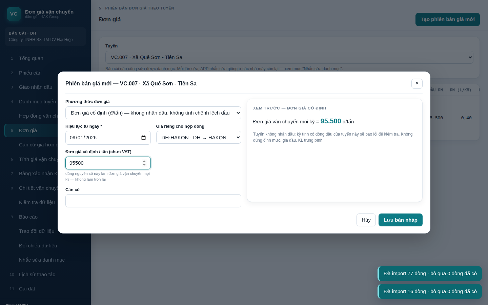
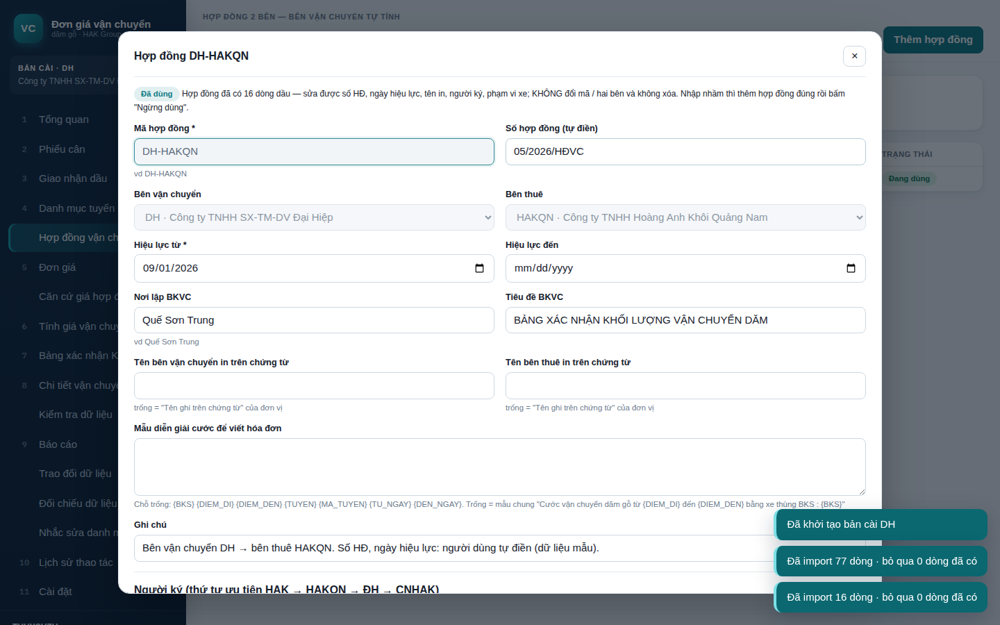
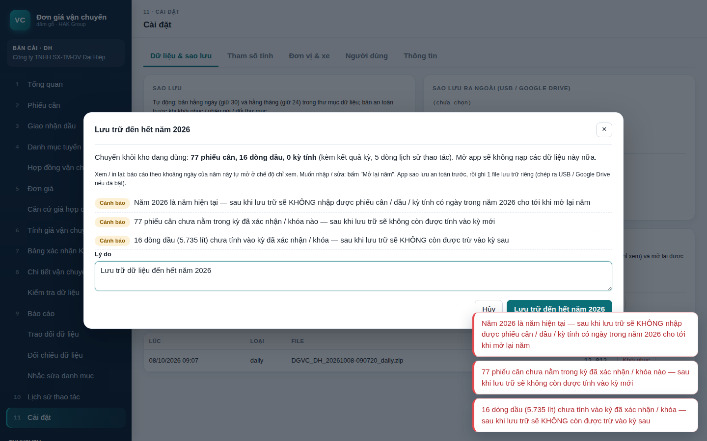

# HƯỚNG DẪN CÀI ĐẶT VÀ SỬ DỤNG — DGVC (Đơn giá vận chuyển dăm)

**Một bộ cài `DGVC-Setup-1.1.2.exe` dùng cho MỌI nhà máy** (HAK, HAKQN, Đại Hiệp, CNHAK …). Lần đầu mở, anh/chị chọn đơn vị của máy đó. Phần mềm chạy không cần Internet; dữ liệu lưu trong một thư mục trên máy.

---

## 1. Cài đặt (mỗi máy làm 1 lần)
1. Chạy `DGVC-Setup-1.1.2.exe`. Máy không cần quyền quản trị; phần mềm cài vào `C:\Users\<tên>\AppData\Local\Programs\DGVC`.
   - Windows có thể hiện *"Windows đã bảo vệ PC của bạn"* vì bộ cài chưa ký số. Bấm **Thông tin thêm → Vẫn chạy**.
2. Bấm **Tiếp → Cài đặt → Hoàn tất**. Bộ cài tạo biểu tượng **Đơn giá vận chuyển dăm** trên màn hình và trong menu Start.

## 2. Mở lần đầu — khởi tạo bản cài (4 bước)

| Bước | Làm gì |
|---|---|
| 1. Thư mục dữ liệu | Mặc định `Documents\DGVC_DATA`. Nên chọn **ổ D:** (vd `D:\DGVC_DATA`) để không mất dữ liệu khi cài lại Windows. Máy đã có dữ liệu (cài lại máy, chuyển máy) → chọn **"Dùng thư mục dữ liệu có sẵn"** rồi trỏ tới thư mục đó |
| 2. Đơn vị của bản cài | Chọn đúng đơn vị đang dùng máy: **HAK / HAKQN / DH / CNHAK**. Phần mềm tự lấy các hợp đồng mà đơn vị này là một bên. **Không đổi được về sau** |
| 3. Danh mục | Bộ cài đã có sẵn danh mục đơn vị, xe, 12 tuyến, giá, hợp đồng. Nếu nhà máy khác vừa gửi gói danh mục `.dgvc` mới hơn thì chọn gói đó để cập nhật ngay (có thể bỏ qua) |
| 4. Sao lưu ra ngoài | Chọn USB hoặc thư mục Google Drive (vd `G:\My Drive`). Có thể bỏ trống và chọn sau |

**Đăng nhập lần đầu:** hai tài khoản ADMIN có sẵn là `saoluucvhak@gmail.com` và `phuthuy.apple@gmail.com`. Tài khoản chưa có mật khẩu → phần mềm hỏi đặt mật khẩu (ít nhất 8 ký tự, có cả chữ và số). Không có mật khẩu mặc định chung.

## 3. Công việc hằng kỳ (bên vận chuyển)

**File Excel mẫu để import:** ở màn hình **Phiếu cân** và **Giao nhận dầu** (sau khi chọn hợp đồng) có nút **Tải file mẫu**. File mẫu được tạo theo danh mục hiện tại của máy, gồm 4 sheet:
- **Sheet nhập liệu** (`NL_VC` / `NL_GIAONHANDAU`): nhập từ dòng 6. Tiêu đề cột đúng tên phần mềm nhận nên không phải ghép cột. Cột có **\*** là bắt buộc.
  - Ô ngày / giờ / số đã có định dạng sẵn. Mã tuyến, biển số, đơn vị chọn trong danh sách thả xuống.
  - Ô bắt buộc còn trống tô cam. KL hàng lệch |Cân 2 − Cân 1| tô đỏ.
  - Bảng kê dầu có cột *Thành tiền (tự tính)* để đối chiếu; phần mềm không đọc cột này.
- **HUONG_DAN:** các bước import và giải thích từng cột.
- **DANH_MUC:** tuyến, xe (bảng kê dầu: chỉ xe của hợp đồng), đơn vị.
- **VI_DU:** dòng mẫu; phần mềm không đọc sheet này.

Danh mục thay đổi (thêm tuyến, thêm xe) thì tải lại file mẫu. File trạm cân / bảng kê dạng cũ vẫn import được như trước.

| # | Màn hình | Thao tác |
|---|---|---|
| 1 | **Phiếu cân** | **Import từ Excel** → chọn file trạm cân (dạng NL_VC hoặc file xuất trạm cân). File không có cột mã tuyến → phần mềm hỏi 1 mã tuyến chung. Xem trước → tích "chấp nhận cảnh báo" → Xác nhận |
| 2 | **Giao nhận dầu** | Chọn hợp đồng → **Import từ Excel** (bảng kê dầu), hoặc **Nhập tay**. Dầu trong bảng kê **tính hết vào kỳ**, kể cả dầu nhận trước ngày bắt đầu kỳ |
| 3 | **Tính giá vận chuyển** | Chọn hợp đồng, từ ngày – đến ngày, tuyến, **thuế suất GTGT** (để *Theo ngày cuối kỳ* = theo lịch thuế suất trong Cài đặt; chọn 0% / 5% / 8% / 10% khi thuế suất thay đổi) → **Xem trước** → **TÍNH GIÁ** (lưu kỳ nháp). Bấm vào đơn giá để **xem chi tiết tính** (15 bước, có thay số) |
| 4 | | Kiểm tra lỗi / cảnh báo → **Xác nhận kỳ** → (tùy chọn) **Khóa kỳ**. Phiếu và dầu của kỳ đã xác nhận không đưa vào kỳ khác được |
| 5 | **Bảng xác nhận KL** | Xem trước A4 → **In** / **Xuất Excel / PDF / CSV**. Mục **Diễn giải để viết hóa đơn** có 1 dòng cho mỗi xe, xuất được Excel / CSV để đưa vào phần mềm hóa đơn |
| 5a | | **Chứng từ in** (cùng màn hình, các thẻ phía trên khung xem trước): **Bảng xác nhận khối lượng** · **Bảng tính đơn giá** · **Biên bản giao nhận dầu**. Mỗi chứng từ có nút **In / Xuất PDF / Xuất Excel** (mục *Chứng từ kèm theo*). Màn hình **Báo cáo** có nút xuất nhanh cho từng kỳ |
| 5b | | **File hóa đơn MISA** (chỉ bên vận chuyển): chọn **Ngày hóa đơn** → **Xuất file hóa đơn MISA**. File Excel đúng mẫu *Hóa đơn GTGT 1 thuế suất* của MISA meInvoice. Trong MISA: **Hóa đơn → Nhập khẩu từ Excel** → chọn file → chọn mẫu *Hóa đơn GTGT 1 thuế suất* → kiểm tra → lưu. Nếu phần mềm báo *VAT lệch* thì xem mục 4 (VAT_ROUND_BASIS). Ở màn hình **Báo cáo**, nút **HĐ MISA** xuất nhanh cho từng kỳ |
| 6 | | **Xuất gói gửi bên thuê** → gửi file `.dgvc` (Zalo / email / USB). Bên thuê vào **Trao đổi dữ liệu → Nhập gói** để xem và in lại |

Mở khóa kỳ hoặc trả kỳ về nháp: chỉ ADMIN hoặc người được cấp quyền mở khóa, và bắt buộc ghi lý do.

### Bù trừ nhiên liệu (dầu âm) — từ bản 1.1.6
- Trong bảng kê dầu ghi **số lít âm** cho dòng bù trừ (vd `-100`). Đơn giá được để trống.
- Phần mềm: dầu thực nhận **trừ** số lít đó; đơn giá dầu của kỳ vẫn là trung bình cộng các dòng **dương** (dòng âm không làm thay đổi giá).
- Trừ 100 lít → CL tiêu hao tăng 100 lít → đơn giá VC tăng 100 × đơn giá dầu ÷ tổng tấn.
- Nếu tổng dầu của tuyến sau bù trừ ≤ 0: vẫn tính, có cảnh báo để kiểm tra lại.
- Biên bản giao nhận dầu: dòng âm ghi chú *Bù trừ*, thành tiền âm (không ghi giá thì lấy đơn giá bình quân).

### Đơn giá cố định (từ bản 1.2.3)
Mỗi phiên bản giá của tuyến chọn 1 trong 2 **phương thức**:
- **Theo giá dầu** (cách cũ, mặc định): Đơn giá VC = Đơn giá HĐ + chênh lệch dầu (định mức − thực nhận) × giá dầu ÷ tổng tấn.
- **Đơn giá cố định (đ/tấn)**: Đơn giá VC của mọi kỳ = đúng số ghi trong bảng giá, không làm tròn lại, **không nhận dầu**, không tính chênh lệch dầu. BKVC = Tấn × đơn giá như bình thường.

Cách làm: **Đơn giá** → chọn tuyến → **Tạo phiên bản giá mới** → *Phương thức đơn giá* = **Đơn giá cố định** → chọn *Hiệu lực từ ngày*, *Giá riêng cho hợp đồng* (nếu chỉ áp cho 1 hợp đồng) → nhập **Đơn giá cố định / tấn** → *Lưu bản nháp* → bấm bản nháp → *Kích hoạt*. Các ô định mức, giá dầu, KL trung bình tự ẩn.
- Cùng 1 hợp đồng có thể có tuyến theo giá dầu và tuyến cố định. Đổi phương thức = tạo phiên bản giá mới từ ngày áp dụng; kỳ tính cắt ngang ngày đổi sẽ bị yêu cầu tách kỳ.
- Tuyến cố định mà trong kỳ có dòng dầu ghi mã tuyến đó → **lỗi** "Tuyến … dùng ĐƠN GIÁ CỐ ĐỊNH … nhưng có N dòng dầu". Sửa mã tuyến của dòng dầu, hoặc bấm nút **Bỏ N dòng dầu khỏi kỳ** (dòng dầu vẫn còn trong bảng kê). Import bảng kê dầu vào tuyến đang cố định cũng có cảnh báo ngay.
- Bảng tính đơn giá in 4 chỉ tiêu (đơn giá cố định, số chuyến, tổng tấn, đơn giá VC) và ghi *Phương thức giá: Đơn giá cố định*. Căn cứ giá hợp đồng ghi thẳng đơn giá ở cột (10), các cột dầu để trống.
- Đơn giá cố định chỉ áp cho tuyến tính theo **tấn**.

### Sửa / cập nhật / xóa phiếu cân (từ bản 1.1.8)
- **Sửa 1 phiếu**: bấm vào phiếu → sửa → *Lưu thay đổi* (ghi lý do). Phiếu ở kỳ đã chốt chỉ sửa được cột mô tả.
- **Cập nhật theo file mới**: trạm cân gửi lại file đã sửa → *Import từ Excel* như bình thường. Phiếu đã có mà **khác số liệu cân** hiện **Cập nhật**, ghi rõ cột nào đổi (vd *KL hàng 16.720 → 16.750*). Tick *Chấp nhận…* rồi xác nhận. Cột không có trong file (LDĐ, nguồn gốc…) giữ nguyên. Kỳ nháp có phiếu đó được đánh dấu phải tính lại. Phiếu ở **kỳ đã xác nhận / khóa**: báo lỗi — trả kỳ về nháp rồi import lại.
- Chỉ khác cột mô tả: vẫn giữ bản đang có (sửa bằng *Sửa hàng loạt cột mô tả*).
- **Xóa nhiều phiếu** (vd import nhầm file): lọc ra các phiếu cần xóa → nút **Xóa N phiếu đang lọc…** → nhập lý do. Phiếu ở kỳ đã chốt được giữ lại.
- **Khôi phục**: lọc *Trạng thái sử dụng = Đã xóa* → bấm phiếu → *Khôi phục phiếu*. Import lại file có phiếu đã xóa cũng tự khôi phục.

## 3b. Báo cáo theo khoảng ngày (menu **Báo cáo**, các thẻ phía trên)
| Thẻ | Nội dung | Tải về |
|---|---|---|
| **Kỳ tính** | Danh sách kỳ, xuất nhanh chứng từ từng kỳ | Excel từng chứng từ |
| **Tổng hợp khối lượng** | Chọn *Từ ngày – Đến ngày*, tuyến, **Tổng hợp theo** và **Chi tiết theo** (tùy chọn). Các chiều: khách hàng (bên thuê), nhóm xe (chủ xe), xe, tuyến, hợp đồng, đơn vị VC trên phiếu, khách hàng ghi trên phiếu, nguồn gốc, tháng, ngày. Mỗi dòng có số chuyến, số xe, KG, tấn, tỷ trọng %; có chọn chiều chi tiết thì có thêm dòng *Cộng* từng nhóm | Excel / PDF / In |
| **Phiếu cân** | Toàn bộ phiếu cân theo ngày cân 1, lọc theo tuyến, nhóm xe, biển số. Có cột tấn, chủ xe, kỳ tính | Excel / PDF / In |
| **Giao nhận dầu** | Bảng kê dầu theo ngày nhận, mọi hợp đồng hoặc 1 hợp đồng, lọc theo bên giao, biển số. Có thành tiền, kỳ tính, ghi chú nghi trùng; có tổng số lít và đơn giá bình quân | Excel / PDF / In |

- *Khách hàng (bên thuê)* của phiếu cân lấy theo kỳ tính đã dùng phiếu. Phiếu chưa tính kỳ thì lấy theo phạm vi xe của hợp đồng tại ngày cân.
- *Nhóm xe* lấy theo chủ xe trong danh mục xe.

### Nhật trình xe (Báo cáo → Nhật trình xe, từ bản 1.2.0)
Chọn **Xe** và **Theo**: Tháng / Quý / Năm / Khoảng ngày → bảng theo từng ngày:

| Cột | Lấy từ |
|---|---|
| Ngày, Tuyến | phiếu cân của xe (ngày cân 1) |
| Cự ly 1 chiều (km) | danh mục tuyến |
| Số chuyến, KL hàng (tấn) | số phiếu cân, tổng KL hàng |
| Số km (đi + về) | cự ly chuyến đi + về × số chuyến |
| Dầu nhận (lít) | bảng kê giao nhận dầu của xe trong ngày (dòng bù trừ âm được trừ); ngày chỉ nhận dầu không chạy vẫn có dòng |
| Dầu định mức (lít) | số km × định mức lít/km của đơn giá đang áp dụng |
| Chủ hàng | bên thuê của hợp đồng (kỳ đã tính; chưa tính thì theo phạm vi xe của hợp đồng) |
| Số phiếu cân | danh sách số phiếu trong ngày |

| Chốt đồng hồ km | số đồng hồ ở ngày có chốt (bản 1.2.2) |
| Kho nhận dầu | cột *Kho nhận dầu* của bảng kê dầu (bản 1.2.1) |

**Chốt đồng hồ km** (bản 1.2.2 — không cần nhập km hằng ngày): ở thẻ Nhật trình xe chọn xe → nút **Chốt đồng hồ km…** → nhập số đồng hồ ở vài thời điểm, tối thiểu 2 lần (vd **01/01 đầu ngày** và **31/12 cuối ngày**; có thể thêm cuối mỗi tháng). *Lúc chốt*: **Đầu ngày** = trước các chuyến trong ngày, **Cuối ngày** = sau các chuyến (chốt tối 31/12 năm trước cũng dùng được thay cho sáng 01/01).
Giữa 2 lần chốt liền nhau phần mềm tính: **Km đồng hồ** = số sau − số trước; **Km theo tuyến** = Σ cự ly đi + về của các chuyến trong khoảng đó; **Chênh lệch** = km đồng hồ − km theo tuyến (km và %: chạy rỗng, đi sửa xe, đường vòng…); **Lít/100 km theo đồng hồ** = dầu nhận trong khoảng ÷ km đồng hồ. Kết quả hiện ở ô tổng và bảng **Đối chiếu km đồng hồ với km theo tuyến** (cũng có trong Excel / PDF). Chênh lệch > 10% tô đỏ. Đồng hồ giảm so với lần chốt trước → cảnh báo.

**Kho nhận dầu** (bản 1.2.1): file import dầu có thêm cột *Kho nhận dầu* (không bắt buộc; file mẫu mới đã có cột này); nhập tay / sửa dòng dầu có ô *Kho nhận dầu* — sửa được cả khi dòng dầu đã ở kỳ đã chốt (không ảnh hưởng số tính). Hiện ở danh sách dầu, báo cáo giao nhận dầu, ghi chú biên bản giao nhận dầu và nhật trình xe.

Theo quý / năm có dòng **Cộng tháng**. Ô tổng phía trên: số chuyến, số km, tấn, dầu nhận, dầu định mức, **lít / 100 km**. Nút *Tải Excel / Xuất PDF / In*.

## 3c. Đối chiếu dữ liệu (menu **Đối chiếu dữ liệu**, từ bản 1.1.4)
Chỉ xem và so sánh, không sửa dữ liệu. Menu hiện **số nhắc** khi có phiếu cân bị sót.

**Thẻ "Phiếu cân chưa tính vào kỳ"** — phiếu cân của xe thuộc hợp đồng mình vận chuyển (xe mình, xe A, xe B…) mà chưa nằm trong kỳ nào:

| Tình trạng | Nghĩa là | Cách xử lý |
|---|---|---|
| **Về muộn** | Ngày cân thuộc kỳ đã xác nhận / đã khóa, nhưng phiếu nhập sau khi chốt | Bấm **Mở kỳ để tính lại** → Trả về nháp → Tính giá → Xác nhận kỳ → xuất lại gói Kỳ tính gửi bên thuê. Bên thuê nhập gói mới, phần mềm **thay** bản cũ (báo "lần tính 1 → 2") |
| **Lọt khe** | Ngày cân không thuộc kỳ nào, nằm trước kỳ đã chốt gần nhất | Bấm **Lập kỳ cho ngày này**, hoặc lùi *Từ ngày* của kỳ sau |
| Kỳ nháp chưa tính lại | Ngày cân thuộc kỳ nháp nhưng kỳ chưa tính lại | Mở kỳ nháp, tính lại |
| Chờ kỳ sau | Sau kỳ đã chốt gần nhất — bình thường | (tick *Hiện cả phiếu chờ kỳ sau* để xem) |

Kèm bảng **xe nằm trong 2 hợp đồng cùng lúc**. Cùng bên thuê = nguy cơ tính tiền 2 lần → đặt *Hiệu lực đến* cho hợp đồng cũ.

Khi **import phiếu cân**, phiếu nào có ngày thuộc kỳ đã chốt được cảnh báo ngay: *"… nhập muộn nên CHƯA được tính"*.

**Thẻ "Đối chiếu với đơn vị khác"** — bấm **Chọn file…**, chọn gói `.dgvc` (Phiếu cân hoặc Kỳ tính) hoặc file Excel phiếu cân của xe A, B, trạm cân bên thuê… Phần mềm so theo **số phiếu + ngày cân 1 + biển số**, mặc định chỉ trong khoảng ngày và các xe có trong file:

- **Khớp** · **Lệch số liệu** (khác số cân / giờ / tuyến, ghi rõ cột nào) · **Khác số phiếu** (cùng xe, ngày, KL — nghi gõ nhầm số phiếu) · **Bên mình chưa có** · **Bên kia không có**.
- Bảng **theo xe**: số chuyến, KG mỗi bên và chênh lệch. Cột *Kỳ bên mình* cho biết phiếu đã nằm ở kỳ nào.
- **Tải Excel**: 3 sheet *Tổng hợp · Theo xe · Chi tiết* để gửi bên kia cùng rà.
- Phiếu "Bên mình chưa có": nhập file / gói đó như bình thường — phiếu đã có tự bỏ qua, không bị nhân đôi.

## 4. Sửa danh mục ở một nhà máy → nhắc sửa các nhà máy còn lại
- **Bản cài nào cũng sửa được** danh mục tuyến, đơn giá, đơn vị, xe, hợp đồng.
- Mỗi lần sửa, phần mềm hiện nhắc *"Nhớ sửa giống ở các nhà máy còn lại: …"*. Menu **Nhắc sửa danh mục** hiện số thay đổi đang chờ ở từng nhà máy.
- Để cập nhật cho các nhà máy khác, chọn một trong hai cách:
  - **Xuất gói danh mục** cho nhà máy đó, gửi file `.dgvc`. Bên kia vào **Trao đổi dữ liệu → Nhập gói**. Phần mềm tự đánh dấu nhà máy đó đã nhận.
  - Nếu bên kia tự sửa tay: bấm **Đã sửa tay** và ghi chú.
- Khi nhận gói: bản đến mới hơn thì phần mềm tự cập nhật. Nếu hai bên cùng sửa một mục, phần mềm báo **xung đột** để anh/chị chọn *giữ bản này* hoặc *lấy bản đến*.

### Trao đổi dữ liệu dùng để làm gì — các chữ trong bảng xem trước (bản 1.1.5)
Mỗi máy giữ dữ liệu riêng; gói `.dgvc` là cách chuyển dữ liệu giữa các máy thay cho gõ lại. Ví dụ: anh/chị tính cước cho D (xe mình + xe A + xe B) → **Xuất gói Kỳ tính** gửi D; A, B (nếu dùng phần mềm) gửi anh/chị **gói Phiếu cân** hoặc file Excel phiếu cân.

| Chữ | Nghĩa |
|---|---|
| Mới | máy này chưa có — thêm vào |
| Đã có | giống hệt — bỏ qua |
| Cập nhật | bên gửi sửa sau (danh mục, dòng dầu của kỳ gửi lại) |
| Xung đột | hai bên khác nhau: cùng sửa 1 mục, hoặc **cùng kỳ (cùng hợp đồng, cùng khoảng ngày) nhưng gửi từ máy khác** → bảng so sánh *Bản đang có / Bản đến* (lần tính, đơn giá, số chuyến, tổng tiền); mặc định **giữ bản đang có** |
| Thay bản cũ | **chính máy đã gửi kỳ đó** gửi lại sau khi tính lại → thay kỳ cũ, không thành 2 kỳ. Kỳ của máy khác **không bao giờ bị thay tự động** |
| Bỏ qua | không liên quan đơn vị này |
| Từ chối | không nhận, không ghi gì — có ghi lý do |

Các trường hợp **từ chối** có lý do rõ:
- Bản cài này là **bên vận chuyển** của hợp đồng trong gói (ví dụ A, B gửi gói *Kỳ tính* của hợp đồng anh/chị với D): kỳ đó do chính anh/chị tính → bấm **Chỉ nhập N phiếu cân trong gói** để lấy phiếu cân.
- Kỳ đến có **phiếu cân** hoặc **dòng dầu** đã tính ở kỳ khác đã nhận (2 kỳ chồng ngày / trừ dầu 2 lần).
- Bản cài không phải bên thuê của hợp đồng.

Hai máy cài cùng một đơn vị sinh mã kỳ giống nhau (KY-DH-000001…). Từ bản 1.1.5 kỳ khác nhau nhưng trùng mã được lưu thành kỳ riêng (mã thêm `@DH.xxxx`), không đè lên nhau. **Khuyến nghị:** mỗi đơn vị tính kỳ trên 1 máy; máy khác dùng *Dùng dữ liệu có sẵn* (cùng thư mục) hoặc chỉ gửi phiếu cân.

**Tuyến vận chuyển** (Danh mục tuyến):
- **Thêm tuyến:** nhập mã, tên, cự ly (cự ly chuyến để trống thì phần mềm lấy 2 × cự ly), đơn vị tính tấn hoặc m³, **điểm đi / điểm đến** (in vào diễn giải hóa đơn).
- **Sửa tên, điểm đi / điểm đến:** sửa lúc nào cũng được.
- **Sửa cự ly:** kỳ nháp dùng tuyến đó phải tính lại. Nếu tuyến đã dùng ở kỳ đã xác nhận thì chỉ ADMIN sửa được, bắt buộc ghi lý do; kết quả của kỳ đã lưu vẫn giữ nguyên.

**Đơn giá** (quản lý theo phiên bản):
- **Tạo phiên bản mới:** màn hình xem trước ĐG HĐ ngay khi gõ số.
- **Đơn giá cước / tấn (chưa VAT) — dùng tính:** giá cước 1 tấn đã gồm dầu theo định mức (cột "Đơn giá mới" của Excel). Chỉ số này vào công thức: ĐG 1 chuyến = Đơn giá cước × KL TB → trừ tiền dầu định mức → ĐG HĐ.
- **Đơn giá tham khảo (chưa VAT) + Nguồn đơn giá tham khảo:** chỉ để đối chiếu, **không dùng tính**. Có nhập đơn giá tham khảo thì bắt buộc ghi nguồn (file · bảng · cột · ngày, hoặc số phụ lục hợp đồng). Danh mục đi kèm bộ cài ghi sẵn nguồn: *File Excel Dongiavanchuyen_24.09 · bảng TBL_DATA · cột "Đơn Giá (chưa VAT)" · ngày cập nhật …*. Bảng danh sách đơn giá có cột **Nguồn tham khảo**.
- **Kích hoạt:** bản giá cũ tự đóng vào ngày trước ngày áp dụng giá mới. Phần mềm không cho đổi giá của những ngày đã nằm trong kỳ đã xác nhận.

**Căn cứ giá hợp đồng** (menu mới, ngay dưới *Đơn giá*): bảng tính đơn giá hợp đồng (chưa gồm nhiên liệu) cho mọi tuyến, cùng cách tính với file Excel cũ.
- Chọn **Hợp đồng** (hoặc *Bảng giá chung*) và **Áp dụng ngày**. Nếu hợp đồng có giá riêng cho tuyến nào thì phần mềm dùng giá riêng đó thay cho giá chung.
- Mỗi tuyến có 10 cột được đánh số:
  - (1) Đơn giá cước; (2) KL trung bình; (3) ĐG 1 chuyến = (1)×(2)
  - (4) Định mức; (5) Dầu / chuyến; (6) ĐG dầu chưa VAT; (7) Tiền dầu / chuyến
  - (8) Tỷ lệ dầu; (9) ĐGVC chưa dầu = [(3) − (7)] / KL_TB
  - **(10) ĐƠN GIÁ HỢP ĐỒNG** = (9) làm tròn đến hàng nghìn
- Bấm vào 1 tuyến để xem thay số.
- **In / Xuất PDF:** A4 ngang, có quốc hiệu, phần cách tính và ký 2 bên. Dùng làm phụ lục khi ký hợp đồng.
- **Xuất Excel (có công thức):** ô nền xanh là số nhập; các cột (3), (5), (7)…(10) là công thức Excel. Sửa đơn giá cước, KL, định mức hoặc giá dầu là tự tính lại ĐG HĐ, dùng để thử phương án trước khi ký.

**Hợp đồng:**
- **Thông tin tự điền:** số hợp đồng, ngày hiệu lực.
- **Tên in trên chứng từ:** mặc định lấy ô "Tên ghi trên chứng từ" của đơn vị; sửa được riêng cho từng hợp đồng.
- **Mẫu diễn giải cước để viết hóa đơn:** mặc định *"Vận chuyển dăm gỗ từ {DIEM_DI} đến {DIEM_DEN} bằng xe thùng biển kiểm soát: {BKS_LIEN}"* (như hóa đơn thật). Có các chỗ trống `{BKS_LIEN}` (biển số không gạch: 92H00057) `{BKS}` `{DIEM_DI}` `{DIEM_DEN}` `{TUYEN}` `{TU_NGAY}` `{DEN_NGAY}`.
- **Phạm vi xe:** có nút **Gợi ý xe**.
- **Người ký:** luôn theo thứ tự ưu tiên **HAK → HAKQN → ĐH → CNHAK**. Bên đứng trước ký VÕ VĂN PHỤNG – Giám đốc, bên kia ký VÕ THỊ NHƯ NGỌC – Phó Giám đốc.

**Bảng tính đơn giá (mẫu in):** A4 dọc, có quốc hiệu. Gồm 20 chỉ tiêu đánh số (1)…(20), mỗi chỉ tiêu có *cách tính theo số thứ tự* và *diễn giải thay số*:
- **Phần A — Đơn giá hợp đồng:** đơn giá cước, KL TB, cự ly, định mức, tiền dầu → **ĐG HĐ**.
- **Phần B — Thực hiện trong kỳ:** số chuyến, tổng tấn, dầu định mức, dầu thực nhận, chênh lệch, đơn giá dầu → **ĐG CL diesel**.
- **Phần C — Đơn giá vận chuyển của kỳ:** khung kết quả kèm số bằng chữ.
- **Phần D — Giá trị cước theo bảng xác nhận khối lượng.**
- Cuối trang: ghi chú dòng dầu đã bỏ khỏi kỳ (nếu có) và khối ký 2 bên.

**Biên bản giao nhận dầu diesel:** A4 dọc, có quốc hiệu, số biên bản, căn cứ hợp đồng. Gồm:
- **Bên giao (A):** bên cấp dầu. **Bên nhận (B):** bên vận chuyển. Mỗi bên có địa chỉ, MST, người đại diện.
- **I. Chi tiết từng lần nhận:** ngày, xe, tuyến, số lít, đơn giá, thành tiền. Dòng nhận trước kỳ được ghi chú.
- **II. Tổng hợp theo xe.**
- **III. Kết luận:** tổng số lít (có số bằng chữ) và đơn giá dầu bình quân, làm căn cứ tính chênh lệch nhiên liệu.
- Ký đại diện 2 bên.
- Chỉ gồm các dòng dầu đã tính vào kỳ. Dòng đã *Bỏ khỏi kỳ* không có trong biên bản. Nhiều bên giao thì mỗi bên 1 biên bản.

**Thuế suất GTGT theo thời điểm** (Cài đặt → Tham số tính, ADMIN):
- `VAT_RATE_OPTIONS`: các thuế suất cho chọn, ví dụ `0;0.05;0.08;0.1`.
- `VAT_RATE_SCHEDULE`: lịch thuế suất, ví dụ `2026-01-01=0.08;2027-01-01=0.10`. Kỳ nào không chọn tay thì phần mềm lấy thuế suất có hiệu lực tại ngày cuối kỳ.
- `VAT_RATE`: thuế suất dùng khi chưa có lịch.
- Thuế suất lưu theo từng kỳ; kỳ đã tính không bị đổi khi sửa lịch.

**Cách làm tròn VAT** (Cài đặt → **Tham số tính** → `VAT_ROUND_BASIS`, chỉ ADMIN, ghi lý do):
- `LINE` (mặc định, như Excel): VAT làm tròn từng xe rồi cộng.
- `TOTAL`: VAT = làm tròn(tổng tiền hàng × 8%), phần lệch dồn vào xe cuối — bảng xác nhận khớp đúng hóa đơn MISA.

**Kỳ không có dầu** (bên giao không cấp dầu, xe tự lo nhiên liệu):
- Khi tính giá, phần mềm báo lỗi *"kỳ này không có dầu thực nhận"*, kèm nút **Tính với dầu = 0**.
- Bấm nút rồi nhập **đơn giá dầu thực tế** (chưa VAT) và **lý do**. Đơn giá được gợi ý sẵn theo lần nhận dầu gần nhất của hợp đồng, nếu chưa có thì theo đơn giá dầu trong danh mục.
- Khi đó dầu thực nhận = 0, nên chênh lệch dầu bằng toàn bộ dầu định mức. Đơn giá vận chuyển = ĐG HĐ + dầu định mức × đơn giá dầu / tổng tấn.
- Xác nhận này được lưu theo kỳ: tính lại vẫn giữ. Muốn đổi thì bấm **Sửa đơn giá dầu** hoặc **Bỏ**.

**Dòng dầu nghi trùng** (màn hình Tính giá vận chuyển → khung *Kiểm tra trước khi xác nhận*):
- Phần mềm cảnh báo các dòng dầu giống hệt nhau (cùng ngày, xe, số lít), mỗi dòng có 2 nút.
- **Bỏ khỏi kỳ:** dùng khi nhập trùng thật. Đơn giá tính lại ngay và dòng còn lại hết cảnh báo. Bấm **TÍNH GIÁ** để lưu. Dòng đã bỏ được **lưu theo kỳ**: tính lại vẫn giữ và hiện dòng *"Đã bỏ dòng dầu … khỏi kỳ"* kèm nút **Đưa lại vào kỳ**.
- **Không trùng:** ghi lý do, ví dụ "2 lần đổ thật". Cả 2 dòng vẫn tính và không cảnh báo nữa.
- Ví dụ kỳ ĐH 18–23/09: bỏ 1 trong 2 dòng 400 lít ngày 18/09 của xe 92H-00192 → **96.900** (khớp hóa đơn 1C26TYY); giữ cả 2 → **88.900**.

## 4b. Sửa danh mục xe nhập sai (Cài đặt → Đơn vị & xe, từ bản 1.1.7)
Bấm vào 1 xe trong bảng **Xe** → cửa sổ sửa xe, có ghi rõ xe đang được dùng ở đâu:
- **Lưu**: sửa chủ xe (nhóm xe), mã xe trong bảng kê dầu, ghi chú.
- **Sửa biển số…**: khi biển số gõ nhầm và xe **chưa có phiếu cân, chưa vào kỳ tính** → phần mềm đổi sang biển số đúng, chuyển luôn phạm vi xe của hợp đồng và dòng dầu chưa tính kỳ.
- Xe **đã có phiếu cân**: không đổi biển số (biển số đến từ dữ liệu trạm cân). Nếu xe nhập nhầm: thêm xe đúng, rồi **Ngừng dùng** xe sai.
- **Xóa xe nhập nhầm**: chỉ hiện khi xe chưa dùng ở đâu (không phiếu cân, dòng dầu, hợp đồng).
- Mọi thay đổi ghi vào Lịch sử thao tác và tạo nhắc sửa danh mục cho các nhà máy khác.

## 4c. Sửa / xóa hợp đồng (menu **Hợp đồng vận chuyển**, từ bản 1.2.4)
Bấm vào 1 hợp đồng trong danh sách. Dòng đầu cửa sổ cho biết hợp đồng **Chưa dùng** hay **Đã dùng**.
- **Luôn sửa được**: số HĐ, ngày hiệu lực, nơi lập BKVC, tiêu đề, tên in trên chứng từ, mẫu diễn giải hóa đơn, ghi chú, người ký, phạm vi xe → **Lưu hợp đồng** / **Lưu phạm vi xe**.
- **Chưa dùng** (chưa có kỳ tính, chưa có dòng dầu): sửa được cả **mã hợp đồng, bên vận chuyển, bên thuê**; có nút **Xóa hợp đồng…** (nhập lý do). Xóa luôn phạm vi xe và giá riêng của hợp đồng đó.
- **Đã dùng**: ô mã / hai bên bị khóa (nền xám), không có nút xóa — vì kỳ tính, bảng kê dầu, gói trao đổi đã gắn với hợp đồng này. Nhập nhầm thì **Thêm hợp đồng** đúng, rồi bấm **Ngừng dùng** hợp đồng sai. Hợp đồng ngừng dùng ghi *(ngừng dùng)* trong ô chọn, không tính giá được nữa; dữ liệu và báo cáo cũ giữ nguyên; bấm **Dùng lại** khi cần.
- Mọi thay đổi ghi vào lịch sử thao tác và nhắc sửa giống ở các nhà máy còn lại.

## 5. Sao lưu — khôi phục (Cài đặt → Dữ liệu & sao lưu)
- **Tự động:** 1 bản mỗi ngày (giữ 30 bản), 1 bản mỗi tháng (giữ 24 bản). Có thêm **bản an toàn** trước khi khôi phục, nhập gói hoặc đổi thư mục.
- **Sao lưu ra USB / Google Drive:** bật và chọn thư mục. Mỗi bản sao lưu được chép thêm sang `…\DGVC_BACKUP\<đơn vị>`.
- **Sao lưu ngay:** bấm trước khi làm việc lớn.
- **Khôi phục:** chọn bản → ghi lý do. Phần mềm kiểm SHA-256 và tự sao lưu hiện trạng trước khi khôi phục.
- **Đổi thư mục dữ liệu** (vd sang ổ D:): phần mềm chép toàn bộ sang thư mục mới; thư mục cũ vẫn giữ nguyên.

### Lưu trữ theo năm (từ bản 1.2.5)
Dữ liệu được ghi gọn (nhỏ hơn khoảng 2–3 lần) và chia theo tháng trong thư mục từng năm; lần đầu mở bản 1.2.5 app tự sao lưu rồi chuyển đổi, số liệu giữ nguyên.

Năm cũ đã làm xong nên **lưu trữ** để app mở nhanh, ít tốn bộ nhớ, bản sao lưu hằng ngày nhỏ:
1. **Cài đặt → Dữ liệu & sao lưu → Lưu trữ theo năm** → dòng năm cần lưu trữ → **Lưu trữ đến hết năm…** (chỉ ADMIN).
2. Màn hình xem trước cho biết số phiếu, dòng dầu, kỳ sẽ chuyển đi và **cảnh báo**: kỳ còn nháp; phiếu / dầu chưa vào kỳ đã chốt (sau khi lưu trữ sẽ không còn được tính); kỳ vắt sang năm sau được giữ lại. Đọc kỹ rồi bấm **Lưu trữ đến hết năm …**.
3. App sao lưu an toàn, ghi 1 file lưu trữ riêng `DGVC_<đơn vị>_LUU_TRU_DEN_HET_NAM_<năm>.zip` (tự chép ra USB / Google Drive nếu đã bật) — **giữ file này cẩn thận**.

Sau khi lưu trữ:
- Mở app không nạp năm đó. Vào **Phiếu cân / Báo cáo / Đối chiếu** chọn ngày trong năm lưu trữ → app tự mở năm đó ở chế độ **chỉ xem** (dải màu vàng phía trên, bấm *Thôi xem* để đóng). In lại BKVC, bảng tính… của kỳ cũ được.
- Không nhập / sửa được phiếu cân, dầu, kỳ có ngày trong năm đã lưu trữ. Cần nhập bổ sung: **Mở lại năm…** (nhập lý do) → dữ liệu trở lại như cũ; xong thì lưu trữ lại.
- Chuyển máy: chép cả thư mục dữ liệu (có thư mục `archive`). Nếu thiếu, dòng năm báo *Thiếu thư mục lưu trữ* → **Nạp file lưu trữ…** chọn file zip ở trên.

## 6. Người dùng (ADMIN: Cài đặt → Người dùng)
- **Thêm người dùng:** email, vai trò **Kế toán** / **Chỉ xem** / **ADMIN**, đơn vị, quyền mở khóa kỳ. Người dùng mới tự đặt mật khẩu ở lần đăng nhập đầu tiên.
- **Nhập sai mật khẩu 5 lần:** tài khoản bị khóa 15 phút.
- **Quên mật khẩu:** ADMIN bấm **Đặt lại mật khẩu**.
- **Không thao tác 60 phút:** phần mềm tự đăng xuất.

## 7. Gỡ cài đặt / cài lại / chuyển máy
- **Gỡ cài đặt:** vào Start → *Đơn giá vận chuyển dăm → Gỡ cài đặt*. **Thư mục dữ liệu và các bản sao lưu không bị xóa.**
- **Cài lại hoặc chuyển máy:** cài bộ mới, ở bước 1 chọn **"Dùng thư mục dữ liệu có sẵn"**. Nếu chuyển máy, chép thư mục `DGVC_DATA` sang máy mới trước, hoặc khôi phục từ bản sao lưu trên USB / Google Drive.
- **Cập nhật phiên bản mới:** chạy bộ cài mới đè lên bản cũ. Dữ liệu giữ nguyên.

## 8. Khi gặp sự cố
- (Từ bản 1.1.9) Cửa sổ nhập liệu (thêm hợp đồng, xe, đơn vị…) **không tự đóng** khi đang nhập dở: bôi đen chữ kéo ra ngoài hoặc bấm ra vùng tối đều không đóng. Muốn đóng: bấm **Hủy** hoặc **✕** (phần mềm hỏi lại nếu đã nhập dữ liệu). Bỏ hiệu ứng nền mờ gây nháy màn hình trên một số máy.

| Hiện tượng | Cách xử lý |
|---|---|
| "Thư mục dữ liệu đang được mở bởi … trên máy …" | Có cửa sổ khác (hoặc máy khác) đang mở cùng thư mục. Đóng cửa sổ đó. Nếu lần trước phần mềm bị tắt đột ngột, đợi 3 phút rồi chọn **Chiếm quyền mở** |
| "Dữ liệu không toàn vẹn (SHA-256)" | Có file dữ liệu bị sửa ngoài phần mềm. Vào **Cài đặt → Dữ liệu & sao lưu → Khôi phục** bản gần nhất |
| Gói `.dgvc` báo "bị sửa hoặc hỏng" | Nhờ bên gửi xuất và gửi lại gói |
| Cần xem nhật ký kỹ thuật | Menu **Trợ giúp → Mở thư mục nhật ký** |
