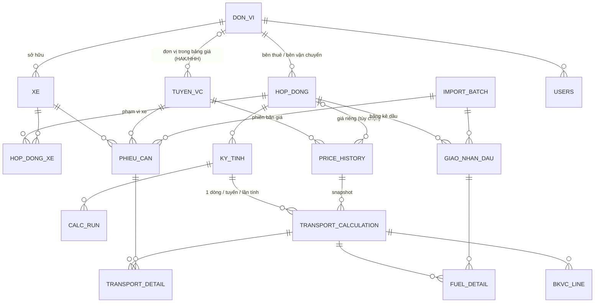

# DATABASE_DESIGN.md — Thiết kế cơ sở dữ liệu (Bước 7)

> Căn cứ: DATA_MODEL / BUSINESS_LOGIC / CALCULATION_RULES / APP_FLOW **v5** (đã xác nhận 24/09/2026).
> Giai đoạn 1: **Google Sheets** (1 file, mỗi bảng 1 sheet). Giai đoạn 2: **PostgreSQL** — DDL tương ứng trong `schema_postgres.sql`.
> Kèm theo: `DB_DGVC_seed.xlsx` — file DB mẫu (19 sheet), đã nạp danh mục + dữ liệu thật của 3 file Excel, **upload lên Google Drive → mở bằng Google Sheets là dùng được**.
> Cả 3 thứ (tài liệu, file mẫu, DDL) sinh từ **một** định nghĩa schema (`schema.py`), nên luôn khớp nhau.

---

## 1. Nguyên tắc thiết kế

| Nguyên tắc | Cách làm |
|---|---|
| Tách danh mục / đầu vào / kết quả / hệ thống | 4 nhóm sheet, màu tiêu đề khác nhau (xanh dương / xanh lá / vàng nâu / xám) |
| Không mất dữ liệu | mỗi dòng import lưu kèm `raw_row_json` (nguyên dòng gốc) + `import_batch_id`; xóa = xóa mềm `is_deleted` / `is_active` |
| Không ghi đè lịch sử giá | `PRICE_HISTORY` theo phiên bản, `is_used = TRUE` thì cấm sửa |
| Kết quả kỳ không đổi khi danh mục đổi | `TRANSPORT_CALCULATION` **snapshot** toàn bộ tham số giá đã dùng; `TRANSPORT_DETAIL` / `FUEL_DETAIL` snapshot KG, lít, giá |
| Truy vết ngược | Đơn giá VC → `TRANSPORT_CALCULATION.trace_json` → `TRANSPORT_DETAIL` (từng phiếu) + `FUEL_DETAIL` (từng dòng dầu) + `price_id` |
| Tính lại không mất bản cũ | mỗi lần tính = 1 `CALC_RUN`; dòng kết quả cũ chuyển `is_current = FALSE`, không xóa |
| Chuyển DB không viết lại UI | tên sheet = tên bảng, tên cột `snake_case` giống hệt cột PostgreSQL; chỉ lớp Repository biết là đang dùng Sheets |

---

## 2. Tổng quan 19 bảng

| Nhóm | Sheet | Vai trò | Thay cho (Excel) | Seed |
|---|---|---|---|---|
| Danh mục | `DON_VI` | Công ty: bên thuê, bên vận chuyển, chủ xe, bên giao dầu | (không có) | 5 |
| | `XE` | Xe + khóa quy đổi mã xe dầu | (không có) | 17 |
| | `TUYEN_VC` | Tuyến | TBL_DATA (phần tuyến) | 12 |
| | `PRICE_HISTORY` | Phiên bản giá theo tuyến (+ theo hợp đồng nếu cần) | TBL_DATA (phần giá) | 12 |
| | `HOP_DONG` | Hợp đồng 2 bên | (không có) | 3 |
| | `HOP_DONG_XE` | Phạm vi xe của hợp đồng | (không có) | 27 |
| Đầu vào | `PHIEU_CAN` | Phiếu cân (dùng chung mọi hợp đồng) | TBL_VC | 326 |
| | `GIAO_NHAN_DAU` | Bảng kê dầu, mỗi dòng thuộc 1 hợp đồng | TBL_GIAONHANDAU (×3 file) | 47 |
| | `IMPORT_BATCH` | Lô import | (không có) | 4 |
| Kết quả | `KY_TINH` | Kỳ tính của 1 hợp đồng | (dán dữ liệu đúng kỳ) | 0 |
| | `TRANSPORT_CALCULATION` | Kết quả 1 tuyến / kỳ + số trung gian | QR_DATA + QR_DGVC (2) | 0 |
| | `TRANSPORT_DETAIL` | Phiếu cấu thành + **chống tính trùng** | (không có) | 0 |
| | `FUEL_DETAIL` | Dòng dầu cấu thành | (không có) | 0 |
| | `BKVC_LINE` | Dòng bảng xác nhận KL | Pivot + BKVC | 0 |
| | `CALC_RUN` | Lần chạy — phục vụ rollback | (không có) | 0 |
| Hệ thống | `USERS` | Người dùng, đơn vị, quyền | (không có) | 2 |
| | `AUDIT_LOG` | Lịch sử thao tác (chỉ ghi thêm) | (không có) | 0 |
| | `CONFIG` | Tham số làm tròn, VAT, chính sách, người ký… | hằng số trong công thức | 23 |
| | `SYS_LOG` | Log kỹ thuật | (không có) | 0 |

---

## 3. Quy ước lưu trữ trên Google Sheets

| Chủ đề | Quy ước |
|---|---|
| Cấu trúc sheet | Dòng 1 = tên cột (không đổi, không gộp ô). Dữ liệu từ dòng 2, không dòng trống xen giữa, không công thức. Dòng tiêu đề được **bảo vệ** (Protect range). |
| Ngày / giờ | Lưu **text** `yyyy-MM-dd`, `HH:mm:ss`, datetime ISO `2026-09-24T22:10:00+07:00`. Cột định dạng Plain text để Sheets không tự đổi theo locale (tránh lỗi 10/07 ↔ 07/10). So sánh ngày = so sánh chuỗi. |
| Số | Kiểu số thật, không định dạng phân tách nghìn trong ô. |
| Boolean | `TRUE` / `FALSE` thật (có data validation). |
| Enum | Data validation dạng danh sách; Repository kiểm tra lại khi ghi. |
| JSON | Chuỗi JSON trong 1 ô (giới hạn 50.000 ký tự/ô — `raw_row_json`, `trace_json` < 3.000 ký tự). |
| ID | Text có tiền tố đọc được: `PC-` phiếu cân, `GD-` dầu, `HD-` hợp đồng, `PR-` giá, `KY-` kỳ, `CR-` lần chạy, `TC-` kết quả… Tạo mới = tiền tố + `Utilities.getUuid()` rút gọn. Seed dùng ID dễ đọc (`PC-573-20260918`). |
| Khóa duy nhất / khóa ngoại | Sheets không tự kiểm → **Repository** kiểm trước khi ghi (build map khóa 1 lần / request). PostgreSQL có ràng buộc thật. |
| Sửa đồng thời | `row_version`: ghi thất bại nếu version trên sheet khác version client gửi lên. Mọi thao tác ghi chạy trong `LockService.getScriptLock()`. |
| Xóa | Không xóa dòng. Danh mục → `is_active = FALSE`; dữ liệu nhập → `is_deleted = TRUE` (cấm nếu đang dùng trong kỳ chưa hủy). |
| Audit | 5 cột chung `created_at, created_by, updated_at, updated_by, row_version` ở danh mục, đầu vào, kỳ tính, users. Bảng kết quả chỉ có `created_*` vì không bao giờ sửa. |

---

## 4. Chi tiết từng bảng

### 4.1. Danh mục

#### `DON_VI` — Đơn vị / công ty (bên thuê, bên vận chuyển, chủ xe, bên giao dầu)

PK `unit_code` · + 5 cột audit chung · seed: **5** dòng

| Cột | Kiểu | Bắt buộc | Ràng buộc / ghi chú | Nguồn Excel |
|---|---|---|---|---|
| `unit_code` | text | ✔ | PK. vd CNHAK, HAKQN, HAK, DH |  |
| `unit_name` | text | ✔ | tên pháp lý đầy đủ | Danh mục công ty |
| `short_name` | text | ✔ | tên viết tắt: HAK, HAKQN, Đại Hiệp, CN Quế Sơn | Danh mục công ty |
| `unit_type` | một trong: CONG_TY / CHI_NHANH | ✔ |  | Danh mục công ty[Loại] |
| `name_aliases` | text |  | các cách viết khác (vd trong cột `Đơn vị VC` phiếu cân), phân cách `;` — dùng khi import | TBL_VC[Đơn vị VC] |
| `tax_code` | text |  | MST | Danh mục công ty |
| `address` | text |  | in trên báo cáo | Danh mục công ty |
| `legal_rep_name` | text |  | người đại diện theo danh mục công ty (tham khảo; người ký BKVC theo quy tắc BL-66) | Danh mục công ty |
| `legal_rep_salutation` | một trong: Ông / Bà |  |  | Danh mục công ty[Xưng hô] |
| `legal_rep_title` | text |  |  | Danh mục công ty[Chức vụ] |
| `factory_name` | text |  | Nhà máy (ủy thác) | Danh mục công ty |
| `email` | text |  |  | Danh mục công ty |
| `phone` | text |  |  | Danh mục công ty |
| `doc_display_name` | text |  | tên ghi trên chứng từ xuất hàng | Danh mục công ty |
| `sign_priority` | số nguyên | ✔ | thứ tự ký: 1 HAK, 2 HAKQN, 3 ĐH, 4 CNHAK (đơn vị ngoài tập đoàn: 90+) — bên số nhỏ hơn ký bằng người ký chính | chỉ đạo 24/09/2026 |
| `accountant_name` | text |  | kế toán ký BKVC phía đơn vị này — người dùng tự điền | BKVC!D32, I33 |
| `fuel_prefix` | text |  | tiền tố mã xe trong bảng kê dầu: DN / DH / QC | TBL_GIAONHANDAU[Biển số xe] |
| `is_active` | TRUE/FALSE | ✔ |  |  |
| `note` | text |  |  |  |

#### `XE` — Xe vận chuyển

PK `plate_no` · UNIQUE `plate_key` · + 5 cột audit chung · seed: **17** dòng

| Cột | Kiểu | Bắt buộc | Ràng buộc / ghi chú | Nguồn Excel |
|---|---|---|---|---|
| `plate_no` | text | ✔ | PK. dạng chuẩn `43H-01080` | TBL_VC[Biển số 1] |
| `plate_key` | text | ✔ | UNIQUE. bỏ gạch/khoảng trắng, in hoa: `43H01080` — khóa quy đổi mã xe dầu |  |
| `owner_unit_code` | text | ✔ | FK DON_VI — công ty sở hữu xe |  |
| `fuel_code` | text |  | mã xe dùng trong sổ xuất dầu: `DN_43H01080` | Sheet3[Mã thống kê] |
| `is_active` | TRUE/FALSE | ✔ |  |  |
| `note` | text |  |  |  |

#### `TUYEN_VC` — Tuyến vận chuyển (phần định danh của TBL_DATA)

PK `route_code` · + 5 cột audit chung · seed: **12** dòng

| Cột | Kiểu | Bắt buộc | Ràng buộc / ghi chú | Nguồn Excel |
|---|---|---|---|---|
| `route_code` | text | ✔ | PK. `VC.007` | TBL_DATA[Mã quãng đường] |
| `route_name` | text | ✔ |  | TBL_DATA[Tuyến] |
| `distance_km` | số | ✔ | > 0, một chiều | TBL_DATA[Cự ly] |
| `trip_distance_km` | số | ✔ | > 0, khứ hồi — dùng trong mọi công thức | TBL_DATA[Cự ly/chuyến] |
| `uom` | một trong: TAN / M3 | ✔ | chuẩn hóa từ `Tấn`/`M3` | TBL_DATA[Đơn vị tính] |
| `catalog_unit_code` | text |  | FK DON_VI — đơn vị VC ghi trong bảng giá gốc: HAK = Công ty TNHH Hoàng Anh Khôi, HHH = Công ty Hùng Hoàng Hoa (tham khảo, không dùng tính) | TBL_DATA[Đơn vị VC] |
| `is_active` | TRUE/FALSE | ✔ | ngừng sử dụng thay cho xóa |  |
| `note` | text |  |  |  |

#### `PRICE_HISTORY` — Phiên bản đơn giá theo tuyến (phần giá của TBL_DATA) — không ghi đè

PK `price_id` · UNIQUE `route_code + contract_id + effective_from` · + 5 cột audit chung · seed: **12** dòng

| Cột | Kiểu | Bắt buộc | Ràng buộc / ghi chú | Nguồn Excel |
|---|---|---|---|---|
| `price_id` | text | ✔ | PK |  |
| `route_code` | text | ✔ | FK TUYEN_VC | TBL_DATA[Mã quãng đường] |
| `contract_id` | text |  | FK HOP_DONG. Trống = giá chung mọi hợp đồng; có giá trị = giá riêng của hợp đồng (BL-64) |  |
| `version_no` | số nguyên | ✔ | 1, 2, 3… theo tuyến (+hợp đồng) |  |
| `effective_from` | ngày | ✔ |  | TBL_DATA[Ngày cập nhật] |
| `effective_to` | ngày |  | tự đóng = ngày hiệu lực bản mới − 1 |  |
| `base_price_excl_vat` | số | ✔ | tham khảo | TBL_DATA[Đơn Giá (chưa VAT)] |
| `price_per_km` | số |  | tham khảo, không dùng tính | TBL_DATA[Giá/km] |
| `new_price` | số | ✔ | >= 0 — dùng tính ĐG 1 chuyến | TBL_DATA[Đơn giá mới] |
| `fuel_price_excl_vat` | số | ✔ | > 0 — giá dầu cơ sở | TBL_DATA[ĐG dầu chưa VAT] |
| `fuel_norm_l_per_km` | số | ✔ | > 0 — lít/km (0,4 = 40 l/100km) | TBL_DATA[ĐM dầu_100km] |
| `avg_load_ton` | số | ✔ | > 0 | TBL_DATA[KL_TB] |
| `avg_volume_m3` | số |  | > 0 nếu tuyến M3 | TBL_DATA[Thể tích TB] |
| `status` | một trong: DRAFT / ACTIVE / CLOSED | ✔ |  |  |
| `is_used` | TRUE/FALSE | ✔ | TRUE khi đã có kỳ dùng → cấm sửa/xóa (BL-02) |  |
| `source_note` | text |  | nguồn/căn cứ đổi giá |  |

#### `HOP_DONG` — Hợp đồng vận chuyển 2 bên (bên vận chuyển lập tính toán)

PK `contract_id` · UNIQUE `contract_code` · + 5 cột audit chung · seed: **3** dòng

| Cột | Kiểu | Bắt buộc | Ràng buộc / ghi chú | Nguồn Excel |
|---|---|---|---|---|
| `contract_id` | text | ✔ | PK |  |
| `contract_code` | text | ✔ | UNIQUE. mã ngắn: `HAKQN-QS`, `DH-HAKQN` |  |
| `contract_no` | text |  | số HĐVC — **người dùng tự điền**, APP không tự sinh | CAN[Số HĐVC] |
| `customer_unit_code` | text | ✔ | FK DON_VI — bên thuê |  |
| `carrier_unit_code` | text | ✔ | FK DON_VI — bên vận chuyển; ≠ bên thuê |  |
| `effective_from` | ngày | ✔ | người dùng tự điền khi tạo hợp đồng |  |
| `effective_to` | ngày |  | người dùng tự điền; trống = chưa hết hạn |  |
| `report_title` | text |  | tiêu đề BKVC, mặc định `BẢNG XÁC NHẬN KHỐI LƯỢNG VẬN CHUYỂN DĂM` | BKVC!A4 |
| `service_desc` | text |  | diễn giải cước (điểm đi – điểm đến) | BKVC!C37 |
| `sign_place` | text |  | vd `Quế Sơn Trung` | BKVC!G26 |
| `customer_signers_json` | JSON |  | trống = tự xác định theo quy tắc ký (BL-66); có giá trị = ghi đè [{title, name}] | BKVC!G27:J33 |
| `carrier_signers_json` | JSON |  | như trên, cho bên vận chuyển | BKVC!A27:E33 |
| `is_active` | TRUE/FALSE | ✔ | bật/tắt |  |
| `note` | text |  |  |  |

#### `HOP_DONG_XE` — Phạm vi xe của hợp đồng

PK `id` · UNIQUE `contract_id + plate_no + effective_from` · + 5 cột audit chung · seed: **27** dòng

| Cột | Kiểu | Bắt buộc | Ràng buộc / ghi chú | Nguồn Excel |
|---|---|---|---|---|
| `id` | text | ✔ | PK |  |
| `contract_id` | text | ✔ | FK HOP_DONG |  |
| `plate_no` | text | ✔ | FK XE |  |
| `effective_from` | ngày | ✔ |  |  |
| `effective_to` | ngày |  |  |  |

### 4.2. Đầu vào

#### `PHIEU_CAN` — Phiếu cân — 1 dòng = 1 chuyến; dùng chung cho mọi hợp đồng

PK `ticket_id` · UNIQUE `ticket_key` · + 5 cột audit chung · seed: **326** dòng

| Cột | Kiểu | Bắt buộc | Ràng buộc / ghi chú | Nguồn Excel |
|---|---|---|---|---|
| `ticket_id` | text | ✔ | PK |  |
| `ticket_key` | text | ✔ | UNIQUE chống trùng = ticket_no/weigh1_date/plate_no (Q16) |  |
| `ticket_no` | text | ✔ | lưu text | TBL_VC[Số\n phiếu] |
| `row_no` | text |  |  | TBL_VC[Stt] |
| `weigh1_date` | ngày | ✔ |  | TBL_VC[Ngày cân 1] |
| `weigh1_time` | giờ |  |  | TBL_VC[Giờ cân 1] |
| `weigh2_date` | ngày | ✔ | >= weigh1_date | TBL_VC[Ngày cân 2] |
| `weigh2_time` | giờ |  |  | TBL_VC[Giờ cân 2] |
| `plate_no` | text | ✔ | FK XE (dạng chuẩn) | TBL_VC[Biển số 1] |
| `weight1_kg` | số |  |  | TBL_VC[Cân lần 1] |
| `weight2_kg` | số |  |  | TBL_VC[Cân lần 2] |
| `net_kg` | số | ✔ | > 0 | TBL_VC[KL hàng (KG)] |
| `origin` | text |  |  | TBL_VC[Nguồn gốc] |
| `customer` | text |  |  | TBL_VC[Khách hàng] |
| `ldd` | text |  |  | TBL_VC[LDĐ] |
| `weigh_type` | text |  |  | TBL_VC[Kiểu cân] |
| `route_code` | text | ✔ | FK TUYEN_VC | TBL_VC[Mã cự ly VC] |
| `transport_unit_name` | text |  | giữ nguyên gốc | TBL_VC[Đơn vị VC] |
| `owner_unit_code` | text |  | FK DON_VI — quy đổi từ tên hoặc từ XE |  |
| `validation_flags` | text |  | mã lỗi/cảnh báo, phân cách `;` |  |
| `flags_ack` | TRUE/FALSE |  | TRUE = người dùng đã kiểm tra cảnh báo và xác nhận giữ nguyên |  |
| `flags_ack_note` | text |  | lý do / người xác nhận |  |
| `import_batch_id` | text |  | FK IMPORT_BATCH |  |
| `raw_row_json` | JSON |  | nguyên dòng gốc — không mất dữ liệu |  |
| `is_deleted` | TRUE/FALSE | ✔ | xóa mềm; cấm nếu đang dùng ở kỳ |  |

#### `GIAO_NHAN_DAU` — Bảng kê giao nhận dầu — mỗi dòng thuộc bảng kê của 1 hợp đồng

PK `receipt_id` · + 5 cột audit chung · seed: **47** dòng

| Cột | Kiểu | Bắt buộc | Ràng buộc / ghi chú | Nguồn Excel |
|---|---|---|---|---|
| `receipt_id` | text | ✔ | PK |  |
| `contract_id` | text | ✔ | FK HOP_DONG — bảng kê của hợp đồng nào |  |
| `receive_date` | ngày | ✔ |  | TBL_GIAONHANDAU[Ngày nhận dầu] |
| `route_code` | text | ✔ | FK TUYEN_VC | TBL_GIAONHANDAU[Mã cự ly VC] |
| `fuel_vehicle_code` | text | ✔ | nguyên gốc: `DH_92H00192`, `92H-00192`, `92H00195` | TBL_GIAONHANDAU[Biển số xe] |
| `plate_no` | text |  | FK XE — quy đổi (bỏ tiền tố XX_, bỏ gạch → plate_key) |  |
| `owner_unit_code` | text |  | FK DON_VI — qua XE, để truy vết |  |
| `uom` | text | ✔ | `LÍT` | TBL_GIAONHANDAU[ĐVT] |
| `qty_liter` | số | ✔ | > 0 | TBL_GIAONHANDAU[Số lượng (lít)] |
| `fuel_price_excl_vat` | số | ✔ | > 0, chưa VAT (Q2) | TBL_GIAONHANDAU[Đơn giá dầu] |
| `purchase_date` | ngày |  |  | TBL_GIAONHANDAU[Ngày mua dầu] |
| `giver_unit_code` | text | ✔ | FK DON_VI — cột `Đơn vị` (CNHAK / HAKQN) | TBL_GIAONHANDAU[Đơn vị] |
| `validation_flags` | text |  |  |  |
| `flags_ack` | TRUE/FALSE |  | TRUE = người dùng đã kiểm tra cảnh báo và xác nhận giữ nguyên |  |
| `flags_ack_note` | text |  | lý do / người xác nhận |  |
| `import_batch_id` | text |  | FK IMPORT_BATCH |  |
| `raw_row_json` | JSON |  |  |  |
| `is_deleted` | TRUE/FALSE | ✔ |  |  |

#### `IMPORT_BATCH` — Lô import (preview → xác nhận)

PK `batch_id` · + 5 cột audit chung · seed: **4** dòng

| Cột | Kiểu | Bắt buộc | Ràng buộc / ghi chú | Nguồn Excel |
|---|---|---|---|---|
| `batch_id` | text | ✔ | PK |  |
| `import_type` | một trong: PHIEU_CAN / GIAO_NHAN_DAU / PRICE | ✔ |  |  |
| `contract_id` | text |  | bắt buộc khi import dầu |  |
| `file_name` | text | ✔ |  |  |
| `sheet_name` | text |  |  |  |
| `header_json` | JSON |  | header gốc |  |
| `mapping_json` | JSON |  | cột gốc → cột DB |  |
| `total_rows` | số nguyên | ✔ |  |  |
| `ok_rows` | số nguyên | ✔ |  |  |
| `warning_rows` | số nguyên | ✔ |  |  |
| `error_rows` | số nguyên | ✔ |  |  |
| `duplicate_rows` | số nguyên | ✔ |  |  |
| `status` | một trong: PREVIEW / CONFIRMED / CANCELLED | ✔ |  |  |
| `confirmed_at` | ngày giờ |  |  |  |
| `confirmed_by` | text |  |  |  |

### 4.3. Kết quả

#### `KY_TINH` — Kỳ tính của 1 hợp đồng

PK `period_id` · UNIQUE `period_code` · + 5 cột audit chung · seed: **0** dòng

| Cột | Kiểu | Bắt buộc | Ràng buộc / ghi chú | Nguồn Excel |
|---|---|---|---|---|
| `period_id` | text | ✔ | PK |  |
| `period_code` | text | ✔ | UNIQUE. `HAKQN-QS/20260918-20260923` |  |
| `contract_id` | text | ✔ | FK HOP_DONG |  |
| `date_from` | ngày | ✔ |  | BKVC!A5 |
| `date_to` | ngày | ✔ | >= date_from | BKVC!A5 |
| `route_filter` | text |  | trống = mọi tuyến |  |
| `status` | một trong: NHAP / DA_XAC_NHAN / DA_KHOA / HUY | ✔ |  |  |
| `calc_version` | số nguyên | ✔ | số lần tính |  |
| `current_run_id` | text |  | FK CALC_RUN của lần tính hiện hành |  |
| `config_snapshot_json` | JSON |  | làm tròn, VAT, phương pháp… tại lúc tính (BL-37) |  |
| `needs_recalc` | TRUE/FALSE | ✔ | TRUE khi dữ liệu nguồn bị sửa sau khi tính |  |
| `report_date` | ngày |  | ngày ký trên BKVC | BKVC!G26 |
| `calculated_at` | ngày giờ |  |  |  |
| `calculated_by` | text |  |  |  |
| `confirmed_at` | ngày giờ |  |  |  |
| `confirmed_by` | text |  |  |  |
| `locked_at` | ngày giờ |  |  |  |
| `locked_by` | text |  |  |  |
| `note` | text |  |  |  |

#### `TRANSPORT_CALCULATION` — Kết quả tính 1 tuyến trong 1 kỳ (thay QR_DGVC4) — lưu cả số trung gian + snapshot

PK `calc_id` · seed: **0** dòng

| Cột | Kiểu | Bắt buộc | Ràng buộc / ghi chú | Nguồn Excel |
|---|---|---|---|---|
| `calc_id` | text | ✔ | PK |  |
| `period_id` | text | ✔ | FK KY_TINH |  |
| `run_id` | text | ✔ | FK CALC_RUN |  |
| `calc_version` | số nguyên | ✔ |  |  |
| `is_current` | TRUE/FALSE | ✔ | chỉ 1 dòng current / (period, route) |  |
| `contract_id` | text | ✔ |  |  |
| `route_code` | text | ✔ |  | QR_DGVC[Mã tuyến] |
| `route_name` | text | ✔ | snapshot | QR_DGVC[Tuyến] |
| `uom` | text | ✔ | snapshot |  |
| `price_id` | text | ✔ | phiên bản giá đã dùng |  |
| `trip_distance_km` | số | ✔ | snapshot | QR_DGVC[Cự ly tuyến] |
| `new_price` | số | ✔ | snapshot (sau ép Int64 nếu bật) |  |
| `avg_load_ton` | số | ✔ | snapshot |  |
| `avg_volume_m3` | số |  | snapshot |  |
| `fuel_price_catalog` | số | ✔ | snapshot giá dầu cơ sở |  |
| `fuel_norm_l_per_km` | số | ✔ | snapshot | QR_DGVC[Định mức dầu Diezel] |
| `start_date` | ngày | ✔ | min(weigh1_date) | QR_DGVC[Ngày bắt đầu] |
| `end_date` | ngày | ✔ | max(weigh2_date) | QR_DGVC[Ngày kết thúc] |
| `trip_count` | số nguyên | ✔ |  | QR_DGVC[Số chuyến] |
| `total_kg` | số | ✔ |  |  |
| `total_ton` | số | ✔ |  | QR_DGVC[Tổng KL (Tấn)] |
| `fuel_giver_unit` | text |  |  |  |
| `fuel_uom` | text |  |  |  |
| `fuel_line_count` | số nguyên | ✔ |  |  |
| `actual_fuel_liter` | số |  |  | QR_DGVC[Dầu Diezel thực nhận] |
| `fuel_start_date` | ngày |  |  |  |
| `fuel_end_date` | ngày |  |  |  |
| `fuel_price` | số |  | TB cộng | QR_DGVC[Đơn giá dầu] |
| `fuel_import_date` | ngày |  | max(purchase_date) | QR_DGVC[Ngày nhập dầu] |
| `trip_price` | số | ✔ | ĐG 1 chuyến | QR_DATA[ĐG 1 Chuyến] |
| `fuel_per_trip` | số | ✔ |  | QR_DATA[Tiêu hao NL chuyến] |
| `fuel_cost_per_trip` | số | ✔ |  | QR_DATA[Tiền dầu] |
| `fuel_cost_ratio` | số | ✔ |  | QR_DATA[Tỷ lệ tiêu hao dầu] |
| `price_no_diesel` | số | ✔ |  | QR_DATA[ĐGVC_NODIEZEL] |
| `contract_price` | số | ✔ | ĐG_HĐ | QR_DGVC[Đơn giá theo hợp đồng…] |
| `standard_fuel_liter` | số | ✔ |  | QR_DGVC[Nhiên liệu … theo định mức (lít)] |
| `fuel_diff_liter` | số |  |  | QR_DGVC[CL Tiêu hao Diezel ] |
| `fuel_adjust_price` | số |  | ĐG CL Diesel | QR_DGVC[Đơn giá CL Diezel] |
| `transport_price_raw` | số |  | trước làm tròn |  |
| `transport_price` | số |  |  | QR_DGVC[Đơn giá vận chuyển] |
| `result_status` | một trong: OK / WARNING / ERROR | ✔ |  |  |
| `warnings_json` | JSON |  |  |  |
| `trace_json` | JSON | ✔ | chuỗi XEM CHI TIẾT TÍNH |  |
| `created_at` | ngày giờ | ✔ |  |  |
| `created_by` | text | ✔ |  |  |

#### `TRANSPORT_DETAIL` — Phiếu cân cấu thành 1 kết quả; cũng là bảng chống tính trùng theo hợp đồng

PK `id` · UNIQUE `contract_id + ticket_id WHERE is_current AND usage_state IN (CONFIRMED,LOCKED)` · seed: **0** dòng

| Cột | Kiểu | Bắt buộc | Ràng buộc / ghi chú | Nguồn Excel |
|---|---|---|---|---|
| `id` | text | ✔ | PK |  |
| `calc_id` | text | ✔ | FK |  |
| `period_id` | text | ✔ | FK |  |
| `contract_id` | text | ✔ | denormalize để kiểm trùng nhanh |  |
| `ticket_id` | text | ✔ | FK PHIEU_CAN |  |
| `ticket_key` | text | ✔ | snapshot |  |
| `plate_no` | text | ✔ | snapshot — nguồn BKVC |  |
| `weigh1_date` | ngày | ✔ | snapshot |  |
| `net_kg` | số | ✔ | snapshot |  |
| `is_current` | TRUE/FALSE | ✔ |  |  |
| `usage_state` | một trong: DRAFT / CONFIRMED / LOCKED / RELEASED | ✔ | đồng bộ theo trạng thái kỳ |  |
| `created_at` | ngày giờ | ✔ |  |  |

#### `FUEL_DETAIL` — Dòng dầu cấu thành 1 kết quả

PK `id` · UNIQUE `contract_id + receipt_id WHERE is_current AND usage_state IN (CONFIRMED,LOCKED)` · seed: **0** dòng

| Cột | Kiểu | Bắt buộc | Ràng buộc / ghi chú | Nguồn Excel |
|---|---|---|---|---|
| `id` | text | ✔ | PK |  |
| `calc_id` | text | ✔ | FK |  |
| `period_id` | text | ✔ | FK |  |
| `contract_id` | text | ✔ |  |  |
| `receipt_id` | text | ✔ | FK GIAO_NHAN_DAU |  |
| `qty_liter` | số | ✔ | snapshot |  |
| `fuel_price_excl_vat` | số | ✔ | snapshot |  |
| `is_current` | TRUE/FALSE | ✔ |  |  |
| `usage_state` | một trong: DRAFT / CONFIRMED / LOCKED / RELEASED | ✔ |  |  |
| `created_at` | ngày giờ | ✔ |  |  |

#### `BKVC_LINE` — Dòng bảng xác nhận khối lượng (1 dòng / xe / tuyến)

PK `id` · seed: **0** dòng

| Cột | Kiểu | Bắt buộc | Ràng buộc / ghi chú | Nguồn Excel |
|---|---|---|---|---|
| `id` | text | ✔ | PK |  |
| `period_id` | text | ✔ | FK |  |
| `calc_id` | text | ✔ | FK — lấy đơn giá |  |
| `contract_id` | text | ✔ |  |  |
| `route_code` | text | ✔ |  |  |
| `seq` | số nguyên | ✔ | STT | BKVC[STT] |
| `plate_no` | text | ✔ |  | BKVC[Biển số xe] |
| `owner_unit_code` | text |  |  |  |
| `trip_count` | số nguyên | ✔ |  | BKVC[Số chuyến] |
| `kg` | số | ✔ |  | BKVC[Khối lượng (KG)] |
| `ton` | số | ✔ | kg/1000 | BKVC[Khối lượng (Tấn)] |
| `unit_price` | số | ✔ |  | BKVC[Đơn giá] |
| `amount` | số | ✔ | ROUND(ton×giá, 0) | BKVC[Thành tiền] |
| `vat_rate` | số | ✔ | 0.08 |  |
| `vat` | số | ✔ | ROUND(amount×vat_rate, 0) | BKVC[VAT (8%)] |
| `amount_incl_vat` | số | ✔ |  | BKVC[Thành tiền] |
| `note` | text |  |  | BKVC[Ghi chú] |
| `is_current` | TRUE/FALSE | ✔ |  |  |
| `created_at` | ngày giờ | ✔ |  |  |

#### `CALC_RUN` — Mỗi lần chạy tính / xác nhận / khóa — phục vụ rollback

PK `run_id` · seed: **0** dòng

| Cột | Kiểu | Bắt buộc | Ràng buộc / ghi chú | Nguồn Excel |
|---|---|---|---|---|
| `run_id` | text | ✔ | PK |  |
| `period_id` | text | ✔ | FK |  |
| `action` | một trong: CALC / RECALC / CONFIRM / LOCK / UNLOCK / CANCEL | ✔ |  |  |
| `status` | một trong: RUNNING / DONE / FAILED / ROLLED_BACK | ✔ |  |  |
| `started_at` | ngày giờ | ✔ |  |  |
| `finished_at` | ngày giờ |  |  |  |
| `user_email` | text | ✔ |  |  |
| `rows_written_json` | JSON |  | {sheet: [row ids]} để rollback |  |
| `before_state_json` | JSON |  | trạng thái trước khi ghi |  |
| `error_message` | text |  |  |  |

### 4.4. Hệ thống

#### `USERS` — Người dùng & quyền

PK `email` · + 5 cột audit chung · seed: **2** dòng

| Cột | Kiểu | Bắt buộc | Ràng buộc / ghi chú | Nguồn Excel |
|---|---|---|---|---|
| `email` | text | ✔ | PK — Session.getActiveUser() |  |
| `full_name` | text | ✔ |  |  |
| `unit_code` | text |  | FK DON_VI — chỉ lập kỳ cho HĐ mà đơn vị này là bên vận chuyển; trống = mọi đơn vị (ADMIN). ADMIN thêm user theo từng đơn vị |  |
| `role` | một trong: ADMIN / KE_TOAN / XEM | ✔ |  |  |
| `can_unlock` | TRUE/FALSE | ✔ |  |  |
| `is_active` | TRUE/FALSE | ✔ |  |  |
| `last_login_at` | ngày giờ |  |  |  |

#### `AUDIT_LOG` — Lịch sử thao tác — chỉ ghi thêm, không sửa/xóa

PK `log_id` · seed: **0** dòng

| Cột | Kiểu | Bắt buộc | Ràng buộc / ghi chú | Nguồn Excel |
|---|---|---|---|---|
| `log_id` | text | ✔ | PK |  |
| `ts` | ngày giờ | ✔ |  |  |
| `user_email` | text | ✔ |  |  |
| `action` | text | ✔ | CREATE/UPDATE/DELETE/IMPORT/CALC/RECALC/CONFIRM/LOCK/UNLOCK/OVERRIDE… |  |
| `entity` | text | ✔ | tên sheet |  |
| `entity_id` | text | ✔ |  |  |
| `before_json` | JSON |  |  |  |
| `after_json` | JSON |  |  |  |
| `reason` | text |  | bắt buộc với UNLOCK / OVERRIDE |  |
| `run_id` | text |  |  |  |
| `device_info` | text |  | user agent nếu có |  |

#### `CONFIG` — Tham số cấu hình (không hard-code)

PK `config_key` · seed: **23** dòng

| Cột | Kiểu | Bắt buộc | Ràng buộc / ghi chú | Nguồn Excel |
|---|---|---|---|---|
| `config_key` | text | ✔ | PK |  |
| `config_value` | text | ✔ |  |  |
| `value_type` | một trong: TEXT / NUM / BOOL / JSON | ✔ |  |  |
| `description` | text |  |  |  |
| `updated_at` | ngày giờ |  |  |  |
| `updated_by` | text |  |  |  |

#### `SYS_LOG` — Log kỹ thuật (lỗi, thời gian chạy)

PK `log_id` · seed: **0** dòng

| Cột | Kiểu | Bắt buộc | Ràng buộc / ghi chú | Nguồn Excel |
|---|---|---|---|---|
| `log_id` | text | ✔ | PK |  |
| `ts` | ngày giờ | ✔ |  |  |
| `level` | một trong: DEBUG / INFO / WARN / ERROR | ✔ |  |  |
| `module` | text | ✔ |  |  |
| `message` | text | ✔ |  |  |
| `context_json` | JSON |  |  |  |
| `user_email` | text |  |  |  |
| `duration_ms` | số nguyên |  |  |  |

**5 cột audit chung** (bảng có đánh dấu): `created_at` (ngày giờ, ✔), `created_by` (email, ✔), `updated_at`, `updated_by`, `row_version` (số nguyên, ✔, +1 mỗi lần sửa).

---

## 5. Chống tính trùng (BL-33, BL-65)

Trạng thái "phiếu đã được dùng" **không lưu trên `PHIEU_CAN`**, vì một phiếu hợp lệ ở nhiều hợp đồng (vd phiếu của xe ĐH nằm trong cả ĐH – HAKQN và HAKQN – QS). Thay vào đó, `TRANSPORT_DETAIL` là nơi kiểm tra:

| `usage_state` | Khi nào | Được đưa vào kỳ khác **cùng hợp đồng**? |
|---|---|---|
| `DRAFT` | kỳ đang `NHAP` | Cảnh báo, cho chuyển (kỳ cũ `needs_recalc = TRUE`) |
| `CONFIRMED` | kỳ `DA_XAC_NHAN` | **Chặn**: "Phiếu cân này đã được sử dụng trong kỳ tính [Mã kỳ] …" |
| `LOCKED` | kỳ `DA_KHOA` | **Chặn** (mở khóa: user `can_unlock`, bắt buộc lý do) |
| `RELEASED` | kỳ `HUY` hoặc phiếu bị bỏ khỏi kỳ | Được dùng lại |

- Quy tắc: không tồn tại 2 dòng `is_current = TRUE` có cùng `(contract_id, ticket_id)` với `usage_state ∈ {CONFIRMED, LOCKED}`. PostgreSQL: partial unique index `ux_transport_detail_usage`. Sheets: Repository kiểm tra trước khi ghi.
- Khi đổi trạng thái kỳ, `PeriodService` cập nhật `usage_state` của **tất cả** dòng `TRANSPORT_DETAIL` + `FUEL_DETAIL` của kỳ trong **1 lần ghi batch**.
- `FUEL_DETAIL` áp dụng y hệt cho dòng dầu.
- Thay đổi so với DATA_MODEL v5: bảng `TICKET_USAGE` / `FUEL_USAGE` đã **gộp** vào `TRANSPORT_DETAIL` / `FUEL_DETAIL` (thêm `contract_id`, `usage_state`) — ít bảng hơn, một chỗ kiểm tra.

---

## 6. Vòng đời kỳ và các bảng bị ghi

| Thao tác | Ghi vào |
|---|---|
| Tạo kỳ | `KY_TINH` (status `NHAP`, `calc_version = 0`) |
| TÍNH GIÁ / tính lại | `CALC_RUN` (RUNNING) → dòng cũ `TRANSPORT_CALCULATION`/`TRANSPORT_DETAIL`/`FUEL_DETAIL`/`BKVC_LINE` của kỳ đặt `is_current = FALSE` → ghi dòng mới → `KY_TINH.calc_version + 1`, `current_run_id`, `config_snapshot_json` → `CALC_RUN` DONE → `AUDIT_LOG` |
| Xác nhận | `KY_TINH.status = DA_XAC_NHAN`; `usage_state = CONFIRMED`; `PRICE_HISTORY.is_used = TRUE` với các `price_id` đã dùng; `AUDIT_LOG` |
| Khóa | `DA_KHOA`, `usage_state = LOCKED`, `AUDIT_LOG` |
| Mở khóa | `DA_XAC_NHAN`, `usage_state = CONFIRMED`, `AUDIT_LOG` có `reason` |
| Hủy kỳ nháp | `HUY`, `usage_state = RELEASED` |
| Sửa phiếu / dòng dầu đang nằm trong kỳ `NHAP` | kỳ `needs_recalc = TRUE`. Trong kỳ đã xác nhận/khóa → **chặn sửa**. |

---

## 6b. Quy tắc người ký BKVC ✅ (chỉ đạo 24/09/2026)

- Mỗi đơn vị có `sign_priority`: **1 HAK → 2 HAKQN → 3 Đại Hiệp → 4 CNHAK**.
- Trong một hợp đồng, bên có thứ tự **nhỏ hơn** ký bằng người ký chính `SIGNER_PRIMARY_JSON` = **VÕ VĂN PHỤNG – Giám đốc**; bên còn lại ký bằng `SIGNER_SECONDARY_JSON` = **VÕ THỊ NHƯ NGỌC – Phó Giám đốc** (một người không ký cả 2 bên).
- Ô Kế toán (nếu mẫu có) lấy `DON_VI.accountant_name` của từng bên.
- `HOP_DONG.customer_signers_json` / `carrier_signers_json` trống = dùng quy tắc; điền = ghi đè cho hợp đồng đặc biệt.

| Hợp đồng | Bên vận chuyển | Bên thuê | Ký Giám đốc – Võ Văn Phụng | Ký Phó Giám đốc – Võ Thị Như Ngọc |
|---|---|---|---|---|
| HAKQN-QS | HAKQN | CN Quế Sơn | HAKQN | CN Quế Sơn |
| DH-HAKQN | Đại Hiệp | HAKQN | HAKQN | Đại Hiệp |
| HAK-HAKQN | HAK | HAKQN | HAK | HAKQN |

Hợp đồng HAKQN-QS khớp BKVC hiện tại. File Excel ĐH và ĐN đang ghi ngược (bên CN HAK – Võ Thị Như Ngọc, bên kia Võ Văn Phụng) → APP sẽ in theo quy tắc trên.

## 7. Giao dịch và rollback (Sheets không có transaction)

1. `CALC_RUN` ghi `before_state_json` (trạng thái kỳ, danh sách dòng `is_current` sẽ bị tắt) **trước** khi ghi gì khác.
2. Ghi theo thứ tự: bảng chi tiết → bảng kết quả → `KY_TINH`. Mỗi bước ghi 1 lần `setValues` và cập nhật `rows_written_json`.
3. Lỗi giữa chừng → `rollbackRun(run_id)`: xóa (trường hợp đặc biệt được phép xóa cứng) các dòng trong `rows_written_json`, bật lại `is_current` từ `before_state_json`, `CALC_RUN.status = ROLLED_BACK`, ghi `SYS_LOG` mức ERROR.
4. Toàn bộ nằm trong `LockService.getScriptLock().waitLock(30000)` → 2 người không tính cùng lúc.
PostgreSQL: thay bằng `BEGIN … COMMIT`, `CALC_RUN` vẫn giữ làm nhật ký.

---

## 8. Hiệu năng trên Google Sheets

| Kỹ thuật | Áp dụng |
|---|---|
| Đọc batch | Mỗi request đọc mỗi sheet cần dùng **1 lần** `getDataRange().getValues()`, chuyển thành mảng object; không gọi `SpreadsheetApp` trong vòng lặp |
| Ghi batch | Gom dòng mới → 1 lần `setValues` / sheet; cập nhật cột trạng thái bằng 1 lần ghi vùng cột |
| Cache danh mục | `DON_VI, XE, TUYEN_VC, PRICE_HISTORY, HOP_DONG, HOP_DONG_XE, CONFIG` vào `CacheService` (chia khúc < 100 KB, TTL `CACHE_TTL_SECONDS`); xóa cache khi danh mục bị sửa |
| Map khóa | build `Map` theo PK / `ticket_key` / `plate_key` 1 lần mỗi request để kiểm trùng, quy đổi xe O(1) |
| Lọc sớm | Tính giá: lọc `PHIEU_CAN` theo `route_code` + ngày + tập xe hợp đồng trước khi tính |

**Ước lượng dung lượng** (theo nhịp file thật: ~330 phiếu / 6 ngày / hợp đồng QS):

| Sheet | Dòng / năm | Ô / năm |
|---|---|---|
| `PHIEU_CAN` (28 cột) | ~20.000 | ~560.000 |
| `TRANSPORT_DETAIL` (12 cột; ~2 hợp đồng / phiếu; ~1,5 lần tính) | ~60.000 | ~720.000 |
| `GIAO_NHAN_DAU` (21 cột) | ~3.000 | ~63.000 |
| Các sheet khác | nhỏ | < 200.000 |

Tổng ≈ 1,6 triệu ô / năm so với giới hạn 10 triệu ô / file → dùng được ~4–5 năm; khuyến nghị **lưu trữ theo năm** (copy file, xóa kỳ đã khóa > 2 năm) hoặc chuyển PostgreSQL trước ngưỡng 6 triệu ô.

---

## 9. Chuyển sang PostgreSQL (giai đoạn 2)

- `schema_postgres.sql` (sinh tự động): 19 bảng, khóa chính, UNIQUE, CHECK enum, CHECK nghiệp vụ (`net_kg > 0`, `date_to >= date_from`, bên thuê ≠ bên vận chuyển…), khóa ngoại, chỉ mục, partial unique index chống tính trùng, `audit_log` chỉ ghi thêm.
- **Đã chạy thử** trên PostgreSQL 16: tạo đủ 19 bảng, nạp toàn bộ seed (326 phiếu, 47 dòng dầu, 27 xe-hợp đồng…) không lỗi khóa ngoại/CHECK; thử chèn trùng phiếu `573|2026-09-18|43H-01080` → bị chặn đúng.
- Kiểu dữ liệu: ngày text → `date`, JSON text → `jsonb`, TRUE/FALSE → `boolean`.
- Code: thay `SheetRepository` bằng `PgRepository` (qua JDBC của Apps Script hoặc REST API riêng); Service / Engine / UI giữ nguyên.

---

## 10. Dữ liệu mẫu (`DB_DGVC_seed.xlsx`) và kiểm chứng

| Sheet | Nội dung seed |
|---|---|
| `DON_VI` | 4 đơn vị theo **Danh mục công ty** (tên, MST, địa chỉ, người đại diện, nhà máy, email, SĐT, tên trên chứng từ) + `sign_priority` 1 HAK · 2 HAKQN · 3 ĐH · 4 CNHAK; tiền tố dầu DN / QC / DH; thêm **HHH – Công ty Hùng Hoàng Hoa** (đơn vị ngoài, có trong bảng giá, thứ tự ký 90) |
| `XE` | 17 xe; `plate_key`, `fuel_code` (vd `DH_92H00192`) |
| `TUYEN_VC`, `PRICE_HISTORY` | 12 tuyến (`catalog_unit_code`: 7 tuyến HAK, 5 tuyến HHH) / 12 phiên bản v1 hiệu lực 2025-07-10, giữ **giá trị gốc** (vd `new_price` 91666.66667 — ép Int64 do Engine làm theo `PQ_INT64_CAST`) |
| `HOP_DONG` | 3 hợp đồng **mẫu để test** (`HAKQN-QS`, `DH-HAKQN`, `HAK-HAKQN`); khi dùng thật người dùng tự tạo danh mục hợp đồng, tự điền số HĐ và ngày hiệu lực; người ký theo §6b |
| `HOP_DONG_XE` | 17 + 5 + 5 xe |
| `PHIEU_CAN` | 326 phiếu từ file QS (đã kiểm: 77 phiếu file ĐH và 100 phiếu file ĐN trùng khớp 100% tập con, cùng KG); 6 phiếu qua đêm gắn cờ `W_OVERNIGHT` |
| `GIAO_NHAN_DAU` | 18 dòng (HAKQN-QS, bên giao CNHAK) + 16 (DH-HAKQN) + 13 (HAK-HAKQN), bên giao HAKQN. Cờ: `GD-DH-006/007` W_POSSIBLE_DUPLICATE đã **xác nhận không trùng** (`flags_ack = TRUE`), `GD-DH-004/005` W_BEFORE_PERIOD, `GD-DH-009` W_PLATE_FORMAT (`92H00195`) |
| `CONFIG` | 23 tham số (thêm người ký chính / phụ) (làm tròn −3 / −2 HALF_EVEN, tiền 0 HALF_UP, VAT 0,08, giá dầu AVERAGE, lọc theo Ngày cân 1…) |
| `USERS` | 2 ADMIN: `saoluucvhak@gmail.com`, `phuthuy.apple@gmail.com` — ADMIN thêm user theo từng đơn vị |

**Kiểm chứng:** đọc lại chính file seed, chạy công thức đã chốt cho 3 hợp đồng, kỳ 18–23/09/2026, tuyến VC.007:

| Hợp đồng | Chuyến | Tấn | Dầu thực nhận | Giá dầu TB | ĐG CL Diesel | ĐG VC | Excel |
|---|---|---|---|---|---|---|---|
| HAKQN-QS | 326 | 6.143,68 | 5.853 | 29.940 | 62.985,4621 | **178.000** | 178.000 ✅ |
| DH-HAKQN | 77 | 1.452,13 | 5.734,69 | 29.210 | −26.139,6038 | **88.900** | 88.900 ✅ |
| HAK-HAKQN | 100 | 1.870,38 | 5.088,35 | 29.490,77 | 10.590,0807 | **125.600** | 125.600 ✅ |

---

## 11. Các điểm đã chốt ngày 24/09/2026

| # | Nội dung | Cách làm |
|---|---|---|
| 1 | Số hợp đồng, ngày hiệu lực | Người dùng **tự tạo danh mục hợp đồng** và tự điền trên APP (`HOP_DONG` bắt buộc `effective_from`); 3 hợp đồng trong seed chỉ để test |
| 2 | Người ký | Theo quy tắc thứ tự ký (§6b) |
| 3 | Kế toán ký BKVC | Tự điền ở `DON_VI.accountant_name` (seed có sẵn HAKQN: Trần Thị Hẹn, CNHAK: Dương Thị Thanh Nga từ file QS) |
| 4 | MST, địa chỉ, người đại diện | Đã nạp từ Danh mục công ty |
| 5 | HAK / HHH trong bảng giá | `TUYEN_VC.catalog_unit_code` → HAK = Công ty TNHH Hoàng Anh Khôi, HHH = Công ty Hùng Hoàng Hoa (thêm vào `DON_VI`); chỉ để tham khảo, không dùng trong công thức |
| 6 | Người dùng | 2 ADMIN (`saoluucvhak@gmail.com`, `phuthuy.apple@gmail.com`); ADMIN thêm user theo từng đơn vị |
| 7 | 2 dòng dầu 18/09 xe 92H-00192 400 lít | **Không trùng** — giữ cả 2 dòng; cờ cảnh báo được xác nhận (`flags_ack`, `flags_ack_note`) để không hiện lại |

Không còn câu hỏi mở nào chặn Bước 8.
